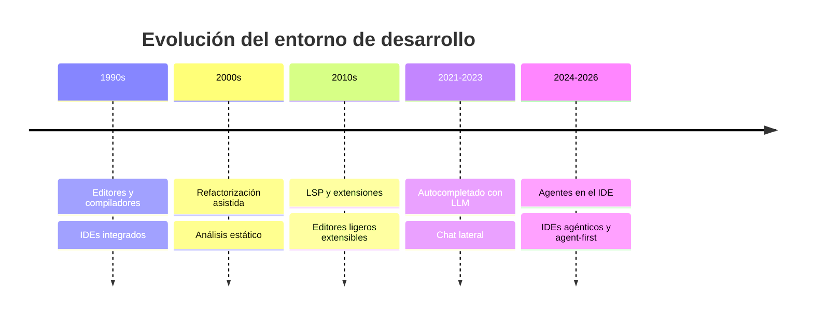
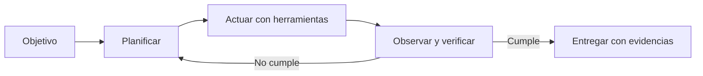

# 01 · Introducción

[← README](README.md) · [Siguiente: 02 · Visión general →](02-antigravity-overview.md)

---

## 1. Qué es un IDE moderno

Un IDE (*Integrated Development Environment*) integra en una sola superficie las herramientas que un desarrollador necesita para producir software: editor, resaltado de sintaxis, navegación semántica, depurador, gestor de compilación, control de versiones y terminal. Su valor histórico no era generar código, sino **reducir la fricción entre intención y resultado**: menos cambios de contexto, más información disponible en el punto de edición.

Un IDE moderno añade, además, cuatro capacidades que condicionan todo lo que viene después:

1. **Comprensión estructural del código.** Servidores de lenguaje (LSP) que ofrecen definición, referencias, renombrado y diagnóstico en tiempo real.
2. **Ecosistema extensible.** Marketplaces de extensiones, depuradores por protocolo (DAP) y configuración declarativa por proyecto.
3. **Integración con el ciclo de entrega.** Git, *linters*, ejecución de tests, contenedores de desarrollo y, cada vez más, CI/CD.
4. **Colaboración.** Edición compartida, revisión de código y sincronización de configuración entre equipos.

Estas capacidades siguen siendo imprescindibles: un agente de IA que edita código sin LSP, tests ni control de versiones es peligroso e ineficaz. Los IDEs agénticos **no sustituyen** esta base; la reutilizan como superficie de trabajo del agente.

## 2. Evolución: cinco generaciones

| Generación | Rol del humano | Rol de la herramienta | Unidad de trabajo |
|---|---|---|---|
| 1. IDE clásico | Escribe todo | Compila, depura, resalta | Línea / fichero |
| 2. IDE con análisis | Escribe, acepta refactors | Sugiere refactors deterministas | Símbolo |
| 3. Editor + LSP/extensiones | Escribe y compone herramientas | Ofrece servicios por protocolo | Proyecto |
| 4. Asistente con LLM | Escribe y valida sugerencias | Completa y responde en chat | Fragmento |
| 5. IDE agéntico | Define objetivo, revisa resultado | Planifica, ejecuta, verifica | **Tarea** |

El salto cualitativo de la generación 4 a la 5 es el cambio de **unidad de trabajo**: de la línea o el fragmento a la tarea completa (“añade paginación al listado de pedidos y verifica que no rompe los tests”). Eso obliga a rediseñar tres cosas: cómo se describe el trabajo, cómo se supervisa y cómo se confía en el resultado.

## 3. Asistentes frente a agentes

Un **asistente** reacciona: el desarrollador provoca cada interacción y el modelo contesta. Un **agente** persigue un objetivo mediante un bucle: observa el estado, decide una acción, la ejecuta con herramientas, comprueba el resultado y repite hasta cumplir o bloquearse.

Las herramientas del agente son las mismas que usa una persona —editor, terminal, navegador—, y esa es la razón de que un IDE sea un buen contenedor para él. Lo nuevo es que el agente puede encadenar decenas de acciones sin intervención humana, y por tanto **el coste de un error ya no es una sugerencia mala, sino una acción ejecutada**.

## 4. Por qué ahora

Tres factores han convergido:

- **Modelos con razonamiento largo y uso fiable de herramientas**, capaces de sostener tareas de varios pasos.
- **Estándares de integración** como el Model Context Protocol (MCP), que desacoplan el agente de cada sistema externo (ver [10 · MCP](10-mcp.md)).
- **Presión de productividad**: los equipos ya no preguntan si usar IA, sino cómo hacerlo sin perder control de calidad, seguridad ni trazabilidad.

Antigravity es la propuesta de Google DeepMind y Google para este punto de inflexión. Se publicó el 18 de noviembre de 2025 como *preview* gratuita junto a Gemini 3 y evolucionó el 19 de mayo de 2026 hacia una plataforma de varias superficies. Se detalla en [02](02-antigravity-overview.md).

## 5. Riesgos que introduce la transición

| Riesgo | Descripción | Capítulo |
|---|---|---|
| Sobreconfianza | Aceptar resultados sin revisar porque “el agente lo verificó” | [03](03-filosofia-agent-first.md), [14](14-buenas-practicas.md) |
| Ejecución con privilegios | El agente corre comandos con los permisos del usuario | [06](06-browser-terminal.md), [16](16-limitaciones.md) |
| Inyección de instrucciones | Contenido no confiable (web, repositorio, issues) que el agente interpreta como órdenes | [06](06-browser-terminal.md), [10](10-mcp.md) |
| Deuda de contexto | Agentes sin documentación ni convenciones producen código inconsistente | [08](08-context-management.md) |
| Dependencia de proveedor | Cuotas, modelos y planes cambian sin previo aviso | [16](16-limitaciones.md) |

## 6. Objetivos del documento

### 6.1 Objetivos generales

1. Proveer un **modelo mental común** sobre qué es un IDE agéntico y cómo se opera Antigravity.
2. Documentar su **arquitectura** con suficiente detalle para evaluar riesgos y puntos de integración.
3. Establecer **buenas prácticas y antipatrones** aplicables desde el primer día.
4. Ofrecer criterios de **decisión** (cuándo usar Antigravity, cuándo otra herramienta) con comparativas honestas.

### 6.2 Objetivos específicos

- Que un desarrollador pueda delegar una tarea acotada, definir su verificación y revisar los *artifacts* en menos de una hora de aprendizaje.
- Que un responsable de seguridad pueda enumerar superficies de ataque y controles disponibles.
- Que plataforma pueda estandarizar Skills, reglas, servidores MCP y workflows de CI.
- Que dirección pueda estimar el impacto organizativo y secuenciar un piloto.

### 6.3 Fuera de alcance

- Tutorial de instalación paso a paso (cambia con cada versión; remitimos a la documentación oficial).
- Comparativas de precio detalladas (volátiles; se citan solo como categoría).
- Ingeniería de *prompts* genérica no específica de agentes de código.

## 7. Principios editoriales

- **Afirmaciones verificables**: se prefiere documentación oficial, informes de seguridad con divulgación coordinada y *release notes*.
- **Distinción explícita** entre lo que ofrece el producto, lo que se recomienda como práctica y lo que es opinión de la organización.
- **Sin promesas de productividad cuantificadas**: los resultados dependen del tipo de tarea, la calidad del contexto y la madurez de revisión.

## 8. Cómo leer lo que sigue

El siguiente capítulo describe el producto: qué es Antigravity y cómo se reparten responsabilidades App, IDE, CLI y SDK. Si tu interés es la teoría del cambio de paradigma, salta a [03 · Filosofía Agent-First](03-filosofia-agent-first.md).

---

[← README](README.md) · [Siguiente: 02 · Visión general →](02-antigravity-overview.md)
