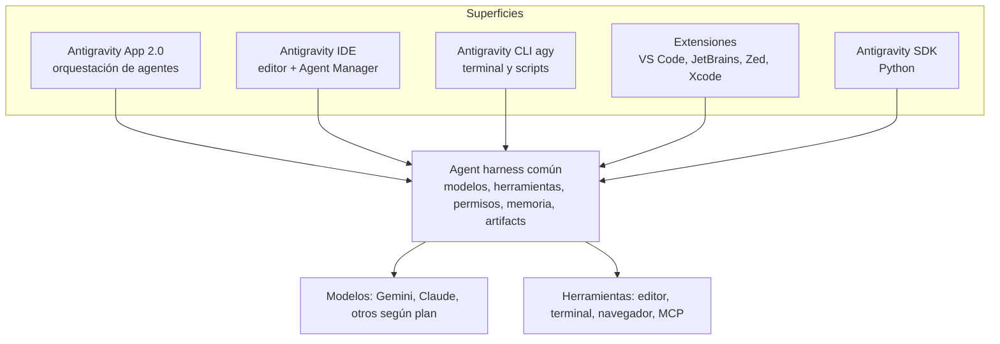

# 02 · Antigravity: visión general

[← 01 · Introducción](01-introduccion.md) · [README](README.md) · [Siguiente: 03 · Agent-First →](03-filosofia-agent-first.md)

---

## 1. Qué es Antigravity

Antigravity es la plataforma de desarrollo agéntico de Google. Su propuesta central es que **el agente es el actor principal** y las superficies (editor, terminal, navegador) existen para que trabaje, no solo para que el humano escriba. Google la presentó el 18 de noviembre de 2025 junto con Gemini 3, como *preview* gratuita para Windows, macOS y Linux.

Hitos relevantes:

| Fecha | Hito |
|---|---|
| Jul 2025 | Google incorpora al equipo de Windsurf (incluido su CEO) y licencia su tecnología |
| 18 nov 2025 | Lanzamiento de Antigravity con Gemini 3: Editor, Agent Manager y navegador controlado por agente |
| Dic 2025 | Modo seguro con revisión humana de acciones (renombrado *strict mode* en feb 2026); ajuste de cuotas |
| Ene–mar 2026 | Opción de ejecutar comandos de terminal en *sandbox* (macOS y Linux) |
| 19 may 2026 | **Antigravity 2.0** (Google I/O): app de escritorio, CLI `agy` y SDK; el editor original pasa a llamarse Antigravity IDE |
| 20 ago 2026 | Extensiones para VS Code, Visual Studio, JetBrains, Zed y Xcode |
| 21 ago 2026 | *Remote Control*: gobernar sesiones desde navegador |
| 29 oct 2026 | Directorio de plugins en App y CLI |

> **Verificar.** Las versiones y fechas proceden de fuentes públicas a noviembre de 2026. Contrasta con `antigravity.google` antes de citarlas en normativa interna.

## 2. Ecosistema: una familia sobre un harness común

Desde 2.0, Antigravity no es “un IDE”: es un conjunto de superficies que comparten el mismo **agent harness** (modelo, herramientas, permisos, memoria y artifacts).



### 2.1 Antigravity App (2.0)

Aplicación de escritorio concebida como **centro de mando de agentes**. No incluye un editor de código: su unidad es el agente y la tarea. Soporta agentes en paralelo, subagentes dinámicos, Projects con varias carpetas, tareas programadas y comandos de barra (por ejemplo `/goal`, `/schedule`, `/browser`). Los subagentes pueden trabajar en *worktrees* de Git aislados, lo que evita colisiones al editar la misma base de código.

Úsala cuando el trabajo sea **delegable y paralelizable** y tu atención deba estar en revisar resultados, no en teclear.

### 2.2 Antigravity IDE

El editor original: un entorno de tipo VS Code con completado, comandos en línea y panel de agente, más la vista Agent Manager. Google ha indicado su intención de ir retirando el Agent Manager del IDE en favor de la App, por lo que conviene no construir procesos que dependan de él. Sigue siendo la opción cuando necesitas **escribir y revisar código con el agente al lado**, de forma síncrona.

### 2.3 Antigravity CLI (`agy`)

Cliente de terminal escrito en Go que sustituye a Gemini CLI (cuyo cierre para los planes de consumo estaba fijado para el 18 de junio de 2026). Ejecuta agentes de código, comandos de shell y subagentes en segundo plano. Es la superficie natural para **scripts, SSH y CI**, y comparte preferencias y permisos con la App.

### 2.4 Extensiones de IDE

Llevan el agente a editores que el equipo ya usa. Útiles cuando la migración de editor no es viable por razones de licencias, *tooling* corporativo o preferencias del equipo.

### 2.5 Antigravity SDK

Biblioteca (Python, en *preview*; `pip install google-antigravity`) que expone el mismo agente de forma programática. Permite construir agentes propios, automatizaciones y revisores de PR. Se trata en [11 · GitHub](11-github-integration.md).

### 2.6 Camino empresarial

Mediante Gemini Enterprise se ofrece inicio de sesión corporativo (SSO, federación de identidad), residencia regional de datos, controles de perímetro (VPC Service Controls) y registro de peticiones y telemetría. El acceso empresarial funciona en App, CLI y extensiones, no en el IDE independiente. Los términos son los de Google Cloud, y Google indica que prompts, código y transcripciones no se usan para entrenar modelos.

## 3. Modelos y planes

Antigravity usa Gemini como modelo núcleo y, según el plan, ofrece modelos de terceros (Claude y GPT-OSS en distintas épocas). El nivel de razonamiento se ajusta por turno (bajo, medio, alto). No existe opción de traer tu propia clave.

| Aspecto | Situación (nov 2026) |
|---|---|
| Plan gratuito | Cuota semanal, modelo Flash |
| AI Pro | Cuota renovada cada pocas horas con tope semanal; acceso a más modelos |
| AI Ultra / Enterprise | Cuota más alta; modelos de terceros |
| Traer tu propia clave | No disponible |
| Menores de 18 años | No pueden usarlo |
| Cuentas de trabajo (Workspace) | Requieren aprovisionamiento por el administrador |

> **Verificar.** Catálogo de modelos, cuotas y precios cambian con frecuencia. No los fijes en normas internas; enlaza a la página oficial de planes.

## 4. Conceptos transversales

- **Artifacts**: planes, listas de tareas, *walkthroughs*, capturas y grabaciones de navegador con las que el agente demuestra su trabajo. Ver [05](05-componentes.md).
- **Knowledge / memoria**: aprendizaje persistente entre sesiones. Ver [08](08-context-management.md).
- **Skills, reglas, workflows, hooks y plugins**: capas de personalización. Un plugin empaqueta skills, servidores MCP, reglas, hooks y agentes a medida en una unidad instalable. Ver [09](09-skills.md) y [10](10-mcp.md).
- **Políticas de permisos**: ejecución de terminal, revisión de artifacts, listas de permitidos para navegador, sandbox. Ver [06](06-browser-terminal.md).

## 5. Qué superficie elegir

| Necesidad | Superficie recomendada | Motivo |
|---|---|---|
| Delegar varias tareas a la vez | App | Orquestación paralela y revisión centralizada |
| Pair programming con el agente | IDE o extensión | Edición síncrona en contexto |
| Automatizar en CI, SSH o scripts | CLI o SDK | Sin interfaz gráfica, reproducible |
| Mantener tu editor actual | Extensión | Menor coste de adopción |
| Construir un agente propio | SDK | Control programático |
| Cumplimiento corporativo | Enterprise vía App/CLI | SSO, residencia de datos, logging |

## 6. Ejemplo: misma tarea, tres superficies

Tarea: “Añade validación de email en el formulario de alta y cubre con tests”.

```text
# CLI (modo no interactivo, ilustrativo)
agy "Añade validación de email en SignupForm y tests unitarios. Ejecuta la suite al terminar."
```

- En la **App**, se crea un agente en el proyecto, se le asigna la tarea y se revisa el *walkthrough* con capturas.
- En el **IDE**, se abre `SignupForm`, se invoca el panel del agente y se revisa el diff en el editor.
- Con el **SDK**, se encapsula en un script que se lanza desde CI para cada rama etiquetada.

## 7. Resumen

Antigravity es hoy una plataforma: varias superficies, un harness, modelos intercambiables según plan y un sistema de personalización por capas. El siguiente capítulo explica por qué esa arquitectura responde a una filosofía distinta de la de los asistentes tradicionales.

---

[← 01 · Introducción](01-introduccion.md) · [README](README.md) · [Siguiente: 03 · Agent-First →](03-filosofia-agent-first.md)
