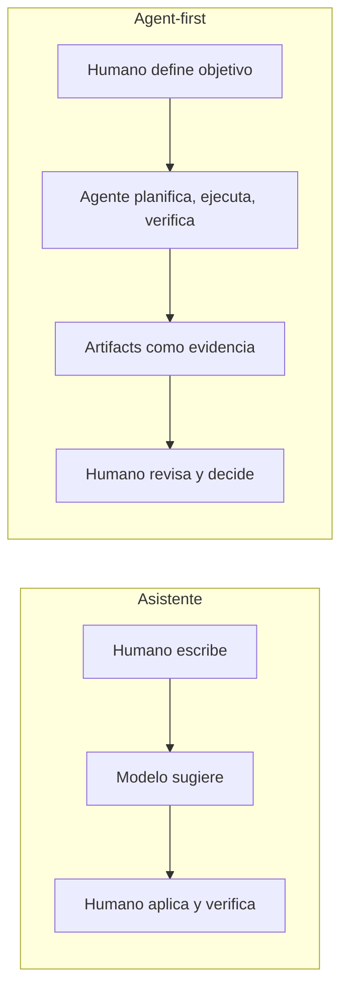
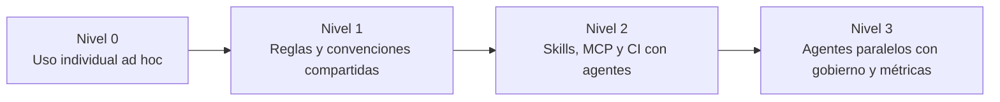

# 03 · Filosofía Agent-First

[← 02 · Visión general](02-antigravity-overview.md) · [README](README.md) · [Siguiente: 04 · Arquitectura →](04-arquitectura.md)

---

## 1. El paradigma

En un asistente tradicional, el agente vive **dentro** de la herramienta: un panel de chat en un editor. En el enfoque agent-first, la relación se invierte: las superficies (editor, terminal, navegador) viven **dentro del alcance del agente**, que las usa para cumplir un objetivo. Google lo formuló al presentar el producto como pasar de agentes embebidos en superficies a superficies embebidas en el agente.

Consecuencias directas:

- La **unidad de interacción** deja de ser el *prompt* y pasa a ser la **tarea**, con ciclo de vida: planificar, ejecutar, verificar, entregar.
- El humano pasa de **autor** a **director y revisor**: define el resultado esperado y los criterios de aceptación, y decide si lo entregado los cumple.
- La **evidencia** sustituye a la observación continua: en vez de mirar cada pulsación del agente, se revisan *artifacts* (planes, capturas, grabaciones) que demuestran el trabajo.
- La **asincronía** es normal: varios agentes avanzan en paralelo y reclaman atención solo cuando necesitan una decisión.

## 2. Diferencias con los asistentes tradicionales

| Dimensión | Asistente (chat/autocompletado) | Agent-first |
|---|---|---|
| Iniciativa | Reactiva a cada petición | Persigue un objetivo con bucle propio |
| Alcance | Fichero o fragmento | Repositorio, terminal y navegador |
| Ejecución | Propone; el humano aplica | Aplica, ejecuta y comprueba |
| Verificación | Del humano | Del agente, con evidencias revisables |
| Paralelismo | Una conversación | Varios agentes simultáneos |
| Memoria | Ventana de contexto | Conocimiento persistente entre sesiones |
| Modo de supervisión | Continuo | Por hitos y por artifacts |
| Coste de error | Sugerencia incorrecta | Acción ejecutada |
| Personalización | Instrucciones de sistema | Skills, reglas, workflows, hooks, MCP, plugins |



## 3. Principios de diseño de Antigravity

Los materiales públicos del equipo señalan cuatro principios que conviene tener presentes porque explican decisiones de producto:

1. **Confianza**: el agente debe poder demostrar lo que hizo. De ahí los artifacts como entregables y no como logs.
2. **Autonomía**: el agente accede a editor, terminal y navegador sin intermediarios, y puede ejecutar flujos largos.
3. **Retroalimentación**: el humano comenta sobre artifacts (como en un documento compartido) y el agente incorpora los comentarios sin reiniciar.
4. **Auto-mejora**: el agente aprende de sesiones previas y guarda conocimiento reutilizable.

> **Lectura crítica.** Confianza y autonomía están en tensión. Más autonomía exige más verificación, y la verificación del propio agente no sustituye una revisión independiente. Los incidentes documentados (ver [16](16-limitaciones.md)) muestran que la confianza debe construirse con controles, no asumirse.

## 4. Qué cambia en el trabajo del desarrollador

### 4.1 De escribir a especificar

La calidad del resultado depende de la calidad de la especificación. Una buena delegación incluye:

- **Objetivo** en términos observables.
- **Restricciones** (qué no tocar, estilo, dependencias permitidas).
- **Criterios de aceptación** ejecutables (tests, comandos, comportamiento en navegador).
- **Contexto** (enlaces a documentación, ADR, ejemplos).

Ejemplo de delegación deficiente frente a buena:

```text
Mala:  "Mejora el rendimiento del listado."

Buena: "El endpoint GET /orders tarda >1,2 s con 10k filas (ver perfil adjunto).
        Objetivo: p95 < 300 ms sin cambiar el contrato JSON.
        Restricciones: no añadir caché externa; migraciones solo con Flyway.
        Aceptación: benchmark en bench/orders.k6.js y suite de integración en verde.
        Entrega: plan de implementación antes de tocar código."
```

### 4.2 De mirar a revisar

La revisión pasa a ser el cuello de botella. Un desarrollador que supervisa cinco agentes sin disciplina de revisión produce más código y menos calidad. Por eso los equipos maduros definen **qué se revisa siempre** (plan antes de ejecutar, diff final, resultados de tests) y **qué puede aprobarse por muestreo**.

### 4.3 De recordar a codificar el conocimiento

El conocimiento implícito (“aquí los servicios se nombran así”, “esta librería está prohibida”) debe formalizarse como reglas, Skills y documentación accesible, o el agente lo ignorará. Ver [08](08-context-management.md) y [09](09-skills.md).

## 5. Implicaciones organizativas

### 5.1 Roles

| Rol | Cambio |
|---|---|
| Desarrollador | Más especificación y revisión; menos tecleo repetitivo |
| Tech lead | Define reglas y criterios de aceptación reutilizables |
| Arquitecto | Convierte decisiones en restricciones legibles por agentes |
| QA | Diseña verificaciones automatizables que el agente pueda ejecutar |
| Seguridad | Gobierna permisos, secretos, listas de permitidos y MCP |
| Plataforma | Mantiene Skills, plugins, workflows y observabilidad de uso |

### 5.2 Procesos

- **Definición de “hecho”** ampliada: incluye artifacts revisados y evidencia de verificación.
- **Revisión de código**: la autoría humana ya no puede presumirse. Conviene marcar PRs generados por agentes y exigir descripción con plan y verificación.
- **Onboarding**: el repositorio debe ser legible para agentes (README operativo, comandos de test, convenciones), lo que beneficia también a personas nuevas.
- **Gestión de capacidad**: las cuotas por plan limitan el trabajo paralelo; planifícalo como un recurso.

### 5.3 Cultura

- Tratar al agente como **colaborador con acceso privilegiado y criterio falible**: se le dan permisos mínimos y se audita.
- Evitar la narrativa de sustitución. Los equipos que reportan mejores resultados invierten en especificación, pruebas y revisión.
- Aceptar que parte del trabajo se vuelve **más lento al inicio** (escribir contexto, afinar reglas) a cambio de reutilización.

## 6. Modelo de madurez de adopción



| Nivel | Señales | Riesgo principal |
|---|---|---|
| 0 | Cada persona usa su configuración | Inconsistencia, fuga de datos |
| 1 | Reglas en el repositorio | Reglas obsoletas |
| 2 | Skills y MCP estandarizados; revisor de PR automático | Exceso de permisos |
| 3 | Orquestación multiagente, métricas de calidad y coste | Cuellos de botella de revisión |

## 7. Cuándo agent-first no es la mejor opción

- Cambios muy pequeños en código que ya tienes en la cabeza: el coste de especificar supera el de escribir.
- Dominios sin forma de verificación automática (heurísticas sin tests, comportamiento no observable).
- Entornos sin posibilidad de aislar la ejecución y con datos sensibles en la estación de trabajo.
- Exploración de diseño donde el valor está en el pensamiento, no en el resultado.

## 8. Ejemplo de decisión

Un equipo debe migrar 40 servicios de un cliente HTTP obsoleto a otro. Es repetitivo, verificable con tests y paralelizable. Encaja de lleno: se define una Skill de migración, se lanzan agentes por servicio en *worktrees* aislados y se revisa cada PR con una checklist común. En cambio, rediseñar el modelo de dominio de facturación exige conversación de diseño; allí el agente puede **asistir** (explorar alternativas, redactar un ADR), pero la decisión es humana.

---

[← 02 · Visión general](02-antigravity-overview.md) · [README](README.md) · [Siguiente: 04 · Arquitectura →](04-arquitectura.md)
