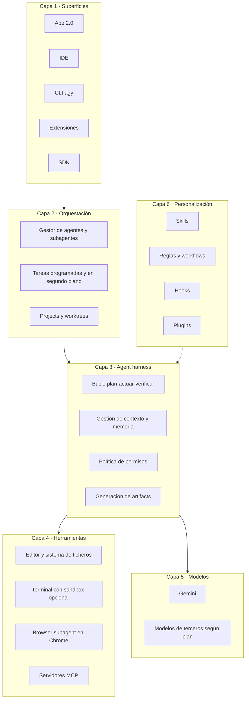
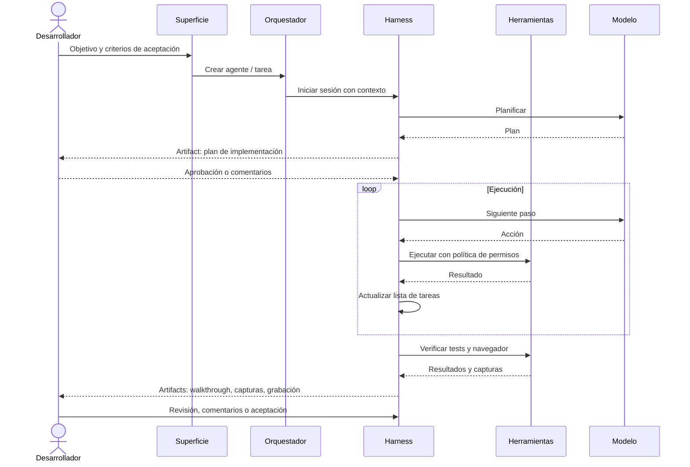
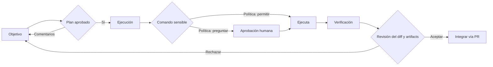
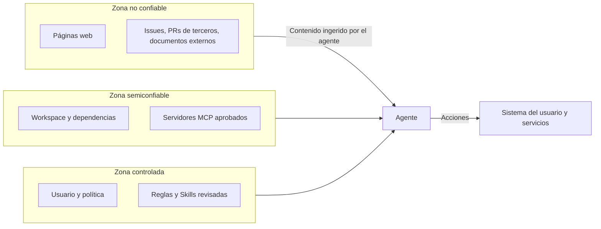
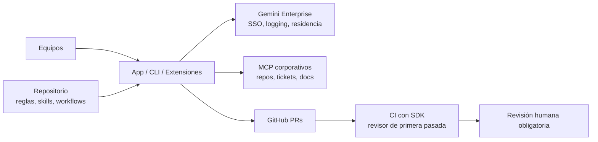

# 04 · Arquitectura

[← 03 · Agent-First](03-filosofia-agent-first.md) · [README](README.md) · [Siguiente: 05 · Componentes →](05-componentes.md)

---

> **Nota de método.** Google no publica un diagrama interno completo. Lo que sigue es un **modelo de referencia** construido a partir de la documentación pública, las presentaciones del equipo y el comportamiento observable del producto. Sirve para razonar sobre integración y riesgo, no como especificación del proveedor.

## 1. Visión por capas

### 1.1 Capa 1 · Superficies

Puntos de entrada humana o programática. Difieren en ergonomía, no en capacidad de fondo: todas se apoyan en el mismo harness. Esto es lo que permite que preferencias y permisos se sincronicen entre App y CLI.

### 1.2 Capa 2 · Orquestación

Gestiona **múltiples agentes**: creación, estado, bloqueos por aprobación, subagentes dinámicos y trabajo en segundo plano. Los subagentes operan en *worktrees* de Git aislados, de modo que dos agentes no pisan los mismos ficheros hasta el momento de integrar. Las tareas programadas permiten ejecutar agentes de forma periódica.

### 1.3 Capa 3 · Agent harness

El núcleo. Contiene:

- **Bucle de agente**: razonamiento, selección de herramienta, ejecución, observación.
- **Contexto y memoria**: qué entra en la ventana del modelo en cada paso y qué se persiste entre sesiones (ver [08](08-context-management.md)).
- **Política de permisos**: qué acciones piden confirmación, cuáles se deniegan y cuáles se auto-aprueban.
- **Artifacts**: transformación del trabajo en entregables revisables.

### 1.4 Capa 4 · Herramientas

| Herramienta | Función | Frontera de riesgo |
|---|---|---|
| Editor y FS | Leer y escribir ficheros del workspace | Ficheros fuera del workspace, secretos en `.env` |
| Terminal | Ejecutar comandos | Ejecución con privilegios del usuario |
| Browser subagent | Navegar, rellenar formularios, capturar | Contenido web no confiable, sesiones autenticadas |
| MCP | Acceso a sistemas externos | Credenciales, alcance de herramientas |

### 1.5 Capa 5 · Modelos

El harness es agnóstico al modelo dentro de lo que cada plan permite. Gemini es el núcleo; según plan hay modelos de terceros. El nivel de razonamiento se ajusta por turno, lo que afecta a latencia, coste de cuota y calidad.

### 1.6 Capa 6 · Personalización

Cuatro mecanismos con granularidad distinta, resumidos en la tabla siguiente y desarrollados en [09](09-skills.md) y [10](10-mcp.md).

| Mecanismo | Se aplica | Función |
|---|---|---|
| Reglas | Siempre o por patrón | Restricciones y convenciones |
| Skills | Bajo demanda | Capacidades con instrucciones y recursos |
| Workflows | Al invocarlos | Secuencias repetibles guiadas |
| Hooks | En eventos del ciclo | Control determinista (validar, bloquear, registrar) |
| MCP | Cuando la herramienta es útil | Acceso a datos y acciones externas |
| Plugins | Instalación | Empaquetan lo anterior |

## 2. Flujo de ejecución de una tarea

### 2.1 Fases

1. **Entrada**: objetivo, restricciones, adjuntos. Skills y reglas relevantes se cargan por coincidencia.
2. **Plan**: el agente produce un plan de implementación y una lista de tareas. Según la política de revisión puede pausar a la espera de aprobación.
3. **Ejecución**: ciclos de edición, terminal y navegador. Cada acción pasa por la política de permisos.
4. **Verificación**: ejecución de tests, comprobaciones en el navegador, capturas y, si procede, grabación de la sesión.
5. **Entrega**: *walkthrough* que resume qué cambió y cómo se comprobó.
6. **Retroalimentación**: comentarios sobre artifacts que el agente incorpora; conocimiento reutilizable se persiste.

### 2.2 Puntos de control humanos

## 3. Fronteras de confianza

El principio clave: **todo lo que el agente lee puede intentar darle órdenes**. La inyección indirecta de instrucciones es la amenaza arquitectónica principal. Se han divulgado casos reales: exfiltración mediante el subagente de navegador desde una página con instrucciones ocultas, y una cadena de ejecución de código a partir del tool de búsqueda de ficheros (corregida en febrero de 2026). Detalle en [16](16-limitaciones.md).

### 3.1 Controles por capa

| Capa | Control disponible |
|---|---|
| Terminal | Política de ejecución (desactivada con lista permitida, automática, turbo), sandbox nativo (macOS con `sandbox-exec`, Windows con AppContainer según documentación de la CLI) |
| Artifacts | Política de revisión: pedir revisión, decidir el agente, proceder siempre |
| Navegador | Perfil de Chrome separado, listas de permitidos y denegados |
| MCP | Aprobación de herramientas, número limitado de herramientas |
| Empresa | SSO, residencia de datos, VPC Service Controls, logging |

## 4. Modelo de datos y almacenamiento local

Los agentes persisten conversaciones, artifacts y conocimiento en el directorio de configuración del usuario. La documentación de la CLI muestra una estructura con directorios para conversaciones y artifacts (`brain/`), ajustes (`settings.json`) y configuración global (`config/` con `plugins/` y `mcp_config.json`). Implicaciones:

- Los artifacts y transcripciones **pueden contener secretos** si el agente los leyó. Trátalos como datos sensibles en copias de seguridad y sincronizaciones.
- La configuración global afecta a todos los proyectos; la de workspace es versionable y revisable.

## 5. Decisiones arquitectónicas relevantes

| Decisión | Beneficio | Coste |
|---|---|---|
| Harness único para todas las superficies | Coherencia de comportamiento y permisos | Cambios en el harness afectan a todo |
| Artifacts como contrato de confianza | Revisión eficiente | Pueden dar falsa seguridad si no se contrastan |
| Subagentes en worktrees | Paralelismo sin conflictos | Integración posterior y consumo de disco |
| Navegador como herramienta de primera clase | Verificación visual de UI | Superficie de ataque nueva |
| Plugins como unidad de distribución | Estandarización | Cadena de suministro a gobernar |

## 6. Ejemplo: arquitectura de adopción en una empresa

Principios: configuración de equipo en el repositorio, identidad corporativa, MCP aprobados centralmente y revisión humana como puerta final.

---

[← 03 · Agent-First](03-filosofia-agent-first.md) · [README](README.md) · [Siguiente: 05 · Componentes →](05-componentes.md)
