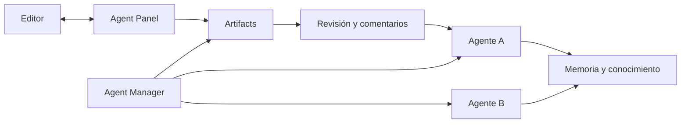
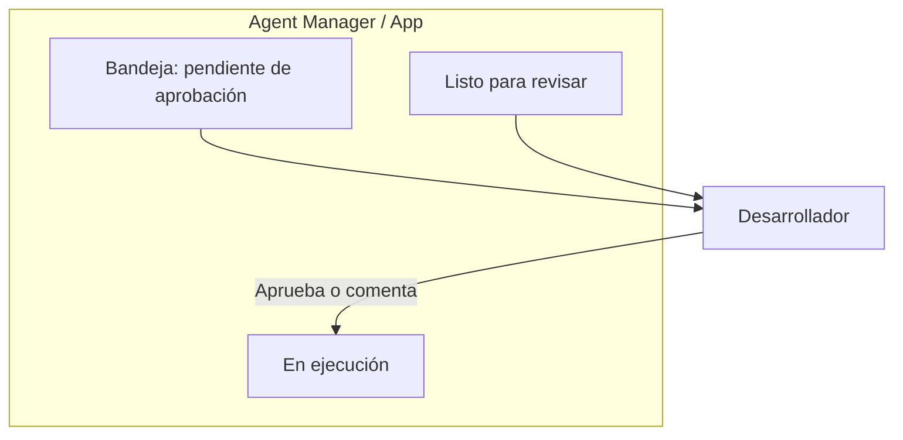

# 05 · Componentes

[← 04 · Arquitectura](04-arquitectura.md) · [README](README.md) · [Siguiente: 06 · Browser y Terminal →](06-browser-terminal.md)

---

## 1. Mapa de componentes



> **Aviso de nomenclatura.** En el IDE original (2025) el **Agent Manager** era una vista junto al Editor. Con Antigravity 2.0 esa función vive en la **App** y Google ha indicado que irá retirándola del IDE. Este capítulo describe el concepto y señala dónde está cada pieza.

## 2. Editor

El Editor es la superficie síncrona: un entorno de tipo VS Code con las funciones esperables (resaltado, LSP, depuración, extensiones compatibles) y capacidades de IA integradas.

| Función | Descripción | Uso recomendado |
|---|---|---|
| Completado (*Tab*) | Predicción multilínea mientras escribes | Escritura rápida con control total |
| Comandos en línea | Instrucción en lenguaje natural sobre una selección | Refactors locales, generar tests de una función |
| Panel de agente lateral | Conversación y tareas con el agente en contexto del fichero | Pair programming |
| Revisión de cambios | Diffs de lo que el agente modifica | Aceptar o rechazar por bloques |

Casos donde el Editor es la mejor superficie: depurar un fallo con el agente observando el mismo fichero, cambios que requieren criterio de estilo continuo, y trabajo en código crítico donde quieres ver cada edición.

> **Verificar.** El IDE se basa en una base de código tipo VS Code; la compatibilidad con extensiones puede diferir del Marketplace de Microsoft (distribuye extensiones vía Open VSX en el IDE independiente, según documentación de terceros). Valida las extensiones críticas de tu stack antes de migrar.

## 3. Agent Panel

El panel de agente es la interfaz de conversación y control de una tarea. Sus elementos esenciales:

- **Entrada**: prompt, adjuntos (ficheros, imágenes, capturas) y menciones de contexto.
- **Selector de modelo y nivel de razonamiento**.
- **Modo de planificación**: el agente elabora plan y lista de tareas antes de actuar, útil para tareas amplias; para cambios triviales conviene el modo rápido.
- **Estado de tareas**: lista de pasos con su progreso.
- **Solicitudes de aprobación**: comandos o acciones que la política marca como sensibles.
- **Comentarios sobre artifacts**: selección de texto o región de una imagen para dar feedback.

### 3.1 Prompt eficaz en el panel

```text
Contexto: servicio payments-api (Java 21, Spring Boot 3).
Objetivo: añadir reintentos con backoff exponencial al cliente de la pasarela.
Restricciones: usar Resilience4j ya presente en el pom; no modificar la interfaz pública GatewayClient.
Aceptación: tests nuevos en GatewayClientRetryTest; mvn -q test en verde.
Antes de editar: muéstrame el plan de implementación.
```

Cada elemento reduce una clase de fallo: el contexto evita suposiciones, las restricciones evitan dependencias nuevas, la aceptación fija la verificación y el plan previo ofrece un punto de control barato.

## 4. Artifacts

Los artifacts son los **entregables verificables** que el agente genera mientras trabaja. Son el mecanismo central de confianza.

| Artifact | Contenido | Cuándo se genera | Qué revisar |
|---|---|---|---|
| Lista de tareas | Pasos y estado | Al planificar y durante la ejecución | Que descomponga bien y no omita criterios |
| Plan de implementación | Enfoque, ficheros afectados, decisiones | Antes de ejecutar tareas amplias | Alcance, riesgos y alternativas |
| Walkthrough | Resumen de cambios y pruebas realizadas | Al terminar | Coherencia con el diff real |
| Capturas de pantalla | Estado de la UI en momentos clave | Durante verificación en navegador | Que muestren lo prometido |
| Grabaciones de navegador | Vídeo de la sesión de pruebas | Verificación de flujos | Que cubran el flujo completo, no solo el camino feliz |
| Diffs de código | Cambios por fichero | Siempre | Línea a línea en código crítico |

### 4.1 Retroalimentación sobre artifacts

El humano comenta sobre el artifact (por ejemplo, selecciona un párrafo del plan o un área de una captura) y el agente incorpora el comentario **sin reiniciar la tarea**. Es el equivalente a comentar en un documento compartido.

### 4.2 Política de revisión

| Valor | Comportamiento | Riesgo |
|---|---|---|
| Pedir siempre revisión | El agente pausa y muestra cambios antes de aplicarlos | Más lento, más control |
| El agente decide | Solicita revisión según su criterio | Depende de la calibración del modelo |
| Proceder siempre | Aplica sin pausar | Máxima velocidad, mínima supervisión |

Para código de producción, en repositorios con secretos o con permisos amplios, usa la opción de **pedir revisión**.

### 4.3 Límites de los artifacts

Un artifact es **un informe del agente sobre su propio trabajo**. Puede ser incompleto o erróneo. Contrasta siempre el walkthrough con el diff y reejecuta los tests en un entorno independiente (CI) antes de integrar.

## 5. Agent Manager

El Agent Manager es la vista de orquestación: lista de agentes y tareas con su estado, bandeja de revisiones pendientes y acceso a sus artifacts. En 2.0 es el corazón de la App.



### 5.1 Capacidades relevantes

- **Agentes en paralelo** sobre el mismo Project o sobre Projects distintos.
- **Subagentes dinámicos**: un agente puede delegar subtareas (por ejemplo, un agente de investigación y otro de implementación).
- **Worktrees aislados** para evitar conflictos entre agentes.
- **Tareas programadas** y ejecución en segundo plano.
- **Projects** con varias carpetas para trabajos que cruzan repositorios.
- **Comandos de barra** como `/goal` (objetivo persistente), `/schedule` (programar) y `/browser` (tarea de navegador).

### 5.2 Patrón: reparto por responsabilidad

| Agente | Tarea | Artifact esperado |
|---|---|---|
| Investigador | Mapear uso de la API a migrar | Informe con lista de llamadas |
| Implementador | Aplicar el cambio por módulo | Diff + tests |
| Verificador | Ejecutar suite y pruebas de UI | Capturas y resultados |

Regla práctica: **no más agentes de los que puedes revisar**. La capacidad humana de revisión limita el paralelismo útil.

## 6. Gestión de memoria

Antigravity mantiene memoria a varios niveles.

| Nivel | Qué guarda | Alcance | Control |
|---|---|---|---|
| Contexto de sesión | Mensajes, resultados de herramientas | Una conversación | Ventana limitada del modelo |
| Artifacts previos | Planes y walkthroughs de tareas anteriores | Proyecto | Legibles por el agente en sesiones futuras |
| Conocimiento persistente (Knowledge) | Patrones, decisiones y aprendizajes extraídos | Entre sesiones | Revisable y editable por el usuario |
| Reglas y Skills | Instrucciones declarativas | Workspace o global | Versionables |

Buenas prácticas de memoria:

1. **Revisa periódicamente** el conocimiento acumulado; puede fijar decisiones obsoletas.
2. **No dependas de la memoria para normas**: lo obligatorio va en reglas versionadas, no en aprendizaje implícito.
3. **Evita que persistan secretos**: no pegues credenciales en conversaciones.
4. **Separa contextos** por Project cuando haya requisitos de confidencialidad distintos.

Profundizamos en [08 · Gestión de contexto](08-context-management.md).

## 7. Ejemplo integrado

Escenario: añadir un filtro por fecha en un listado.

1. En el **Agent Manager** se crea un agente con el objetivo y criterios.
2. El agente genera **plan** y **lista de tareas**; el desarrollador comenta “no uses una librería de fechas nueva” y el plan se ajusta.
3. El agente ejecuta; en el **Editor** el desarrollador revisa el diff de `OrdersFilter.tsx`.
4. El agente verifica en el navegador y adjunta **capturas** y una **grabación**.
5. El **walkthrough** resume cambios; el desarrollador lo contrasta con el diff y los resultados de CI.
6. Se abre PR con enlace a los artifacts.

---

[← 04 · Arquitectura](04-arquitectura.md) · [README](README.md) · [Siguiente: 06 · Browser y Terminal →](06-browser-terminal.md)
