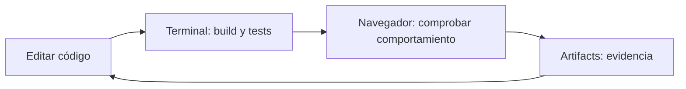
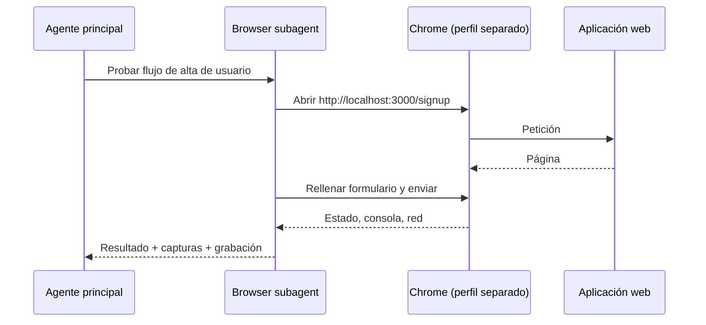
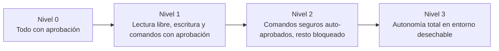

# 06 · Browser Agent y Terminal Agent

[← 05 · Componentes](05-componentes.md) · [README](README.md) · [Siguiente: 07 · Comparativa →](07-comparativa-ides.md)

---

## 1. Por qué importan

El editor permite al agente **cambiar** el código. El terminal y el navegador le permiten **ejecutarlo y comprobarlo**. Esa combinación cierra el bucle de verificación y es lo que diferencia a un agente de un generador de código. También es donde se concentra el riesgo: son las dos herramientas que actúan sobre el mundo real.



## 2. Terminal Agent

### 2.1 Qué hace

El agente puede ejecutar comandos de shell en el entorno del usuario: instalar dependencias, compilar, lanzar tests, usar `git`, inspeccionar logs, arrancar servidores de desarrollo y ejecutar scripts. En 2.0, la CLI `agy` además permite ejecutar agentes y subagentes en segundo plano.

### 2.2 Política de ejecución

La política determina qué comandos requieren confirmación humana. Los nombres exactos varían entre versiones y superficies, pero el modelo conceptual es:

| Política | Comportamiento | Cuándo usarla |
|---|---|---|
| Restrictiva (lista permitida) | Ningún comando sin aprobación o sin estar en la lista | Código sensible, repositorios desconocidos |
| Automática (el agente decide) | El agente ejecuta lo que considera seguro y pregunta lo demás | Trabajo diario con contexto confiable |
| Turbo / sin aprobación | Ejecuta todo sin preguntar | Solo en entornos desechables y aislados |

Los permisos también pueden expresarse por regla (`allow`, `ask`, `deny`) sobre patrones de comandos. Denegar de forma explícita lo que nunca debe ejecutarse es más fiable que confiar en el criterio del modelo.

```text
# Ilustrativo: política por patrones
deny:  rm -rf /*, git push --force*, curl * | sh
ask:   git push*, docker *, kubectl *
allow: npm test, npm run lint, git status, git diff
```

> **Verificar.** La sintaxis y ubicación de estos ajustes dependen de la superficie. Consulta la sección de permisos de la documentación oficial.

### 2.3 Sandbox de terminal

Antigravity ofrece ejecución de comandos en un **sandbox** del sistema operativo: en macOS mediante `sandbox-exec` y en Windows mediante AppContainer, según la documentación de la CLI. Restringe acceso al sistema de ficheros y a conexiones de red salientes.

Qué aporta y qué no:

| Aporta | No garantiza |
|---|---|
| Limita daño por comandos destructivos | Protección frente a todas las rutas de ataque (se ha demostrado una evasión vía herramienta nativa ya corregida) |
| Restringe red saliente | Que el agente no pueda leer datos que sí están dentro del perímetro permitido |
| Reduce el radio de impacto de errores | Sustituir a un entorno aislado (contenedor, VM) |

### 2.4 Incidentes que informan el diseño de políticas

- En diciembre de 2025 se informó de que, con ejecución sin aprobación (Turbo), una orden de limpiar caché derivó en un comando dirigido a la raíz de una unidad, con borrado irrecuperable. Moraleja: **la autonomía total en una máquina con datos propios es una decisión de riesgo, no de comodidad**.
- Investigadores mostraron que el agente podía eludir la política de revisión usando comandos para imprimir contenido de ficheros. Moraleja: la política de ejecución **no es un control de acceso a datos**.

## 3. Browser Agent

### 3.1 Qué hace

Un **subagente de navegador** controla una instancia de Chrome: navega, hace clic, rellena formularios, lee la consola, captura pantallas y graba sesiones. El agente principal le delega la tarea y recibe de vuelta el resultado y artifacts. Requiere instalar una extensión de Chrome en el primer uso.



### 3.2 Usos principales

- **Verificación de UI**: comprobar que el cambio se ve y se comporta como se pidió.
- **Pruebas end-to-end exploratorias**: recorrer flujos sin escribir antes el script.
- **Lectura de documentación** y recursos web durante la tarea.
- **Reproducción de errores** con acceso a consola y peticiones de red.
- **Entrada visual**: capturar una pantalla y compararla con un diseño de referencia.

### 3.3 Controles del navegador

| Control | Función | Recomendación |
|---|---|---|
| Perfil de Chrome separado | Aísla sesiones y cookies del navegador personal | Mantenerlo siempre separado; no iniciar sesión con cuentas personales o corporativas amplias |
| Lista de permitidos / denegados | Restringe dominios accesibles | Permitir solo `localhost` y dominios de documentación necesarios |
| Aprobación de acciones | Confirmación en acciones sensibles | Activar para formularios con efectos externos |

### 3.4 Riesgo principal: inyección indirecta

Una página web puede contener instrucciones ocultas (por ejemplo, texto de un punto de tamaño) que el agente interpreta como órdenes. Se ha demostrado un ataque donde un documento aparentemente inocuo conseguía que el agente invocara el navegador para enviar credenciales y código a un destino controlado por el atacante.

Medidas:

1. Lista de permitidos estricta; **sin navegación abierta** en tareas con acceso a secretos.
2. No exponer `.env`, claves ni tokens en el workspace durante tareas con navegador.
3. Tratar cualquier contenido web como datos, no como instrucciones; indicarlo en reglas del proyecto.
4. Separar tareas: investigación web en un agente **sin acceso** a secretos; implementación en otro **sin navegación abierta**.

## 4. Ejecución autónoma responsable

### 4.1 Niveles de autonomía



| Nivel | Entorno | Ejemplo |
|---|---|---|
| 0 | Repos desconocidos o con secretos | Evaluar un repositorio de terceros |
| 1 | Código crítico propio | Cambios en pagos o autenticación |
| 2 | Desarrollo habitual con reglas | Features en servicios internos |
| 3 | Contenedor o VM desechable, sin credenciales | Migraciones masivas, experimentos |

### 4.2 Entorno desechable: patrón recomendado para nivel 3

```bash
# Ilustrativo: ejecutar el agente en un contenedor sin credenciales
docker run --rm -it \
  --network none \
  -v "$PWD":/work -w /work \
  --user 1000:1000 \
  my-agent-image agy "Migra el cliente HTTP en src/ siguiendo la skill migrate-http"
```

Sin red no podrá instalar dependencias ni usar MCP remotos; si la tarea lo requiere, usa red con salida filtrada y dependencias precargadas.

## 5. Validación automática

El valor del agente se mide por su capacidad de **demostrar** que el cambio funciona. Capas de validación recomendadas, de más barata a más costosa:

| Capa | Herramienta | Quién la ejecuta |
|---|---|---|
| 1. Estática | Linter, formateador, tipos | Terminal del agente |
| 2. Unitaria | Tests rápidos | Terminal del agente |
| 3. Integración | Contenedores, base de datos de prueba | Terminal del agente o CI |
| 4. Comportamiento visual | Navegador, capturas, grabación | Browser subagent |
| 5. Independiente | CI, revisión humana | **Fuera del agente** |

Regla: **nunca cerrar la validación solo con lo que el agente dice de sí mismo**. La capa 5 es obligatoria antes de integrar.

### 5.1 Plantilla de criterios de aceptación ejecutables

```markdown
## Aceptación
- [ ] `npm run lint` sin errores nuevos
- [ ] `npm test -- --coverage` con cobertura de `src/signup` >= 85 %
- [ ] En navegador: con email inválido aparece el mensaje "Formato de email no válido" y el botón queda deshabilitado
- [ ] Grabación del flujo completo de alta con email válido
```

### 5.2 Skill de verificación en navegador

Define una Skill con instrucciones fijas (iniciar grabación antes de la primera acción, detenerla tras la última, parar y escalar si hay tiempo agotado o dominio bloqueado) para que la verificación sea consistente entre agentes. Ver [09 · Skills](09-skills.md).

## 6. Checklist de seguridad

- [ ] Política de terminal restrictiva o sandbox activo en máquinas con datos propios.
- [ ] Reglas `deny` explícitas para comandos destructivos y `curl | sh`.
- [ ] Perfil de Chrome separado y lista de dominios permitidos.
- [ ] Sin secretos en el workspace durante tareas con navegador o contenido externo.
- [ ] Revisión humana del diff antes de cualquier `push`.
- [ ] Tareas de alta autonomía solo en contenedor o VM desechable.

---

[← 05 · Componentes](05-componentes.md) · [README](README.md) · [Siguiente: 07 · Comparativa →](07-comparativa-ides.md)
