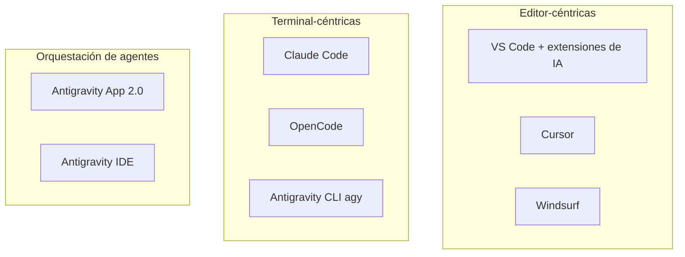
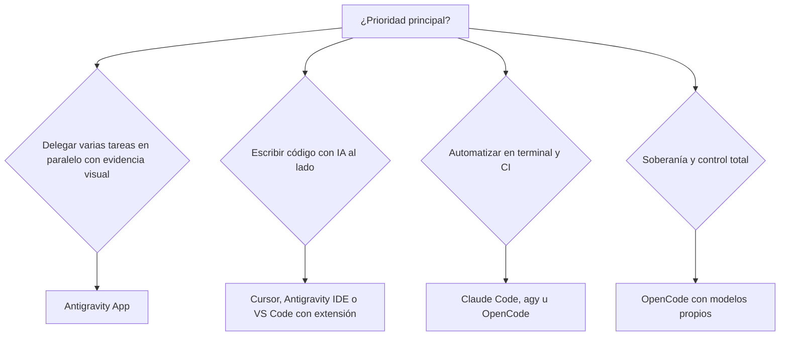

# 07 · Comparativa de herramientas

[← 06 · Browser y Terminal](06-browser-terminal.md) · [README](README.md) · [Siguiente: 08 · Contexto →](08-context-management.md)

---

> **Advertencia metodológica.** Este mercado cambia cada pocas semanas: modelos, precios, cuotas y funciones. La comparación se centra en **diseño y modelo operativo**, que es más estable, y evita cifras volátiles. Las afirmaciones sobre productos distintos de Antigravity reflejan conocimiento general y deben validarse con cada proveedor antes de decidir. Ninguna herramienta es la mejor en todos los casos.

## 1. Categorías de herramientas

Antigravity abarca varias categorías a la vez: IDE (editor), CLI (terminal) y App (orquestación). Esto complica la comparación uno a uno; por eso se indica la superficie cuando procede.

## 2. Resumen por herramienta

### 2.1 VS Code (con extensiones de IA)

Editor de referencia, extensible y neutral. La IA llega vía extensiones (por ejemplo, el agente de GitHub Copilot u otros). Su fortaleza es el ecosistema, la estandarización corporativa y el control de configuración.

- **Ventajas**: ecosistema inmenso, adopción generalizada, políticas empresariales maduras, no obliga a cambiar de editor.
- **Inconvenientes**: la experiencia agéntica es la que aporte cada extensión; no hay una superficie nativa de orquestación multiagente comparable.
- **Encaja cuando**: la organización ya está estandarizada en VS Code y quiere adopción gradual.

### 2.2 Cursor

Editor derivado de VS Code, centrado en IA, con agente integrado, edición multifichero, reglas por proyecto y ejecución de agentes en segundo plano.

- **Ventajas**: experiencia de edición asistida muy pulida, comunidad amplia, multiplicidad de modelos.
- **Inconvenientes**: modelo de suscripción y límites propios; el centro de gravedad sigue siendo el editor.
- **Encaja cuando**: el equipo escribe mucho código con IA al lado y quiere un editor optimizado para ello.

### 2.3 Claude Code

Agente de programación de Anthropic con enfoque en terminal, también disponible en IDE y web/escritorio. Se apoya en ficheros de instrucciones del proyecto, Skills, servidores MCP, hooks y subagentes.

- **Ventajas**: modelo operativo claro y scriptable, fuerte en tareas largas de refactor y razonamiento sobre código, buen encaje con CI y automatización.
- **Inconvenientes**: la verificación visual en navegador depende de integraciones; menos orientado a una “vista de orquestación” gráfica que la App de Antigravity.
- **Encaja cuando**: el equipo vive en terminal, valora la reproducibilidad y quiere integrar agentes en pipelines.

### 2.4 OpenCode

Agente de código de **código abierto**, orientado a terminal y agnóstico de proveedor de modelo.

- **Ventajas**: transparencia, flexibilidad de modelos (incluidos locales o autoalojados), personalización profunda, sin dependencia de un único proveedor.
- **Inconvenientes**: la integración, el soporte y el gobierno corren por cuenta de la organización; menos pulido de producto.
- **Encaja cuando**: hay requisitos de soberanía, uso de modelos propios o necesidad de control total del harness.

### 2.5 Windsurf

Editor de IA con el agente *Cascade*. Su tecnología y parte del equipo se repartieron en 2025 entre Google (licencia y fichaje de directivos) y Cognition (adquisición del resto), y es el origen frecuentemente citado de la base de Antigravity.

- **Ventajas**: flujo de agente integrado en editor y buena experiencia de contexto.
- **Inconvenientes**: tras los cambios corporativos de 2025, conviene verificar hoja de ruta y soporte.
- **Encaja cuando**: el equipo ya lo usa y valora su flujo; evalúa continuidad antes de estandarizar.

### 2.6 Antigravity

- **Ventajas**: App de orquestación con agentes paralelos y revisión por artifacts; navegador de primera clase con grabaciones; harness común entre App, IDE, CLI, extensiones y SDK; acceso empresarial con SSO y residencia de datos; plugins que empaquetan Skills y MCP.
- **Inconvenientes**: producto joven y cambiante (renombrados, retirada anunciada del Agent Manager en el IDE); incidentes de seguridad públicos en su primer año; cuotas dependientes de plan; sin posibilidad de traer tu propia clave de modelo; el acceso empresarial no cubre el IDE independiente.
- **Encaja cuando**: quieres delegar tareas verificables en paralelo y valoras la evidencia visual.

## 3. Matriz comparativa

Leyenda: ● fuerte · ◐ parcial o depende de configuración · ○ limitado. Valoración cualitativa por diseño, no benchmark.

| Criterio | VS Code + IA | Cursor | Claude Code | OpenCode | Windsurf | Antigravity |
|---|---|---|---|---|---|---|
| Edición asistida en editor | ◐ | ● | ◐ | ○ | ● | ● |
| Agente autónomo de tareas largas | ◐ | ● | ● | ● | ● | ● |
| Orquestación multiagente visual | ○ | ◐ | ◐ | ○ | ○ | ● |
| Verificación en navegador integrada | ◐ | ◐ | ◐ | ○ | ◐ | ● |
| Uso en terminal y CI | ◐ | ◐ | ● | ● | ○ | ● |
| Neutralidad de modelo | ● | ● | ○ | ● | ◐ | ◐ |
| Código abierto del agente | ◐ | ○ | ○ | ● | ○ | ○ |
| Extensibilidad (skills, MCP, hooks) | ● | ● | ● | ● | ◐ | ● |
| Control empresarial (SSO, datos) | ● | ◐ | ◐ | ◐ | ◐ | ◐ |
| Madurez y estabilidad | ● | ● | ● | ◐ | ◐ | ◐ |

## 4. Diferencias de diseño más relevantes

| Dimensión | Terminal-céntricas (Claude Code, OpenCode, agy) | Editor-céntricas (Cursor, Windsurf, VS Code) | Orquestación (Antigravity App) |
|---|---|---|---|
| Unidad | Sesión de trabajo | Edición en contexto | Tarea / agente |
| Supervisión | Texto y diffs | Diffs en editor | Artifacts y bandeja de revisión |
| Automatización | Natural (scripts, CI) | Limitada | Programación de tareas y SDK |
| Curva de adopción | Media para quien usa terminal | Baja | Media (cambio de hábito) |

## 5. Estándares compartidos

Varias herramientas convergen en estándares que reducen el bloqueo:

- **MCP** como protocolo de herramientas externas (ver [10](10-mcp.md)).
- **Agent Skills**: formato de Skills basado en directorios con `SKILL.md`, interoperable entre varios productos (ver [09](09-skills.md)).
- **Ficheros de instrucciones de proyecto** en Markdown (cada herramienta usa su nombre; conviene mantener una fuente única y enlazarla).

Invertir en estos estándares protege la inversión frente a cambios de herramienta.

## 6. Árbol de decisión

## 7. Recomendación de estrategia

1. **No estandarices una sola herramienta** para todo; define un conjunto aprobado por casos de uso.
2. Mantén **contexto portátil**: reglas, Skills y servidores MCP en formatos estándar y versionados.
3. Realiza un **piloto de 4–6 semanas** con tareas reales y métricas: tasa de aceptación de PR, tiempo de revisión, defectos escapados, coste en cuota.
4. Reevalúa trimestralmente; este mercado no es estable.

## 8. Ejemplo de piloto comparativo

| Tarea | Herramienta A | Herramienta B | Métrica |
|---|---|---|---|
| Migrar cliente HTTP en 10 servicios | Claude Code | Antigravity App | PRs aceptados sin cambios mayores |
| Corregir bugs de UI con captura | Cursor | Antigravity IDE | Tiempo hasta verificación |
| Revisión de primera pasada de PRs | Antigravity SDK en CI | Claude Code en CI | Hallazgos útiles por PR |

---

[← 06 · Browser y Terminal](06-browser-terminal.md) · [README](README.md) · [Siguiente: 08 · Contexto →](08-context-management.md)
