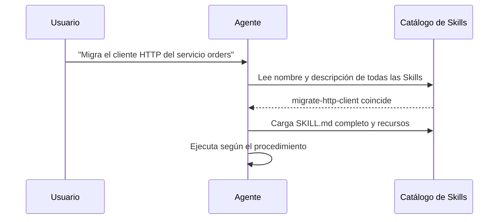

# 09 · Skills

[← 08 · Contexto](08-context-management.md) · [README](README.md) · [Siguiente: 10 · MCP →](10-mcp.md)

---

## 1. Qué son las Skills

Una **Skill** es un paquete de conocimiento procedimental que el agente carga **bajo demanda**: una carpeta con un fichero `SKILL.md` (instrucciones y metadatos) y, opcionalmente, scripts, plantillas y referencias. Responde a una necesidad concreta: dar al agente la forma de hacer bien una tarea especializada **sin saturar el contexto permanente**.

El formato sigue el estándar abierto *Agent Skills*, por lo que una Skill bien escrita es en gran medida portable entre productos que lo soportan (varias herramientas de agentes de código lo implementan).

### 1.1 Cómo se activan

Antigravity usa **descubrimiento semántico**: al empezar una tarea, el agente conoce el nombre y la descripción de las Skills disponibles y carga completa la que coincide con la intención. Por ello **la descripción es la parte más importante** de la Skill: es lo único que el agente lee para decidir si la necesita.



## 2. Skills frente a reglas, workflows, MCP y plugins

| Mecanismo | Pregunta que responde | Carga | Ejemplo |
|---|---|---|---|
| Regla | ¿Qué restricciones aplican siempre? | Siempre | “No añadir dependencias sin ADR” |
| Skill | ¿Cómo se hace bien esta tarea? | Por intención | Procedimiento de migración |
| Workflow | ¿Cuál es la secuencia que quiero repetir? | Al invocarlo | `/release-notes` |
| MCP | ¿Con qué sistema externo actúo? | Cuando la herramienta es útil | Servidor de GitHub |
| Hook | ¿Qué debe ocurrir siempre en un evento? | Determinista | Bloquear commits con secretos |
| Plugin | ¿Cómo distribuyo todo esto? | Instalación | Paquete corporativo |

Una frase útil: **las Skills son el cerebro (estrategia) y MCP las manos (ejecución)**. Una Skill de migración de base de datos guía al agente a usar una herramienta MCP de Postgres con el procedimiento correcto.

## 3. Ubicación

| Ámbito | Ruta habitual | Uso |
|---|---|---|
| Workspace | `.agents/skills/<nombre>/` (formato antiguo: `.agent/skills/`) | Skills del proyecto, versionadas |
| Global | `~/.gemini/config/skills/` (común a productos) u otras rutas por superficie | Skills personales |

Las Skills de workspace se pueden versionar y compartir con el equipo; las del mismo nombre en workspace prevalecen sobre las globales según la documentación consultada.

> **Verificar.** Las rutas globales difieren entre App, IDE y CLI en la documentación pública. Comprueba la de tu versión y evita depender de rutas globales en procesos de equipo: usa el workspace.

## 4. Anatomía de una Skill

```text
.agents/skills/migrate-http-client/
├── SKILL.md              # Metadatos + procedimiento
├── references/
│   └── mapping-table.md  # Equivalencias entre APIs
├── scripts/
│   └── find_usages.sh    # Utilidad determinista
└── assets/
    └── pr-template.md    # Plantilla de PR
```

### 4.1 Estructura de `SKILL.md`

```markdown
---
name: migrate-http-client
description: >
  Migra llamadas del cliente HTTP legacy (LegacyHttp) al cliente corporativo
  (CorpHttp) en servicios Java. Úsala cuando se pida migrar, reemplazar o
  eliminar LegacyHttp. No la uses para clientes de terceros ni para código
  que no sea Java.
---

# Migración de LegacyHttp a CorpHttp

## Cuándo usar
Peticiones de migración de LegacyHttp en un servicio concreto.

## Procedimiento
1. Ejecuta `scripts/find_usages.sh <servicio>` y guarda la lista en el plan.
2. Para cada uso, consulta `references/mapping-table.md` y aplica la equivalencia.
3. Mantén la firma pública de las clases; los cambios son internos.
4. Si un uso no aparece en la tabla, **detente y pregunta**; no inventes equivalencias.
5. Ejecuta `./mvnw -q test`. Si falla, corrige sin modificar los tests existentes.

## Criterios de finalización
- No quedan imports de `legacy.http` en el servicio.
- Tests en verde y salida de `find_usages.sh` vacía.

## Entrega
Usa `assets/pr-template.md` e incluye la lista de usos migrados.

## Qué no hacer
- No cambiar versiones de dependencias.
- No tocar otros servicios.
```

### 4.2 Metadatos

| Campo | Función | Consejo |
|---|---|---|
| `name` | Identificador | Corto, en minúsculas con guiones |
| `description` | **Disparador de activación** | Incluye qué hace, cuándo usarla y cuándo no |

## 5. Principios de diseño

1. **Una Skill, una responsabilidad.** Si necesita “y además…”, son dos Skills.
2. **Descripción como contrato de activación.** Verbos y términos que el usuario realmente usará; incluye exclusiones.
3. **Procedimiento ejecutable.** Pasos numerados, con comandos exactos y criterios de finalización.
4. **Determinismo donde se pueda.** Si un paso es mecánico (buscar usos, validar formato), pon un script; no pidas al modelo que lo improvise.
5. **Divulgación progresiva.** `SKILL.md` breve; detalle en `references/` que solo se lee cuando hace falta.
6. **Condiciones de parada.** Indica cuándo preguntar o abortar; evita que el agente invente.
7. **Seguridad explícita.** Qué no tocar, qué no leer, qué no enviar fuera.
8. **Verificación incluida.** Cómo se comprueba que la tarea está hecha.
9. **Versionado y propietario.** Trátala como código: revisión por PR y responsable.

## 6. Ejemplos

### 6.1 Skill de verificación en navegador

```markdown
---
name: browser-verify
description: >
  Verifica cambios de interfaz en el navegador con evidencia. Úsala tras
  modificar componentes web o cuando se pida comprobar un flujo en pantalla.
---

# Verificación en navegador

## Reglas
- Navega solo a `localhost` y a dominios de la lista de permitidos del proyecto.
- Inicia la grabación antes de la primera acción y detenla tras la última.
- Captura una pantalla por cada estado relevante (inicial, error, éxito).

## Procedimiento
1. Arranca la aplicación con el comando de `README.md`.
2. Ejecuta el flujo definido en los criterios de aceptación.
3. Revisa la consola del navegador y registra errores.
4. Adjunta capturas y grabación al walkthrough.

## Parada
Si la extensión de navegador no está instalada, o hay un tiempo de espera
agotado dos veces, detente y comunica al usuario.
```

### 6.2 Skill de revisión de PR

```markdown
---
name: pr-review-checklist
description: >
  Revisa un cambio de código frente a la checklist del equipo: seguridad,
  tests, compatibilidad y legibilidad. Úsala al revisar diffs o PRs.
---

# Revisión de PR

1. Lee el diff completo y la descripción.
2. Comprueba: manejo de errores, entradas no confiables, secretos, SQL
   concatenado, permisos, logs con datos personales.
3. Verifica que cada cambio de comportamiento tiene test.
4. Clasifica hallazgos: bloqueante, importante, sugerencia.
5. Para cada hallazgo, cita fichero y línea y propón corrección.
No apruebes ni fusiones; solo informa.
```

### 6.3 Skill de aplicación de convención con script

```text
.agents/skills/check-adr/
├── SKILL.md
└── scripts/check_adr.py   # Falla si un PR añade dependencia sin ADR enlazado
```

Aquí el *script* implementa la regla de forma determinista y la Skill solo indica cuándo y cómo ejecutarlo. Es el patrón más robusto.

## 7. Distribución: plugins

Un **plugin** empaqueta Skills, servidores MCP, reglas, hooks y agentes a medida como unidad instalable; Antigravity lanzó un directorio de plugins en octubre de 2026 para App y CLI. Para una organización:

- Publica un **plugin corporativo** con Skills aprobadas y MCP autorizados.
- Fija versión y revisa cambios como cualquier dependencia.
- Gobierna la **cadena de suministro**: un plugin ejecuta instrucciones y puede incluir scripts.

## 8. Antipatrones

| Antipatrón | Problema | Corrección |
|---|---|---|
| Descripción vaga (“Ayuda con código”) | Se activa mal o nunca | Describir tarea, disparadores y exclusiones |
| Skill “todoterreno” | Cargada siempre, procedimiento difuso | Dividir por responsabilidad |
| `SKILL.md` de miles de palabras | Satura el contexto al activarse | Mover detalle a `references/` |
| Pasos ambiguos (“asegura calidad”) | Resultados inconsistentes | Comandos y criterios medibles |
| Sin condición de parada | El agente inventa | Indicar cuándo preguntar o abortar |
| Instrucciones que contradicen reglas | Comportamiento errático | Revisión conjunta de reglas y Skills |
| Skills de terceros sin revisar | Inyección y exfiltración | Auditar, fijar versión y limitar permisos |
| Secretos dentro de la Skill | Fuga | Usar gestor de secretos y variables |
| Duplicar la documentación | Divergencia | Enlazar a la fuente única |
| Sin propietario ni pruebas | Obsolescencia | Responsable y casos de prueba |

### 8.1 Cómo probar una Skill

1. **Prueba de activación**: 10 peticiones reales; ¿se carga cuando debe y no cuando no?
2. **Prueba de ejecución**: tarea de ejemplo en un repositorio de prueba; ¿cumple los criterios?
3. **Prueba de límites**: caso fuera de alcance; ¿se detiene?
4. **Regresión**: tras cada cambio, repetir las pruebas anteriores.

## 9. Checklist

- [ ] Descripción con qué, cuándo y cuándo no.
- [ ] Procedimiento numerado con comandos exactos.
- [ ] Criterios de finalización verificables.
- [ ] Condiciones de parada.
- [ ] Scripts para lo determinista.
- [ ] Revisada por PR y con propietario.
- [ ] Sin secretos ni enlaces a recursos no confiables.

---

[← 08 · Contexto](08-context-management.md) · [README](README.md) · [Siguiente: 10 · MCP →](10-mcp.md)
