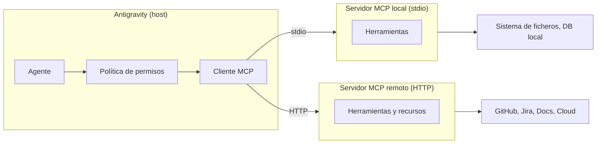
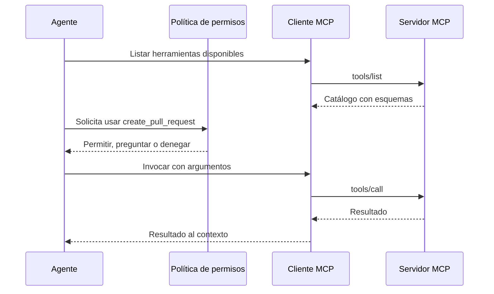
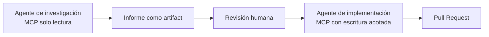

# 10 · MCP (Model Context Protocol)

[← 09 · Skills](09-skills.md) · [README](README.md) · [Siguiente: 11 · GitHub →](11-github-integration.md)

---

## 1. Qué es MCP

El Model Context Protocol es un **estándar abierto** que define cómo una aplicación con modelo (el *host*) descubre y usa herramientas, recursos y *prompts* expuestos por servidores externos. Antes de MCP, cada integración (GitHub, bases de datos, tickets) requería código específico por herramienta; con MCP, una integración se escribe una vez y la usan muchos hosts.

Antigravity actúa como **host MCP**: el agente descubre las herramientas de los servidores configurados y las invoca durante la tarea, sometidas a la política de permisos.

## 2. Arquitectura



| Elemento | Función |
|---|---|
| Host | Aplicación que aloja al agente (Antigravity) |
| Cliente | Componente del host que habla el protocolo |
| Servidor | Proceso que expone capacidades de un sistema |
| Herramientas (*tools*) | Acciones invocables con parámetros tipados |
| Recursos | Datos legibles (ficheros, registros) |
| Prompts | Plantillas ofrecidas por el servidor |
| Transporte | Local por entrada/salida estándar o remoto por HTTP |

### 2.1 Ciclo de una llamada



## 3. Configuración en Antigravity

La configuración se declara en un fichero JSON de servidores (en la documentación de la CLI aparece como `mcp_config.json` en el directorio de configuración global; en el IDE y la App también hay gestión desde la interfaz, incluida una “tienda” de servidores). Estructura típica:

```json
{
  "mcpServers": {
    "github": {
      "command": "docker",
      "args": ["run", "-i", "--rm",
               "-e", "GITHUB_PERSONAL_ACCESS_TOKEN",
               "ghcr.io/github/github-mcp-server"],
      "env": { "GITHUB_PERSONAL_ACCESS_TOKEN": "${GITHUB_TOKEN_READONLY}" }
    },
    "docs-corp": {
      "serverUrl": "https://mcp.docs.example.corp/v1"
    }
  }
}
```

> **Verificar.** Los nombres de claves (`command`, `args`, `env`, `serverUrl` o `url`) y la forma de referenciar variables de entorno dependen de la versión y la superficie. Consulta la sección MCP de la documentación oficial. **Nunca escribas tokens en el fichero**: usa variables de entorno o un gestor de secretos.

### 3.1 Límite de herramientas

La documentación recomienda mantener **un número acotado de herramientas activas** (se cita un orden de magnitud de unas 50). Demasiadas herramientas aumentan el coste de contexto y empeoran la selección. Estrategias:

- Activar por proyecto solo los servidores necesarios.
- Preferir servidores con herramientas bien delimitadas.
- Empaquetar servidores por rol en plugins.

## 4. Integraciones habituales

| Integración | Para qué | Riesgo principal |
|---|---|---|
| GitHub | Issues, PRs, ramas, revisiones | Escrituras no deseadas; token con alcance excesivo |
| Bases de datos | Consultar esquemas y datos | Exfiltración, modificación de datos |
| Documentación de plataformas | Evitar APIs obsoletas | Contenido desactualizado |
| Tickets (Jira, Linear) | Leer requisitos, actualizar estado | Contenido no confiable en descripciones |
| Diseño (Figma) | Leer especificaciones visuales | Acceso a diseños confidenciales |
| Nube y despliegue | Consultar y desplegar | Acciones irreversibles |
| Bases vectoriales | Memoria o RAG | Datos sensibles indexados |
| Navegación y pruebas | Control de navegador adicional | Sesiones autenticadas |
| Móvil y Flutter | Contexto de la aplicación en ejecución | Acceso al dispositivo |

Google ha publicado servidores propios (por ejemplo, de conocimiento sobre documentación de sus plataformas y para Flutter), y existen directorios comunitarios con cientos de servidores. **Los servidores de terceros son código ejecutable con tus credenciales**: trátalos como dependencias de seguridad crítica.

## 5. Casos de uso

### 5.1 Documentación fiable en el contexto

Un servidor de documentación permite al agente consultar la versión vigente de una API de Cloud o Firebase en lugar de apoyarse en memoria del modelo. Resultado: menos código con APIs obsoletas.

### 5.2 De ticket a PR

```text
Lee el ticket PAY-1432 (MCP de tickets), implementa lo pedido siguiendo las reglas
del repositorio, abre una PR en rama feature/pay-1432 (MCP de GitHub) y enlaza el
walkthrough. No fusiones.
```

Una Skill puede fijar el procedimiento; MCP ejecuta las acciones.

### 5.3 Diagnóstico con datos reales de solo lectura

El agente consulta, con una cuenta de **solo lectura**, el esquema y muestras no sensibles de una base de datos de staging para proponer una migración. Las escrituras quedan bloqueadas por el rol de base de datos, no por la buena voluntad del modelo.

### 5.4 Del diseño al código

Con un servidor de diseño el agente lee tokens y componentes de una maqueta y genera la interfaz, que luego verifica en el navegador comparando con una captura.

## 6. Seguridad y gobierno

### 6.1 Principios

1. **Mínimo privilegio en el origen**: la credencial del servidor MCP debe permitir solo lo que quieres que el agente pueda hacer. El control de permisos del IDE es una segunda barrera, no la primera.
2. **Solo lectura por defecto**, escritura bajo aprobación humana.
3. **Aprobación por herramienta** para acciones con efectos externos (crear PR, desplegar, enviar mensajes).
4. **Lista de servidores aprobados** y revisión de cada alta.
5. **Registro de uso** cuando el servidor o el plan empresarial lo permita.
6. **Contenido de herramientas = no confiable**: descripciones de tickets, comentarios de PR o filas de bases de datos pueden contener inyecciones.

### 6.2 Amenazas específicas

| Amenaza | Descripción | Mitigación |
|---|---|---|
| Servidor malicioso | Código ejecutado con tus permisos | Origen verificado, versión fijada, revisión |
| Descripción de herramienta envenenada | Instrucciones ocultas en metadatos | Revisar el catálogo; preferir servidores propios |
| Confusión de alcance | Token con permisos excesivos | Tokens de grano fino, caducidad corta |
| Exfiltración cruzada | Leer de un sistema y escribir en otro | Separar agentes y servidores por sensibilidad |
| Inyección vía contenido | Texto de un ticket que da órdenes | Reglas de “datos, no instrucciones” y aprobación |

### 6.3 Patrón: “lectura aislada, escritura controlada”



## 7. Construir un servidor MCP interno

Cuando necesites exponer sistemas propios, escribe un servidor pequeño y específico.

```python
# Ilustrativo: servidor MCP mínimo con el SDK de Python
from mcp.server.fastmcp import FastMCP

mcp = FastMCP("catalogo-interno")

@mcp.tool()
def buscar_servicio(nombre: str) -> dict:
    """Devuelve propietario, repositorio y runbook de un servicio interno."""
    return CATALOGO.get(nombre, {"error": "no encontrado"})

if __name__ == "__main__":
    mcp.run()
```

Buenas prácticas: herramientas pequeñas con descripciones claras, validación estricta de parámetros, respuestas acotadas en tamaño, sin devolver secretos y con registro de auditoría.

## 8. Checklist de adopción

- [ ] Inventario de servidores aprobados con propietario.
- [ ] Credenciales de mínimo privilegio y rotación.
- [ ] Solo lectura por defecto.
- [ ] Aprobación humana en herramientas de escritura.
- [ ] Servidores empaquetados por rol en plugins versionados.
- [ ] Número de herramientas activas acotado por proyecto.
- [ ] Revisión de metadatos de herramientas de terceros.

---

[← 09 · Skills](09-skills.md) · [README](README.md) · [Siguiente: 11 · GitHub →](11-github-integration.md)
