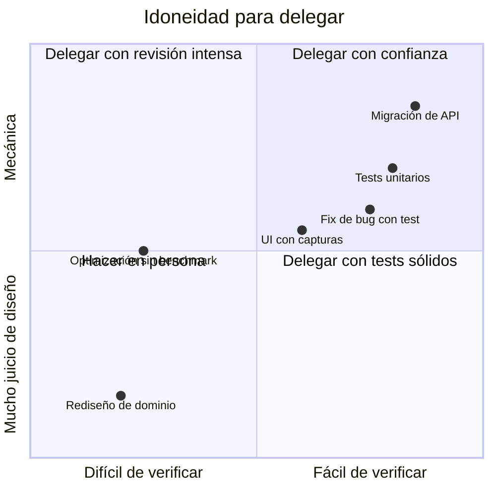
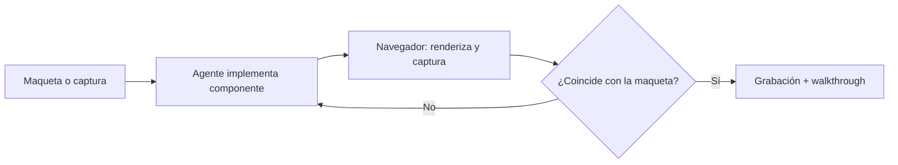

# 12 · Casos de uso

[← 11 · GitHub](11-github-integration.md) · [README](README.md) · [Siguiente: 13 · Workflow →](13-workflow.md)

---

## 1. Criterio de idoneidad

Una tarea es buena candidata a delegar en un agente cuando cumple, como mínimo, tres de estas cuatro condiciones:

1. **Verificable**: existe una forma automática de comprobar que está bien (tests, comando, comportamiento observable).
2. **Acotada**: el alcance cabe en un plan de pocas páginas y en un PR revisable.
3. **Repetitiva o mecánica**: el valor está en la ejecución, no en la decisión de diseño.
4. **Contextualizable**: la información necesaria está en el repositorio o en documentación accesible.



## 2. Caso 1 · Migración masiva de API o dependencia

**Contexto.** 40 servicios usan un cliente HTTP obsoleto; hay que migrar a la librería corporativa.

**Por qué encaja.** Mecánica, paralelizable, verificable con tests existentes.

**Flujo.**

1. Plataforma escribe la Skill `migrate-http-client` con tabla de equivalencias y script de búsqueda de usos (ver [09](09-skills.md)).
2. En la App se crea un agente por servicio, cada uno en su worktree.
3. Cada agente genera plan, aplica cambios, ejecuta la suite y abre un PR.
4. Revisión humana con checklist común; los PRs que fallan se devuelven con comentarios sobre el artifact.

**Verificación.** Script que garantiza cero imports legacy; suite en CI; revisión de los usos fuera de la tabla (el agente debe haberse detenido y preguntado).

**Riesgos.** Equivalencias semánticas distintas (timeouts, reintentos). Mitiga con casos de prueba específicos en la Skill.

**Medida de éxito.** PRs aceptados sin reescritura mayor; tiempo total frente a estimación manual.

## 3. Caso 2 · Generación y mejora de tests

**Contexto.** Módulo crítico con cobertura baja.

**Flujo.**

```text
Objetivo: subir la cobertura de src/billing a >= 80 % sin modificar código de producción.
Restricciones: tests deterministas, sin dependencias nuevas; usar los builders de test existentes.
Aceptación: ./mvnw -q test verde; informe de cobertura adjunto; mutaciones: PIT >= 60 %.
Antes de escribir: lista los casos de borde que cubrirás.
```

**Consejo.** Exige **mutation testing** o revisión de aserciones: un agente puede generar tests que pasan sin comprobar nada relevante.

## 4. Caso 3 · Corrección de bugs con reproducción

**Contexto.** Informe de bug con pasos de reproducción.

**Flujo.**

1. El agente reproduce el fallo (terminal o navegador) y adjunta evidencia.
2. Escribe un test que falla.
3. Corrige y comprueba que el test pasa y nada más se rompe.
4. El walkthrough incluye causa raíz.

**Valor del navegador.** En fallos de UI, la captura *antes/después* y la grabación del flujo reducen discusiones sobre si el bug está corregido.

## 5. Caso 4 · Desarrollo de interfaz con verificación visual

**Contexto.** Nueva pantalla a partir de una maqueta.



**Verificación.** Capturas en varios tamaños de pantalla, accesibilidad básica (foco, contraste, etiquetas) y consola sin errores.

**Límite.** El agente compara visualmente de forma aproximada; la revisión de diseño humana sigue siendo necesaria.

## 6. Caso 5 · Revisión automática de PRs

**Contexto.** Cola de PRs que satura a los revisores.

**Flujo.** Workflow de CI con el SDK (ver [11](11-github-integration.md)) que comenta hallazgos clasificados por severidad.

**Valor.** Detecta problemas mecánicos (validación de entradas, errores sin manejar, tests ausentes) antes de la revisión humana.

**Condición.** El revisor automático **no aprueba**. Se mide la tasa de hallazgos aceptados para decidir si sigue aportando.

## 7. Caso 6 · Comprensión de código heredado

**Contexto.** Equipo nuevo hereda un sistema sin documentación.

**Flujo.**

1. Agente de investigación en modo lectura recorre el repositorio.
2. Produce un informe: módulos, dependencias, flujos principales, puntos de riesgo, diagrama Mermaid.
3. Humanos validan y corrigen; el informe pasa a `docs/architecture.md`.
4. Ese documento se convierte en contexto para futuras tareas.

**Riesgo.** El informe puede contener afirmaciones plausibles pero falsas. Contrástalo con el código y los propietarios antes de publicarlo.

## 8. Caso 7 · Prototipado rápido

**Contexto.** Validar una idea con una demo funcional.

**Encaje.** Alto: el coste de equivocarse es bajo y el valor está en la velocidad. Aun así:

- Declara el prototipo **desechable**; no se promociona a producción sin reescritura y revisión.
- Ejecuta en un entorno aislado y sin credenciales reales.

## 9. Caso 8 · Automatización programada

**Contexto.** Tareas periódicas: actualización de dependencias menores, informe semanal de deuda técnica, comprobación de enlaces rotos en documentación.

**Flujo.** Tarea programada en la App o ejecución de la CLI/SDK en CI con calendario. Cada ejecución produce un PR o informe, nunca cambios directos.

```text
/schedule semanal: revisa dependencias con actualizaciones de parche en services/*,
actualiza las que pasen los tests y abre un PR por servicio con el changelog resumido.
```

## 10. Caso 9 · Integración de documentación y conocimiento

**Contexto.** Respuestas de ingeniería de plataforma que requieren combinar documentación interna y externa.

**Flujo.** Servidor MCP de documentación y servidor interno de catálogo de servicios; el agente responde con citas del documento fuente y propone cambios en runbooks.

## 11. Dónde no usarlo (o hacerlo con cautela)

| Situación | Motivo | Alternativa |
|---|---|---|
| Código criptográfico o de seguridad crítica | Errores sutiles de alto impacto | Agente como asistente de revisión, no como autor |
| Decisiones de arquitectura de fondo | Requieren juicio y contexto organizativo | Agente para explorar alternativas y redactar ADR |
| Datos personales o regulados en el entorno local | Riesgo de fuga | Entorno aislado y datos sintéticos |
| Repositorios de terceros no confiables | Inyección y ejecución de código | Nivel 0 de autonomía, contenedor |
| Tareas sin forma de verificación | No hay criterio de aceptación | Primero definir pruebas |

## 12. Matriz resumen

| Caso | Autonomía recomendada | Superficie | Verificación principal |
|---|---|---|---|
| Migración masiva | Media | App + CLI | Script y suite en CI |
| Tests | Media | IDE o App | Cobertura y mutación |
| Bugs | Media | IDE | Test que falla y pasa |
| UI | Media | App con navegador | Capturas y grabación |
| Revisión de PRs | Baja (solo comenta) | SDK en CI | Tasa de hallazgos aceptados |
| Código heredado | Baja (solo lectura) | App | Contraste con propietarios |
| Prototipo | Alta en entorno aislado | App | Demo funcional |
| Automatización programada | Media con PR | App, CLI o SDK | PR revisado |

---

[← 11 · GitHub](11-github-integration.md) · [README](README.md) · [Siguiente: 13 · Workflow →](13-workflow.md)
