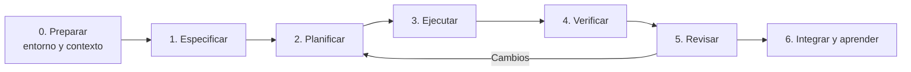
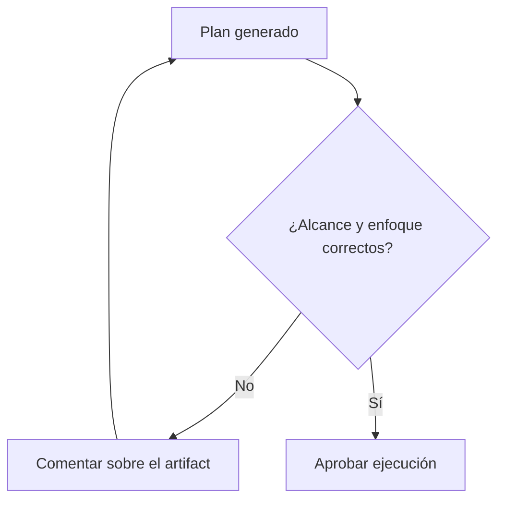

# 13 · Workflow

[← 12 · Casos de uso](12-casos-uso.md) · [README](README.md) · [Siguiente: 14 · Buenas prácticas →](14-buenas-practicas.md)

---

## 1. Visión general

El flujo de trabajo agéntico tiene siete fases. Su diferencia con el desarrollo tradicional es que **la especificación y la revisión ganan peso** y la escritura lo pierde.



## 2. Fase 0 · Preparación (una vez por repositorio)

| Elemento | Acción | Responsable |
|---|---|---|
| Reglas | Comandos canónicos, convenciones, prohibiciones | Tech lead |
| Skills | Procedimientos repetibles | Plataforma |
| MCP | Servidores aprobados y credenciales de mínimo privilegio | Plataforma y seguridad |
| Permisos | Política de terminal, sandbox, dominios permitidos | Seguridad |
| CI | Tests, linters, análisis de seguridad, revisor automático | Plataforma |
| Documentación | README operativo, ADR, glosario | Equipo |

Prueba de preparación: **un agente sin contexto previo debería poder construir y testear el proyecto leyendo solo el repositorio**. Si no puede, tampoco puede una persona nueva.

## 3. Fase 1 · Especificar

Plantilla de delegación:

```markdown
## Objetivo
(Resultado observable, no implementación)

## Contexto
(Ficheros, ADR, tickets relevantes con rutas)

## Restricciones
(Qué no tocar, dependencias, compatibilidad, seguridad)

## Criterios de aceptación
(Comandos y comportamientos verificables)

## Entregables
(Plan previo, PR, walkthrough, capturas si hay UI)

## Autonomía
(Nivel: 0-3; qué requiere aprobación)
```

Errores frecuentes: objetivos vagos (“mejora”), criterios que el agente no puede ejecutar, y falta de restricciones.

## 4. Fase 2 · Planificar

Para tareas no triviales, pide **plan antes de ejecutar** y revísalo.

Qué mirar en el plan:

- **Alcance**: ¿toca más ficheros de los esperados?
- **Enfoque**: ¿hay una alternativa más simple?
- **Riesgos**: ¿identifica migraciones, compatibilidad, seguridad?
- **Verificación**: ¿incluye los criterios de aceptación?
- **Dependencias**: ¿propone añadir librerías?

Comenta directamente sobre el artifact (selecciona la parte y escribe el cambio). Aprobar un plan mediocre es la fuente más común de trabajo rehecho.



## 5. Fase 3 · Ejecutar

- **Una tarea por agente**. Mezclar objetivos degrada el resultado.
- **Worktree aislado** si hay varios agentes sobre el mismo repositorio.
- **Autonomía acorde al riesgo** (ver [06](06-browser-terminal.md)).
- **Atender las solicitudes de aprobación**: lee el comando antes de aceptar; la aprobación por inercia anula el control.
- **Intervenir pronto**: si el agente se desvía, redirígelo con un comentario en vez de esperar al final.

### 5.1 Paralelismo

```mermaid
gantt
    title Ejemplo de tres agentes en paralelo
    dateFormat HH:mm
    axisFormat %H:%M
    section Agente A (migración orders)
    Plan            :a1, 09:00, 10m
    Ejecución       :a2, after a1, 25m
    Verificación    :a3, after a2, 10m
    section Agente B (migración billing)
    Plan            :b1, 09:00, 10m
    Ejecución       :b2, after b1, 30m
    Verificación    :b3, after b2, 10m
    section Humano
    Revisión plan A y B :h1, 09:10, 10m
    Revisión resultados :h2, 09:45, 30m
```



Regla: el número de agentes se limita por **tu capacidad de revisión**, no por la cuota.

## 6. Fase 4 · Verificar

Orden de verificación, de menor a mayor coste:

1. Lint y tipos.
2. Tests unitarios y de integración.
3. Comportamiento en navegador (UI) con capturas y grabación.
4. CI independiente.
5. Revisión humana.

El agente puede ejecutar 1–3; la 4 y la 5 **no se delegan**.

## 7. Fase 5 · Revisar

### 7.1 Checklist de revisión

- [ ] El diff coincide con el plan y con el walkthrough.
- [ ] No hay cambios fuera de alcance (ficheros, configuración, dependencias).
- [ ] Tests nuevos comprueban comportamiento real (no aserciones vacías).
- [ ] No se han debilitado tests existentes para que pasen.
- [ ] Sin secretos, URLs externas ni código ofuscado.
- [ ] Manejo de errores y casos de borde razonables.
- [ ] Seguridad: entradas no confiables, permisos, registros.

### 7.2 Señales de alerta

| Señal | Posible causa |
|---|---|
| Tests modificados junto al código de producción | El agente ajustó tests para que pasen |
| Dependencias nuevas no pedidas | Atajo de implementación |
| Walkthrough más optimista que el diff | Resumen no fiable |
| Cambios masivos de formato | Ruido que oculta cambios reales |
| Comandos de red inesperados | Posible inyección |

## 8. Fase 6 · Integrar y aprender

1. Abrir PR con plantilla (plan, verificación, riesgos).
2. CI y revisión humana; merge por las reglas de rama protegida.
3. **Retroalimentar el contexto**: si el agente falló por falta de información, añade regla, Skill o documentación.
4. **Revisar conocimiento persistente**: elimina aprendizajes erróneos u obsoletos.
5. Registrar métricas (aceptación, iteraciones, coste).

## 9. Ejemplo completo

**Tarea**: “Añadir exportación CSV al listado de pedidos”.

```text
Objetivo: botón "Exportar CSV" en /orders que descargue los pedidos filtrados actualmente.
Contexto: src/orders/OrdersPage.tsx, docs/adr/0021-exportaciones.md (formato y límites).
Restricciones: sin librerías nuevas; máximo 50.000 filas; no cambiar el contrato de GET /orders.
Aceptación:
- npm test y npm run lint en verde
- test de componente para el botón y test unitario del generador CSV (escape de comas y comillas)
- en navegador: con filtro "estado=pagado" el CSV contiene solo pedidos pagados (captura del fichero abierto)
Entregables: plan antes de editar; PR con plantilla.
Autonomía: nivel 2; pedir aprobación para git push.
```

Recorrido:

1. El agente propone plan; el humano nota que no considera el límite de filas y comenta; el agente lo incorpora.
2. Ejecución y verificación en navegador con grabación.
3. Revisión: se detecta que el escape de comillas dobles faltaba en un caso; el humano lo señala y el agente añade test y corrección.
4. PR con CI verde; merge tras aprobación.
5. Se añade a las reglas: “Las exportaciones deben respetar los límites de la ADR 0021”.

## 10. Variantes del flujo

| Variante | Cuándo | Diferencia |
|---|---|---|
| Rápida | Cambios triviales | Sin plan formal; revisión de diff |
| Exploratoria | Entender código | Agente en solo lectura; el artifact es un informe |
| Batch | Muchas tareas similares | Una Skill y un agente por unidad |
| Programada | Mantenimiento periódico | Disparo por calendario; salida siempre como PR |
| CI | Revisión automática | Agente sin intervención; salida como comentario |

---

[← 12 · Casos de uso](12-casos-uso.md) · [README](README.md) · [Siguiente: 14 · Buenas prácticas →](14-buenas-practicas.md)
