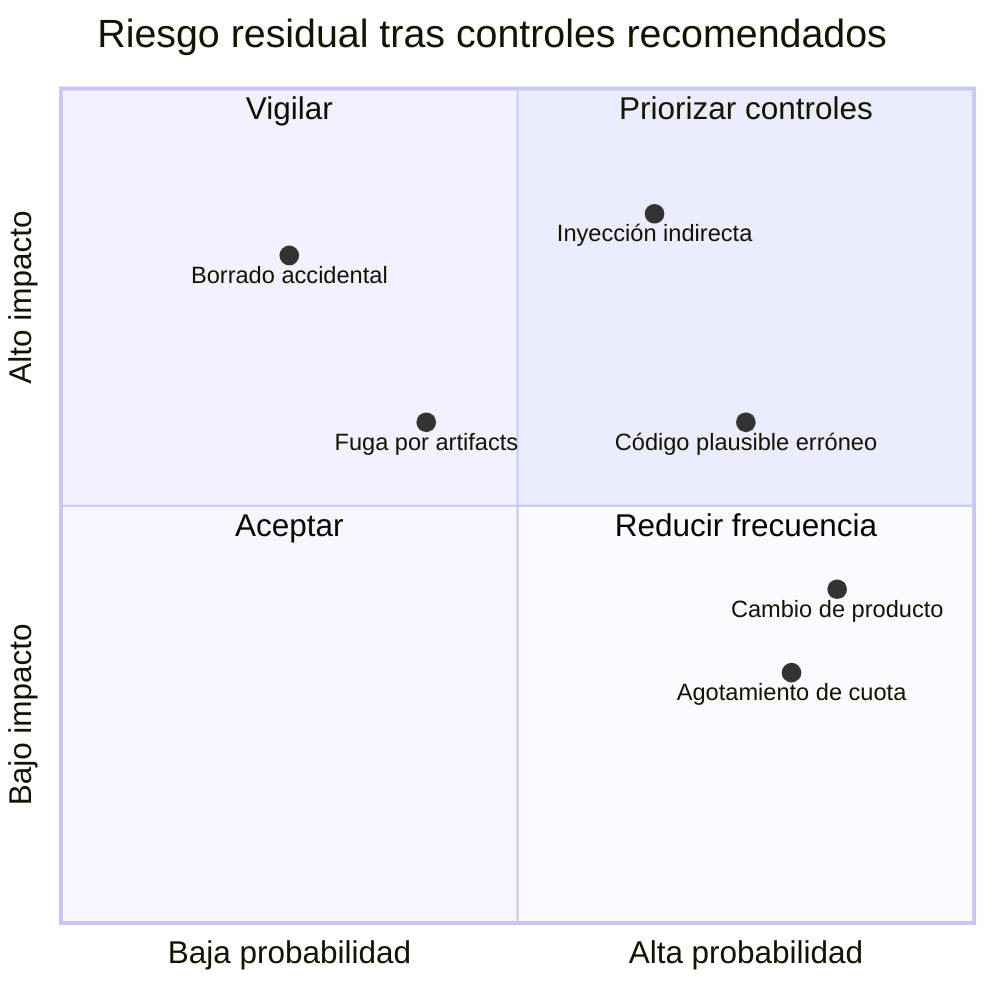

# 16 · Limitaciones

[← 15 · Antipatrones](15-antipatrones.md) · [README](README.md) · [Siguiente: 17 · Futuro →](17-futuro.md)

---

Este capítulo sirve para fijar expectativas realistas. Distingue entre limitaciones **inherentes** a los agentes basados en modelos de lenguaje y limitaciones **específicas** de Antigravity a noviembre de 2026.

## 1. Limitaciones inherentes a los agentes

### 1.1 Falibilidad plausible

Un modelo puede producir código que parece correcto y no lo es, con explicaciones convincentes. La tasa de error baja con mejor contexto y verificación, pero **no es cero**. Consecuencia: la revisión y las pruebas independientes son estructurales.

### 1.2 Ventana de contexto y degradación en sesiones largas

El contexto es finito. En sesiones largas se acumulan resultados de herramientas, decisiones contradictorias y ruido. Mitigación: tareas pequeñas, resúmenes y reinicios (ver [08](08-context-management.md)).

### 1.3 No determinismo

El mismo prompt puede producir resultados distintos. Esto dificulta reproducir fallos y exige que lo crítico se codifique en **mecanismos deterministas** (scripts, hooks, tests) y no solo en instrucciones.

### 1.4 Comprensión limitada del contexto organizativo

El agente no conoce acuerdos verbales, deuda de negocio, prioridades políticas ni restricciones no escritas. Lo que no está en el repositorio o en la documentación accesible no existe para él.

### 1.5 Verificación limitada por lo que se puede observar

El agente solo puede comprobar lo que su entorno permite: sin datos realistas, integraciones reales ni carga, la verificación es parcial. Los defectos de concurrencia, rendimiento a escala y comportamiento en producción siguen requiriendo pruebas específicas.

## 2. Seguridad

### 2.1 Inyección indirecta de instrucciones

Es la limitación de seguridad central y **no está resuelta** en la industria. Casos públicos relacionados con Antigravity:

| Fecha | Hallazgo | Estado |
|---|---|---|
| Finales de 2025 | Exfiltración de credenciales y código mediante instrucciones ocultas en una página web leída por el subagente de navegador | Divulgado públicamente; Google indicó que trabajaba en mitigaciones |
| Finales de 2025 | Puerta trasera persistente a partir de un repositorio malicioso, que se ejecutaba incluso con políticas restrictivas | Divulgado por investigadores |
| Dic 2025 | Borrado de una unidad completa con ejecución sin aprobación (Turbo) | Notificado por un usuario; Google indicó que investigaba |
| Ene–abr 2026 | Inyección en el tool de búsqueda de ficheros que permitía ejecución de código, incluso en modo estricto | Informado en enero, corregido el 28 de febrero de 2026, divulgado en abril |
| Mar 2026 | Informes de riesgo continuado de exfiltración de ficheros fuente por inyección indirecta | Documentado por terceros |

Estos casos **no son exclusivos de Antigravity**: afectan a otras herramientas de la misma categoría. Pero muestran que la autonomía amplía la superficie de ataque.

### 2.2 El sandbox reduce daño, no lo elimina

La ejecución en sandbox restringe sistema de ficheros y red, pero se ha demostrado una evasión que combinaba inyección con capacidades nativas permitidas. Un sandbox es una capa, no una garantía.

### 2.3 Valores por defecto

Los materiales de seguridad señalan que la configuración recomendada por defecto prioriza la fluidez (ejecución automática de comandos considerados seguros). Una organización debe **definir su propia configuración** y no aceptar valores por defecto.

### 2.4 Cadena de suministro

Plugins, Skills y servidores MCP de terceros ejecutan instrucciones y código con tus credenciales. El ecosistema es joven, con poca verificación independiente.

### 2.5 Datos en artifacts y transcripciones

Los artifacts, capturas y conversaciones pueden contener secretos y datos personales leídos durante la tarea. Se almacenan localmente y pueden sincronizarse según la superficie y el plan.

## 3. Limitaciones del producto (nov 2026)

| Área | Limitación | Impacto |
|---|---|---|
| Madurez | Producto con apenas un año; cambios de nombre, superficies y rutas de configuración | Documentación y procesos se quedan obsoletos rápido |
| Convivencia IDE/App | El Agent Manager se anuncia como retirable del IDE; la App no incluye editor | Hay que elegir superficie según tarea y estar atento a migraciones |
| Cobertura empresarial | El acceso corporativo con SSO y residencia de datos no cubre el IDE independiente | Elección de superficie condicionada por cumplimiento |
| Modelos | Catálogo variable; modelos de terceros restringidos por plan; retiradas anunciadas de versiones | No fijar procesos a un modelo concreto |
| Clave propia | No se puede traer tu propia clave de modelo | Dependencia del proveedor y de sus cuotas |
| Cuotas | Plan gratuito con cuota semanal; planes de pago con renovación periódica y tope semanal; límites sujetos a cambio | Planificación de capacidad e incertidumbre de costes |
| Fiabilidad | Informes de errores por sobrecarga del proveedor del modelo y agotamiento rápido de cuota en el plan gratuito | Tareas interrumpidas; no apto como único camino crítico |
| Edad | No disponible para menores de 18 años | Programas formativos con menores quedan fuera |
| Cuentas de trabajo | Necesitan aprovisionamiento por administrador | Despliegue con fricción inicial |
| SDK | En *preview*, con API susceptible de cambios | No construir sobre él procesos críticos sin aislar la dependencia |
| Plataformas | Disponible en macOS, Windows y Linux; el sandbox nativo varía por sistema operativo | Paridad de seguridad desigual entre estaciones |
| Origen del código | El editor derivó de VS Code y se discutió la falta de transparencia sobre su base | Compatibilidad de extensiones y cumplimiento de licencias a verificar |

> **Verificar.** Esta tabla envejece. Antes de citarla en una decisión, contrasta con la documentación oficial de planes, modelos y descargas.

## 4. Limitaciones de coste

- La cuota es un **recurso compartido por todas las superficies** del mismo plan.
- Las tareas largas, con razonamiento alto y navegador, consumen más.
- Los créditos adicionales funcionan como excedente en planes de pago, con control explícito.
- El coste real incluye **tiempo de revisión humana**, que suele ser mayor que el de cuota.

Estimación recomendada: mide durante el piloto el coste en cuota y en horas de revisión por tarea, y compáralo con el esfuerzo manual de referencia.

## 5. Limitaciones organizativas

| Limitación | Descripción |
|---|---|
| Cuello de botella de revisión | La generación escala, la revisión humana no |
| Pérdida de conocimiento tácito | Equipos que dejan de escribir código pueden perder familiaridad con el sistema |
| Atribución y responsabilidad | La responsabilidad del código es de la persona que lo aprueba, no del agente |
| Propiedad intelectual y licencias | Dependencias y fragmentos propuestos por el agente pueden tener licencias incompatibles |
| Brecha de habilidades | Especificar y revisar bien exige experiencia; los perfiles junior pueden aceptar sin criterio |
| Gestión del cambio | Resistencia, expectativas infladas y métricas mal diseñadas |

## 6. Cuándo no es la herramienta adecuada

1. **Entornos aislados sin conexión** o con restricciones de red incompatibles con servicios en la nube.
2. **Datos regulados** que no pueden salir del perímetro y para los que no se ha validado la vía empresarial.
3. **Requisitos de soberanía** que exigen modelos propios o autoalojados (alternativas abiertas pueden encajar mejor).
4. **Equipos que necesitan estabilidad absoluta** de producto en el corto plazo.
5. **Tareas sin forma de verificación automática**.

## 7. Matriz de riesgo residual

## 8. Plan de mitigación resumido

| Limitación | Mitigación principal |
|---|---|
| Falibilidad | CI independiente, revisión humana, mutation testing |
| Inyección | Contenido externo como datos, lista de permitidos, agentes separados, sin secretos |
| Sandbox imperfecto | Contenedor o VM para alta autonomía |
| Producto cambiante | Contexto portátil con estándares abiertos; revisión trimestral |
| Cuotas | Planificación de capacidad, razonamiento ajustado, tareas pequeñas |
| Cumplimiento | Vía empresarial, residencia de datos, datos sintéticos |
| Revisión saturada | Límite de agentes por persona, PRs pequeños |

---

[← 15 · Antipatrones](15-antipatrones.md) · [README](README.md) · [Siguiente: 17 · Futuro →](17-futuro.md)
