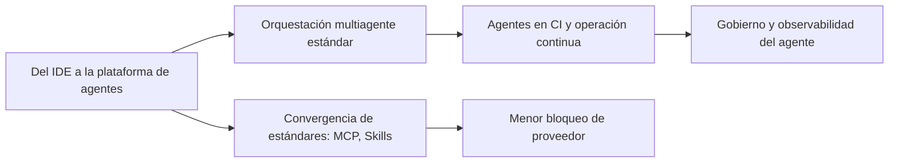
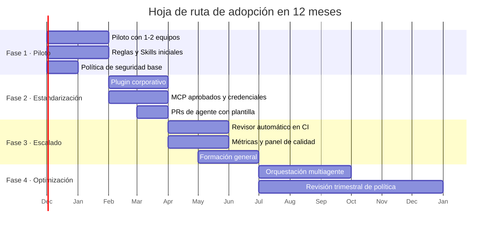

# 17 · Futuro

[← 16 · Limitaciones](16-limitaciones.md) · [README](README.md) · [Siguiente: 18 · Referencias →](18-referencias.md)

---

> **Naturaleza del capítulo.** Es prospectiva razonada, no predicción. Se apoya en la trayectoria observada de Antigravity y del sector entre noviembre de 2025 y noviembre de 2026. Las proyecciones se marcan como tales y no deben tratarse como compromisos del proveedor.

## 1. Lo que ya ha cambiado en un año

La velocidad es el dato más relevante para planificar. En doce meses Antigravity pasó de:

| Nov 2025 | Nov 2026 |
|---|---|
| Un IDE con vista de gestor de agentes | Familia de superficies: App, IDE, CLI, extensiones y SDK |
| Un modelo núcleo y alguna alternativa | Catálogo de modelos propios y de terceros según plan |
| Edición y navegador con artifacts | Agentes paralelos, subagentes dinámicos, tareas programadas, Projects y control remoto |
| Personalización básica | Skills, reglas, workflows, hooks y plugins con directorio |
| Uso individual en preview gratuita | Vía empresarial con SSO, residencia de datos y logging |
| Controles de seguridad iniciales | Modo estricto, sandbox nativo y varias correcciones tras divulgaciones |

La conclusión de planificación es: **asume que cualquier detalle concreto de hoy será distinto dentro de seis meses** y diseña tus procesos sobre capacidades estables.

## 2. Tendencias previsibles

### 2.1 Del editor al centro de mando

La separación de la App (sin editor) y el IDE sugiere que el editor se convierte en **una superficie más**, y no la central. Es razonable esperar más trabajo asíncrono, más revisión y menos escritura directa, con el editor como herramienta de intervención.

### 2.2 Agentes que viven fuera de la estación del desarrollador

Ejecución en CI, en servidores y de forma programada, con control remoto desde navegador. Esto desplaza el modelo de seguridad: del “agente en mi portátil” al **“agente como servicio con identidad propia”**, que exige cuentas de servicio, auditoría y políticas centralizadas.

### 2.3 Estándares abiertos

MCP y Agent Skills reducen el coste de cambiar de herramienta y favorecen ecosistemas de plugins. Es previsible más contenido reutilizable (Skills y servidores), con el correspondiente riesgo de cadena de suministro y la aparición de prácticas de verificación y firma.

### 2.4 Seguridad como disciplina propia

La inyección de instrucciones sigue sin solución definitiva. Cabe esperar más aislamiento por defecto, permisos por capacidad más finos, separación entre contenido no confiable y canal de instrucciones, y herramientas de auditoría. Hasta entonces, el aislamiento a nivel de entorno es la defensa fiable.

### 2.5 Evaluación continua de agentes

Los equipos medirán agentes como medirán servicios: tasas de aceptación, regresiones tras cambios de modelo, coste por tarea. Los cambios de modelo (incluidas retiradas anunciadas) harán necesarias **pruebas de regresión de Skills y flujos**.

### 2.6 Roles y competencias

Más peso en especificación, diseño de verificación, revisión y gobierno de contexto. Surgirán perfiles de plataforma de agentes (mantenedores de Skills, MCP y políticas).

## 3. Señales a vigilar

| Señal | Qué indicaría | Acción |
|---|---|---|
| Retirada del Agent Manager en el IDE | Consolidación en la App | Migrar flujos a la App |
| Cobertura empresarial del IDE | Cierre de la brecha de cumplimiento | Revisar elección de superficie |
| Salida de *preview* del SDK | API estable | Planificar integración en CI con garantías |
| Cambios de planes y cuotas | Variación de coste | Revisar capacidad y presupuesto |
| Nuevas divulgaciones de seguridad | Superficie de ataque | Revisar configuración y actualizar |
| Madurez del directorio de plugins | Cadena de suministro | Definir política de aprobación |
| Evolución de modelos de terceros | Dependencia de proveedor | Evitar acoplar procesos a un modelo |
| Estándares: nuevas versiones de MCP y Agent Skills | Compatibilidad | Mantener portabilidad |

## 4. Escenarios

| Escenario | Descripción | Preparación |
|---|---|---|
| Consolidación | Antigravity se estabiliza como plataforma líder en orquestación | Invertir en Skills, MCP y plugins corporativos |
| Fragmentación | Varias herramientas con fortalezas distintas coexisten | Contexto portátil y estándares abiertos |
| Retroceso por seguridad | Incidentes graves frenan la adopción en organizaciones reguladas | Aislamiento, auditoría y plan de contingencia |
| Commoditización | Capacidades convergen y la diferencia está en el contexto propio | Convertir el conocimiento interno en activo |

La estrategia robusta es válida en los cuatro: **contexto portátil, aislamiento, medición y revisión humana**.

## 5. Hoja de ruta de adopción

### 5.1 Fase 1 · Piloto (meses 1–2)

- Selecciona 1–2 equipos con tareas verificables.
- Define métricas base (aceptación, tiempo de revisión, defectos, coste).
- Configura seguridad base: política de terminal, navegador separado, sin secretos en el entorno.
- Escribe reglas y 2–3 Skills.
- **Criterio de salida**: métricas por encima del umbral acordado y sin incidentes de seguridad.

### 5.2 Fase 2 · Estandarización (meses 3–5)

- Plugin corporativo con Skills y MCP aprobados.
- Credenciales de mínimo privilegio.
- Plantilla de PR y etiquetado.
- Vía empresarial si hay requisitos de cumplimiento.

### 5.3 Fase 3 · Escalado (meses 6–8)

- Revisor automático en CI (solo comenta).
- Panel de métricas.
- Formación y comunidad interna.

### 5.4 Fase 4 · Optimización (meses 9–12)

- Orquestación multiagente en tareas masivas.
- Evaluación de alternativas y ajuste de la herramienta por caso de uso.
- Revisión trimestral de política, modelos y configuración.

## 6. Principios para decidir con incertidumbre

1. **Reversibilidad**: prefiere decisiones fáciles de deshacer (configuración en repositorio, estándares abiertos).
2. **Piloto antes de política**: la evidencia propia pesa más que las demostraciones.
3. **Capacidades antes que productos**: documenta qué necesitas (orquestación, verificación visual, CI) y evalúa quién lo cubre.
4. **Seguridad por aislamiento, no por confianza**.
5. **Medir lo que importa**: calidad, ciclo completo y esfuerzo de revisión.

## 7. Preguntas abiertas

- ¿Cómo se auditarán las acciones de agentes de larga duración con identidad propia?
- ¿Qué modelo de responsabilidad y licencias aplicará al código generado en entornos corporativos?
- ¿Se separará de forma robusta el canal de instrucciones del contenido no confiable?
- ¿Cómo evolucionará la relación entre cuotas de suscripción y costes reales de computación?
- ¿Qué competencias de revisión deben garantizarse para mantener la capacidad de supervisión humana?

---

[← 16 · Limitaciones](16-limitaciones.md) · [README](README.md) · [Siguiente: 18 · Referencias →](18-referencias.md)
