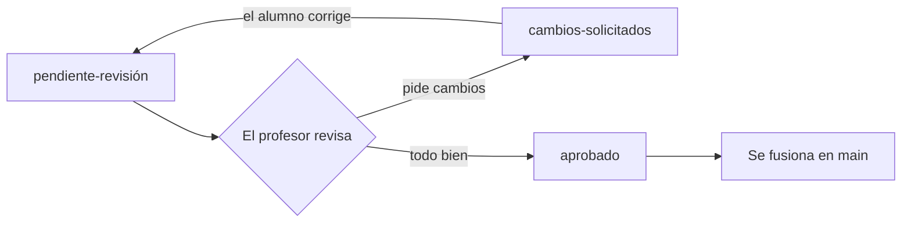

# Cómo contribuir a Upgrade IA

Este repositorio se trabaja con **Issues**: el profesor deja tareas por hacer y cada alumno o alumna coge una, la desarrolla en su propia rama y la entrega con un pull request.

> Si es tu primera vez con Git y GitHub, empieza por el [tutorial de trabajo colaborativo](docs/trabajoColaborativo/README.md). Esta página es la referencia corta: el flujo y el significado de las etiquetas.

## El flujo en 5 líneas

1. Elige una Issue **sin asignar** y asígnatela. Una a la vez.
2. Crea tu rama desde `main`, con el número de la Issue (`docs/12-analisis-sota`).
3. Haz lo que pide la Issue y sube tus commits.
4. Abre un pull request hacia `main` con `Closes #N` en la descripción.
5. El profesor revisa; si pide cambios, los haces en la misma rama.

Los pasos completos, con comandos, están en [Cómo trabajamos](docs/trabajoColaborativo/09-como-trabajamos.md).

## Reglas básicas

- **`main` está protegida:** todo entra por pull request y solo el profesor lo fusiona.
- **Una Issue, una rama, un pull request.**
- **Commits con [Conventional Commits](https://www.conventionalcommits.org/es/):** `docs: añadir ejemplo de matriz comparativa`.
- **Nunca subas secretos** (claves, contraseñas, tokens) ni datos personales.

## Etiquetas

Las etiquetas clasifican Issues y pull requests. **Las pone el profesor**: si crees que una está mal, dilo en un comentario.

Cada grupo tiene su propia gama de color, para reconocerlo de un vistazo.

### Tipo: qué es

Coinciden con el prefijo del commit.

| Etiqueta | Se usa para | Color |
|---|---|---|
| `docs` | Documentación, temario, README | `#0891b2` cian |
| `feat` | Contenido o funcionalidad nueva | `#1d76db` azul |
| `fix` | Corregir un error, un enlace roto o una errata | `#5319e7` violeta |
| `chore` | Mantenimiento, estructura, automatización | `#cfd3d7` gris |
| `pregunta` | Una duda abierta | `#d876e3` rosa |

### Estado: en qué punto está

Se mueve a medida que avanza la revisión.

| Etiqueta | Significa | Color |
|---|---|---|
| `estado: pendiente-revisión` | Esperando al profesor | `#fbca04` amarillo |
| `estado: cambios-solicitados` | Te toca a ti corregir | `#f9a03f` naranja |
| `estado: aprobado` | Listo para fusionar | `#0e8a16` verde |
| `estado: bloqueado` | Parado: depende de algo externo | `#7c4a1e` marrón |

### Prioridad: cuánto corre prisa

Un solo tono rojo: **cuanto más intenso, más urgente**. Si una Issue no lleva prioridad, se entiende `P2`.

| Etiqueta | Significa | Color |
|---|---|---|
| `P0` | Crítica: bloquea la clase o rompe `main` | `#b60205` rojo intenso |
| `P1` | Alta: debe entrar antes de la próxima clase o entrega | `#e4606d` rojo medio |
| `P2` | Normal: mejora útil sin fecha | `#f4b6bc` rosa claro |
| `P3` | Baja: se hace si hay tiempo | `#fbe4e6` rosa pálido |

## Cambiar las etiquetas

Esta lista es la primera versión y puede crecer. Si se añade, renombra o quita una etiqueta, actualiza **a la vez** esta página y [Issues y etiquetas](docs/trabajoColaborativo/10-issues-y-etiquetas.md).
