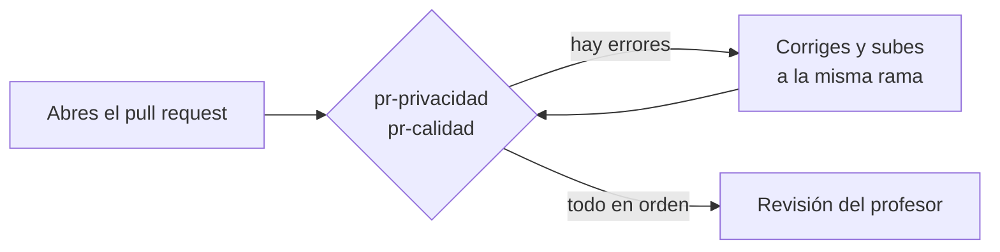
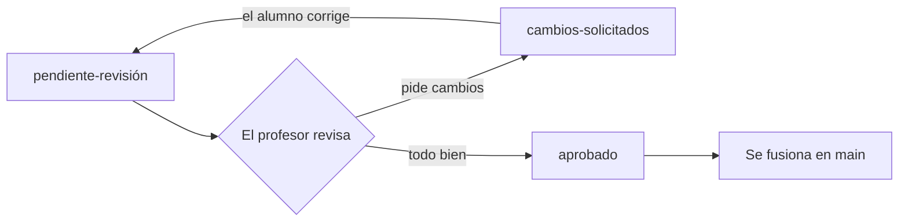

# Cómo contribuir a Upgrade IA

Este repositorio se trabaja con **Issues**: el profesor deja tareas por hacer y cada alumno o alumna coge una, la desarrolla en su propia rama y la entrega con un pull request.

> Si es tu primera vez con Git y GitHub, empieza por el [tutorial de trabajo colaborativo](docs/trabajoColaborativo/README.md). Esta página es la referencia corta: el flujo y el significado de las etiquetas.

## El flujo en 5 líneas

1. Elige una Issue **sin asignar** y asígnatela. Una a la vez.
2. Crea tu rama desde `main`, con el número de la Issue (`docs/12-analisis-sota`).
3. Haz lo que pide la Issue y sube tus commits.
4. Abre un pull request hacia `main` con `Closes #N` en la descripción.
5. El profesor revisa; si pide cambios, los haces en la misma rama.

Los pasos completos, con comandos, están en [Cómo trabajamos](docs/trabajoColaborativo/09-como-trabajamos.md).

## Reglas básicas

- **`main` está protegida:** todo entra por pull request y solo el profesor lo fusiona.
- **Una Issue, una rama, un pull request.**
- **Commits con [Conventional Commits](https://www.conventionalcommits.org/es/):** `docs: añadir ejemplo de matriz comparativa`.
- **Nunca subas secretos** (claves, contraseñas, tokens) ni datos personales.

## Zona de analítica

Además de documentación, se aportan **hojas de cálculo, dashboards y scripts de Python** que analizan y automatizan este repositorio. Viven en [`analitica/`](analitica/README.md), que explica qué se puede aportar y las reglas: datos abiertos o agregados, sin secretos y con el uso de IA declarado. Cada pull request pasa por unas [comprobaciones automáticas](#comprobaciones-automáticas) que bloquean los datos personales y los secretos que reconocen, pero **no detectan nombres propios ni datos en texto libre**: antes de subir datos, pregúntate si son de personas reales. El proceso es el mismo: una Issue, una rama, un pull request.

## Comprobaciones automáticas

Cada pull request pasa por dos comprobaciones automáticas (CI) antes de que el profesor lo revise:



| Comprobación | Qué mira | ¿Bloquea? |
|---|---|---|
| `pr-privacidad` | Datos personales y secretos en lo que cambia tu PR | Sí |
| `pr-calidad` | Pruebas de los scripts, Markdown (enlaces, anclas, diagramas), estructura de ficheros y título del PR | Los errores sí; los avisos no |

### Qué detecta la comprobación de privacidad

- Correos electrónicos, DNI/NIE (con la letra de control válida), teléfonos españoles, IBAN, tarjetas de pago, números de la Seguridad Social y fechas de nacimiento que aparezcan junto a la palabra *nacimiento*.
- **Cabeceras de tablas** que anuncian datos personales (`nombre`, `apellidos`, `dni`, `email`, `telefono`, `direccion`, `fecha_nacimiento`, `iban` y sus equivalentes en inglés).
- Hojas de cálculo (`.xlsx`, `.xlsm`, `.ods`): el texto de las celdas y de los comentarios, y si traen macros. Cuadernos `.ipynb`: el código **y las salidas**, donde se cuelan los datos.
- Secretos: contraseñas, claves y tokens escritos en el código, claves privadas y ficheros `.env`, `.pem` o `.key`.
- Un fichero de más de 5 MB falla: reduce su tamaño.

**El valor detectado nunca se muestra.** Los registros de un repositorio público son públicos, así que el CI solo dice el fichero, la línea y el tipo de dato.

### Si salta la comprobación

1. Mira el fichero, la línea y el tipo que indica el CI (pestaña *Checks* del pull request, o el resumen del job). **GitHub solo muestra las 10 primeras anotaciones de cada tipo:** si hay más, el CI te lo avisa en la primera, y la lista completa está en el resumen del job (*Summary*) y en el registro del paso.
2. Quita el dato o sustitúyelo por **datos inventados**, y sube el cambio a la misma rama.
3. **Si el dato ya estaba en un commit anterior de tu rama, borrarlo en un commit nuevo no basta:** sigue en el historial, y el repositorio es público. Avisa al profesor antes de seguir: hay que reescribir el historial.
4. Si crees que es un **falso positivo** (por ejemplo, datos de ejemplo inventados), pide una excepción al profesor. No edites tú la lista de excepciones: el CI falla si un PR de otra persona la toca.

### Límites de estas comprobaciones

- Detectan **patrones**. **No detectan nombres propios ni datos identificativos en texto libre.**
- **Un pull request limpio no garantiza que no haya datos personales.** Estas comprobaciones no sustituyen la revisión del profesor ni tu responsabilidad: antes de subir datos, pregúntate si son de personas reales.
- Los formatos que no se pueden analizar (`.xls`, `.pdf`, `.docx`, `.parquet`, imágenes…) solo generan un aviso, y los comprimidos, `.pkl` y bases de datos se rechazan. Una contraseña escrita como frase con espacios no se detecta.
- Los cambios en `.github/` y `.githooks/` (el CI y los hooks) solo los hace el profesor; un pull request de otra persona que los toque falla.

### Comprobar en tu ordenador antes de subir (opcional, recomendado)

Los *hooks* de Git del repositorio hacen las mismas comprobaciones **antes** de crear el commit y de subir la rama, así te enteras antes de que salte el CI. Se instalan una vez por clon, con Python 3.11 o superior:

```bash
python3 .githooks/hooks.py instalar
```

Hacen tres cosas:

- **Al commitear:** impiden commitear en `main`, revisan lo que vas a commitear (datos personales, secretos, formatos no admitidos, marcas de conflicto sin resolver, enlaces rotos en Markdown).
- **Al escribir el mensaje:** comprueban que sigue Conventional Commits.
- **Al subir:** impiden subir a `main` y revisan los commits que salen.

Los hooks **ayudan, no son la barrera**: `git commit --no-verify` y `git push --no-verify` los saltan. La barrera es el CI del pull request, que repite todo. Si no tienes Python, los hooks avisan y no bloquean nada. Para quitarlos: `git config --unset core.hooksPath`.

## Etiquetas

Las etiquetas clasifican Issues y pull requests. **Las pone el profesor**: si crees que una está mal, dilo en un comentario.

Cada grupo tiene su propia gama de color, para reconocerlo de un vistazo.

### Tipo: qué es

Coinciden con el prefijo del commit.

| Etiqueta | Se usa para | Color |
|---|---|---|
| `docs` | Documentación, temario, README | `#0891b2` cian |
| `feat` | Contenido o funcionalidad nueva | `#1d76db` azul |
| `fix` | Corregir un error, un enlace roto o una errata | `#5319e7` violeta |
| `chore` | Mantenimiento, estructura, automatización | `#cfd3d7` gris |
| `pregunta` | Una duda abierta | `#d876e3` rosa |

### Estado: en qué punto está

Se mueve a medida que avanza la revisión.

| Etiqueta | Significa | Color |
|---|---|---|
| `estado: pendiente-revisión` | Esperando al profesor | `#fbca04` amarillo |
| `estado: cambios-solicitados` | Te toca a ti corregir | `#f9a03f` naranja |
| `estado: aprobado` | Listo para fusionar | `#0e8a16` verde |
| `estado: bloqueado` | Parado: depende de algo externo | `#7c4a1e` marrón |



### Prioridad: cuánto corre prisa

Un solo tono rojo: **cuanto más intenso, más urgente**. Si una Issue no lleva prioridad, se entiende `P2`.

| Etiqueta | Significa | Color |
|---|---|---|
| `P0` | Crítica: bloquea la clase o rompe `main` | `#b60205` rojo intenso |
| `P1` | Alta: debe entrar antes de la próxima clase o entrega | `#e4606d` rojo medio |
| `P2` | Normal: mejora útil sin fecha | `#f4b6bc` rosa claro |
| `P3` | Baja: se hace si hay tiempo | `#fbe4e6` rosa pálido |

## Cambiar las etiquetas

Esta lista es la primera versión y puede crecer. Si se añade, renombra o quita una etiqueta, actualiza **a la vez** esta página y [Issues y etiquetas](docs/trabajoColaborativo/10-issues-y-etiquetas.md).
