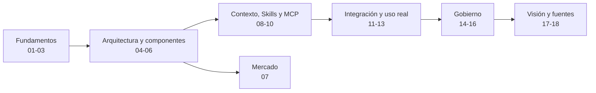

# Antigravity IDE: documentación técnica y de adopción

[Siguiente: 01 · Introducción →](01-introduccion.md)

---

## 1. Descripción del proyecto

Este repositorio documental reúne, en 18 capítulos, todo lo que un equipo de ingeniería necesita para evaluar, adoptar y operar **Google Antigravity** de forma profesional. Cubre desde los fundamentos conceptuales (qué cambia cuando el agente deja de ser un asistente y pasa a ser el actor principal) hasta aspectos operativos: arquitectura, permisos, seguridad, integración con GitHub, gestión de contexto, Skills, MCP, flujos de trabajo y antipatrones.

Antigravity se presentó el 18 de noviembre de 2025 junto con Gemini 3 y, desde mayo de 2026 (Antigravity 2.0, Google I/O), es una **familia de superficies** sobre un mismo agent harness: una aplicación de escritorio para orquestar agentes, el IDE original, una CLI (`agy`), extensiones para otros editores y un SDK. La documentación refleja ese estado y distingue siempre qué superficie se describe.

> **Alcance temporal.** El contenido está redactado con información pública disponible a **noviembre de 2026**. El producto evoluciona con rapidez (versiones, planes, modelos y rutas de configuración cambian). Cada capítulo señala lo que conviene verificar contra la documentación oficial antes de convertirlo en norma interna. Consulta [18 · Referencias](18-referencias.md).

## 2. Cómo está organizada

| Bloque | Capítulos | Pregunta que responde |
|---|---|---|
| Fundamentos | 01–03 | ¿Qué es y por qué cambia el paradigma? |
| Arquitectura | 04–06 | ¿Cómo está construido y qué puede hacer el agente? |
| Mercado | 07 | ¿Cómo se compara con otras herramientas? |
| Ingeniería de contexto | 08–10 | ¿Cómo hago que el agente trabaje bien en mi base de código? |
| Integración | 11–13 | ¿Cómo encaja en GitHub, CI y mi flujo diario? |
| Gobierno | 14–16 | ¿Qué hacer, qué evitar y qué límites existen? |
| Prospectiva | 17–18 | ¿Hacia dónde va y de dónde sale la información? |

## 3. Índice completo

| # | Documento | Contenido principal |
|---|---|---|
| 01 | [Introducción](01-introduccion.md) | IDEs modernos, evolución hacia IDEs agénticos, objetivos |
| 02 | [Antigravity: visión general](02-antigravity-overview.md) | Qué es, ecosistema, App/IDE/CLI/SDK |
| 03 | [Filosofía Agent-First](03-filosofia-agent-first.md) | Paradigma, diferencias con asistentes, impacto organizativo |
| 04 | [Arquitectura](04-arquitectura.md) | Capas, componentes, flujo de ejecución, diagramas |
| 05 | [Componentes](05-componentes.md) | Editor, Agent Panel, Artifacts, Agent Manager, memoria |
| 06 | [Browser y Terminal](06-browser-terminal.md) | Browser Agent, Terminal Agent, autonomía y validación |
| 07 | [Comparativa de IDEs](07-comparativa-ides.md) | VS Code, Cursor, Claude Code, OpenCode, Windsurf |
| 08 | [Gestión de contexto](08-context-management.md) | Context engineering, RAG, documentación, patrones |
| 09 | [Skills](09-skills.md) | Concepto, diseño, ejemplos, antipatrones |
| 10 | [MCP](10-mcp.md) | Arquitectura, integraciones, casos de uso |
| 11 | [Integración con GitHub](11-github-integration.md) | PRs, Actions, flujos empresariales |
| 12 | [Casos de uso](12-casos-uso.md) | Escenarios reales y criterios de idoneidad |
| 13 | [Workflow](13-workflow.md) | Flujo de trabajo extremo a extremo |
| 14 | [Buenas prácticas](14-buenas-practicas.md) | Recomendaciones operativas y de seguridad |
| 15 | [Antipatrones](15-antipatrones.md) | Errores frecuentes y cómo evitarlos |
| 16 | [Limitaciones](16-limitaciones.md) | Límites técnicos, de coste, de seguridad y de madurez |
| 17 | [Futuro](17-futuro.md) | Tendencias y hoja de ruta de adopción |
| 18 | [Referencias](18-referencias.md) | Fuentes, glosario y checklist de verificación |

## 4. Cómo utilizar la documentación

### 4.1 Rutas de lectura recomendadas

| Perfil | Ruta | Tiempo estimado |
|---|---|---|
| Desarrollador que empieza | 01 → 02 → 05 → 13 → 14 | 2 h |
| Tech lead / arquitecto | 03 → 04 → 07 → 08 → 11 → 16 | 3 h |
| Seguridad / cumplimiento | 04 → 06 → 10 → 15 → 16 | 2,5 h |
| Plataforma / DevEx | 08 → 09 → 10 → 11 → 13 | 3 h |
| Dirección técnica | 01 → 03 → 07 → 12 → 17 | 1,5 h |

### 4.2 Convenciones del repositorio

- **Front matter YAML** en todos los ficheros: `title`, `description`, `doc_id`, `version`, `last_updated`, `status`, `audience`, `tags`, `prev`, `next`.
- **Navegación**: cada documento abre y cierra con enlaces relativos a anterior, siguiente y este índice.
- **Diagramas**: Mermaid, renderizables nativamente en GitHub.
- **Avisos**: los bloques `> **Verificar**` marcan afirmaciones sujetas a cambio rápido (versiones, cuotas, rutas).
- **Ejemplos**: los fragmentos de código y configuración son ilustrativos y deben adaptarse a tu entorno; los nombres de rutas se han contrastado con la documentación pública, pero pueden variar entre superficies y versiones.

### 4.3 Terminología fija

| Término | Uso en esta documentación |
|---|---|
| Antigravity App | Aplicación de escritorio 2.0, centro de mando de agentes |
| Antigravity IDE | Editor original (derivado de VS Code) con Agent Manager integrado |
| CLI / `agy` | Cliente de terminal |
| SDK | Biblioteca para orquestar el agente programáticamente |
| Harness | Bucle de agente: modelo, herramientas, permisos, contexto |
| Artifact | Entregable verificable del agente (plan, walkthrough, captura, grabación) |
| Skill | Paquete de instrucciones y recursos cargado bajo demanda |
| MCP | Model Context Protocol, estándar de herramientas externas |

## 5. Mantenimiento

1. Toda modificación pasa por Pull Request con revisión de al menos una persona de plataforma y una de seguridad si toca los capítulos 06, 10, 14, 15 o 16.
2. Actualiza `last_updated` y, si cambia el contenido normativo, incrementa `version` (semver: mayor para cambios de política, menor para ampliaciones, parche para erratas).
3. Revisa trimestralmente la checklist de verificación del [capítulo 18](18-referencias.md#4-checklist-de-verificación-periódica).
4. Cualquier dato volátil (precios, cuotas, versiones) se anota con fecha de consulta.

## 6. Cómo contribuir

- Abre una *issue* con la etiqueta `docs` describiendo el capítulo y la sección.
- Aporta fuente primaria (documentación oficial, *release notes*, informe de seguridad) para cualquier afirmación técnica nueva.
- Mantén el tono: técnico, directo, sin adjetivos promocionales.
- Ejecuta el validador de enlaces locales antes de abrir el PR.

---

[Siguiente: 01 · Introducción →](01-introduccion.md)
