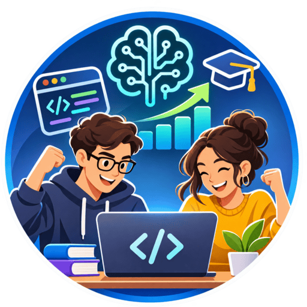

<p align="center">
  
</p>

<h1 align="center">Upgrade IA</h1>

<p align="center">
  <a href="LICENSE.md"></a>
  
  
  
  
</p>

> *Un proyecto de clase para mejorar las competencias informáticas con materiales actuales de IA.*

**Upgrade IA** es un proyecto y espacio de trabajo de clase donde elaboramos,
entre todos, materiales sobre **asistencia de IA en el desarrollo de software**:
qué herramientas existen, cómo se usan y cómo se integran en un flujo de trabajo
real.

Cada tema del temario se investiga, se prueba y se documenta en Markdown. El
resultado es una base de materiales que sirve de referencia para la clase.

## Temario

1. **IDEs**
   - Antigravity
2. **LLMs gratuitos**
   - OpenCode
   - OpenRouter
3. **Agentes**
4. **Skills**
5. **Flujos de trabajo**
6. **Autoaprendizaje**
   - Reflection
   - Harness
7. **Documentación**
   - Markdown
8. **Plugins de Claude Code para OpenCode**

## Qué hay en el repositorio

| Ruta                                       | Contenido                                             |
|--------------------------------------------|-------------------------------------------------------|
| [`markdown/`](markdown/)                   | Curso de Markdown en 63 capítulos numerados (tema 7). |
| [`plugins-claudecode-opencode/`](plugins-claudecode-opencode/) | Plugins de Claude Code y su volcado a OpenCode (tema 8). |
| [`.github/CODEOWNERS`](.github/CODEOWNERS) | Define quién revisa y aprueba los cambios.            |
| [`docs/img/`](docs/img/)                   | Imágenes del repositorio (logo).                      |
| [`LICENSE.md`](LICENSE.md)                 | Licencia MIT.                                         |

## Cómo trabajar en el proyecto

La rama `main` está **protegida**: no se puede subir nada directamente a ella.
Todo cambio entra mediante una **rama de trabajo** y un **pull request (PR)**, y
solo el profesor puede aprobarlo y fusionarlo.

1. **Clona el repositorio** (solo la primera vez):

   ```bash
   git clone https://github.com/profeFPInfor/upgrade-ia.git
   cd upgrade-ia
   ```

2. **Actualiza `main`** antes de empezar:

   ```bash
   git checkout main
   git pull
   ```

3. **Crea tu rama** con un nombre que describa el tema, por ejemplo
   `opencode` o `docs/agentes`:

   ```bash
   git checkout -b nombre-de-tu-rama
   ```

4. **Escribe tu material** en un fichero Markdown (`.md`) y guarda los cambios:

   ```bash
   git add .
   git commit -m "docs: añadir material sobre <tema>"
   ```

5. **Sube tu rama** a GitHub:

   ```bash
   git push -u origin nombre-de-tu-rama
   ```

6. **Abre un pull request** hacia `main` desde la pestaña *Pull requests* de
   GitHub (*New pull request*). Explica en la descripción qué aportas.

7. **Espera la revisión.** El profesor puede pedirte cambios; súbelos a la misma
   rama y el PR se actualiza solo. Cuando lo apruebe, se fusionará en `main`.

## Normas del proyecto

- **Nada de secretos:** no subas claves de API, tokens, contraseñas ni ficheros
  `.env`. Si una clave se sube por error, considérala comprometida y revócala.
- **Nada de datos personales** de ninguna persona en los materiales.
- **Una rama por tema** y un PR por tema, pequeños y fáciles de revisar.
- **Formato Markdown:** usa títulos, listas y bloques de código. Los diagramas,
  en [Mermaid](https://mermaid.js.org/), no en imágenes.
- **Mensajes de commit** con el formato [Conventional Commits](https://www.conventionalcommits.org/es/)
  (`docs:`, `feat:`, `fix:`, `chore:`…).
- **Cita las fuentes** de lo que investigues y comprueba que lo que escribes
  funciona antes de documentarlo.

## Licencia

Material recopilado por los alumnos del CIFP de La Laboral para la asignatura
de Digitalización Avanzada de DAM2. Se distribuye bajo licencia
[MIT](LICENSE.md).
