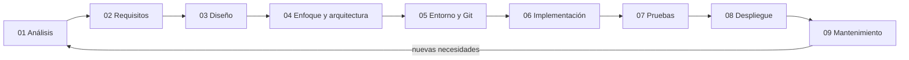
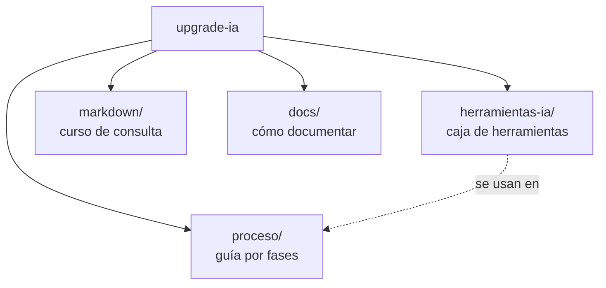

<p align="center">
  
</p>

<h1 align="center">Upgrade IA</h1>

<p align="center">
  <a href="LICENSE.md"></a>
  
  
  
</p>

> *Desarrollo de software multiplataforma asistido con IA.*

## Qué es

**Upgrade IA** es una colección de información, recursos y herramientas para
alumnos de **2º de DAM** (Desarrollo de Aplicaciones Multiplataforma) que quieren
aprender y mejorar como desarrolladores de software con asistencia de IA.

Lo elaboramos entre todos en el taller de la optativa Digitalización Avanzada
del CIFP La Laboral. Cada aportación se documenta en Markdown y queda como
material de consulta para la clase.

## Cómo está planteado

La guía principal es el **proceso de desarrollo de software multiplataforma**,
de la primera idea al mantenimiento. Cada fase tiene su carpeta con la misma
estructura: qué se hace, qué se entrega y cómo ayuda la IA.



Las herramientas de IA se documentan una sola vez y las fases las enlazan cuando
las usan.



## Contenido

| Ruta                                       | Qué hay                                                  |
|--------------------------------------------|----------------------------------------------------------|
| [`proceso/`](proceso/)                     | Las 9 fases del desarrollo multiplataforma.              |
| [`herramientas-ia/`](herramientas-ia/)     | Herramientas de IA, empezando por OpenCode.              |
| [`markdown/`](markdown/)                   | Curso de Markdown en 63 capítulos numerados.             |
| [`docs/`](docs/)                           | Estándar de trabajo para documentar y aportar.           |
| [`assets/img/`](assets/img/)               | Imágenes del repositorio.                                |
| [`.github/CODEOWNERS`](.github/CODEOWNERS) | Quién revisa y aprueba los cambios.                      |
| [`LICENSE.md`](LICENSE.md)                 | Licencia MIT.                                            |

## Estructura de `proceso/` y `herramientas-ia/`

```text
proceso/
├── 01-analisis/                       Análisis y estado del arte (SOTA)
├── 02-requisitos/
├── 03-diseno/
├── 04-enfoque-y-arquitectura/
├── 05-entorno-y-control-de-versiones/
├── 06-implementacion/
├── 07-pruebas/
├── 08-despliegue/
└── 09-mantenimiento-y-documentacion/

herramientas-ia/
└── opencode/                          Agente de programación con el que se trabaja
```

Cada fase de `proceso/` tiene su `README.md` con la misma estructura. Las
herramientas de `herramientas-ia/` se documentan una sola vez y las fases las enlazan.

## Cómo participar

Antes de aportar, lee la guía de trabajo: [docs/README.md](docs/README.md).

## Licencia

Material recopilado por los alumnos del CIFP de La Laboral para la asignatura
de Digitalización Avanzada de DAM2. Se distribuye bajo licencia
[MIT](LICENSE.md).
