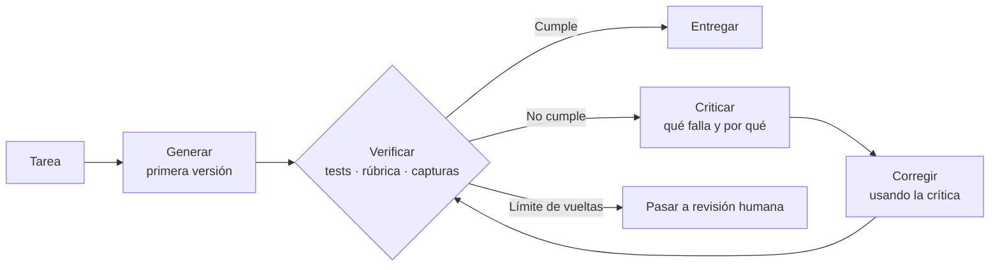
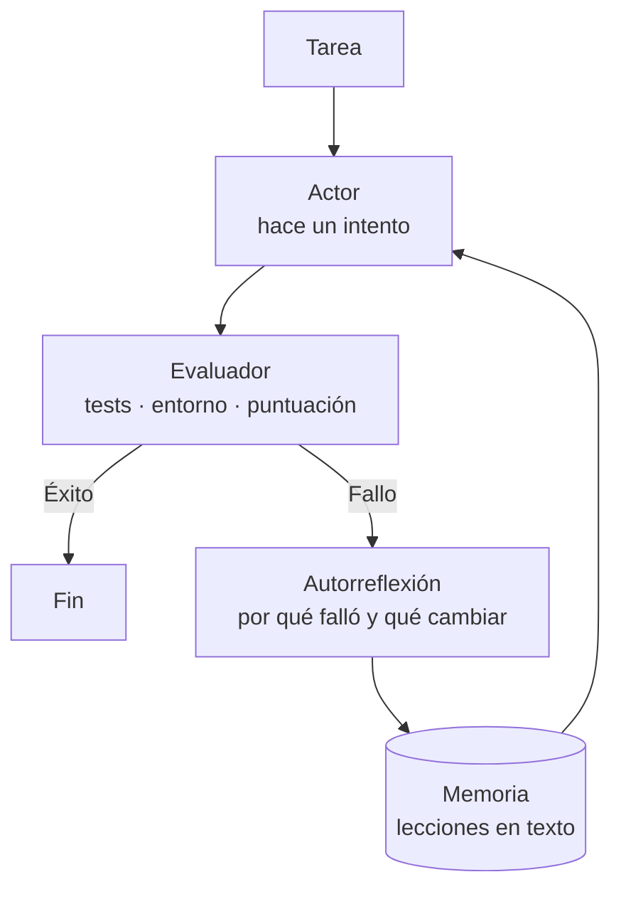
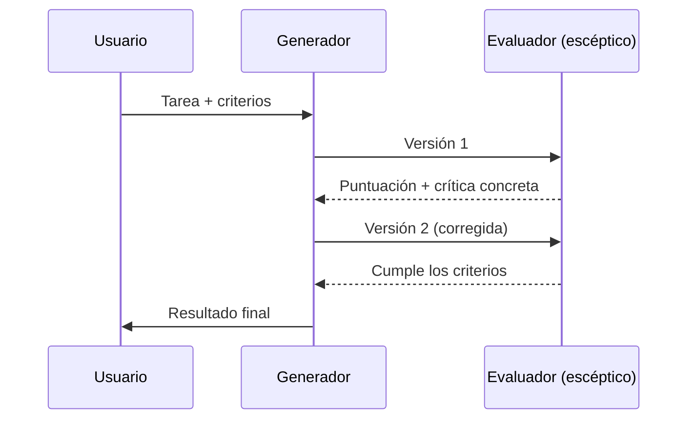
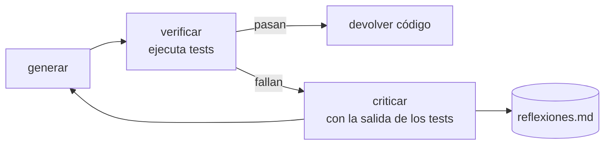
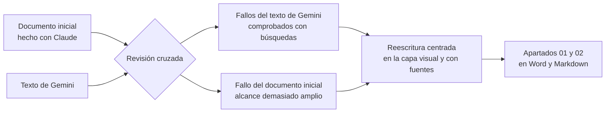
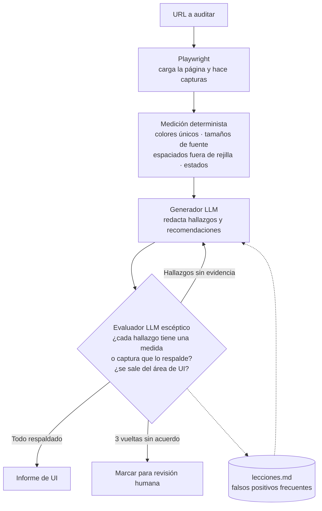

# Reflection en IA: cómo hacer que un modelo revise y corrija su propio trabajo

| | |
|---|---|
| **Autor** | Álvaro Blanco Marcos |
| **Ciclo** | 2.º DAM · CIFP La Laboral |
| **Tema** | Flujos de aprendizaje sobre usos con IA · Punto 6: autoaprendizaje y *reflection* |
| **Fecha** | Octubre de 2026 |
| **Archivos** | `reflection-ia.md` (este documento) · `reflection_loop.py` (ejemplo ejecutable, también en el [Anexo A](#anexo-a-código-completo-de-reflection_looppy)) |

---

## Índice

1. [Resumen](#1-resumen)
2. [Qué es la reflection](#2-qué-es-la-reflection)
3. [Por qué funciona: los datos](#3-por-qué-funciona-los-datos)
4. [Anatomía del bucle](#4-anatomía-del-bucle)
5. [Variantes de la técnica](#5-variantes-de-la-técnica)
6. [Límites y riesgos](#6-límites-y-riesgos)
7. [Cuándo usarla y cuándo no](#7-cuándo-usarla-y-cuándo-no)
8. [Cómo aplicarla en la práctica](#8-cómo-aplicarla-en-la-práctica)
9. [Caso práctico: el auditor de UI](#9-caso-práctico-el-auditor-de-ui)
10. [Relación con el resto del esquema](#10-relación-con-el-resto-del-esquema)
11. [Demostración en clase](#11-demostración-en-clase)
12. [Guion para la exposición](#12-guion-para-la-exposición)
13. [Preguntas frecuentes](#13-preguntas-frecuentes)
14. [Glosario](#14-glosario)
15. [Bibliografía](#15-bibliografía)
- [Anexo A: código completo de `reflection_loop.py`](#anexo-a-código-completo-de-reflection_looppy)

---

## 1. Resumen

La **reflection** (reflexión) es un patrón de diseño de agentes de IA en el que el modelo **no da por buena su primera respuesta**: la genera, la revisa (o la revisa otro modelo), detecta fallos y la corrige. El ciclo se repite hasta cumplir unos criterios o hasta llegar a un número máximo de vueltas.

Ideas clave del documento:

- Es uno de los **cuatro patrones agénticos** que popularizó Andrew Ng en 2024, junto con el uso de herramientas, la planificación y la colaboración entre varios agentes.
- Funciona muy bien en **código y textos** cuando hay **algo externo con lo que comparar**: tests, un compilador, una captura de pantalla, una búsqueda web o una rúbrica clara.
- Sin esa señal externa, la autocrítica es poco fiable: los modelos tienden a **darse la razón a sí mismos** y, en tareas de razonamiento, pueden incluso empeorar.
- La versión más robusta separa los papeles: **un agente genera y otro, configurado para ser exigente, evalúa**.
- Tiene un coste: más llamadas, más tokens y más tiempo. Merece la pena cuando el resultado mejora de forma medible.

> **Regla de oro:** una reflection vale lo que vale su verificación. Si la crítica no se apoya en algo comprobable, el bucle puede girar sin mejorar nada.

---

## 2. Qué es la reflection

### 2.1 Definición

Un LLM normal funciona "de un tirón": recibe una petición y escribe la respuesta palabra a palabra, sin volver atrás. Andrew Ng lo compara con pedirle a alguien que escriba una redacción entera del tirón, sin poder borrar, y esperar que salga perfecta (Ng, 2024a).

La reflection automatiza lo que haría una persona con un borrador:

1. **Generar** una primera versión.
2. **Revisarla**: buscar errores, cosas que faltan, partes mejorables.
3. **Corregirla** usando esa revisión.
4. **Repetir** si hace falta.

Ng la describe como automatizar el paso en el que tú le dices a ChatGPT, Claude o Gemini "esto está mal, mejóralo": en vez de dar tú la crítica, se la pide el propio sistema al modelo (Ng, 2024b).

### 2.2 Ejemplo mínimo

Tarea: *"Escribe una función que calcule la letra del DNI"*.

| Paso | Qué ocurre |
|---|---|
| Generación | El modelo escribe `return "TRWAGMYFPDXBNJZSQVHLCKE"[numero % 23]`. |
| Verificación | Se ejecutan los tests: `letra_dni(-1)` devuelve `"E"` en vez de dar error, y `letra_dni("12345678")` lanza un `TypeError` que no es el esperado. |
| Crítica | "No validas el tipo ni el rango. Un número negativo o de más de 8 cifras debería lanzar `ValueError`." |
| Corrección | El modelo añade las validaciones. |
| Verificación | Todos los tests pasan. Fin del bucle. |

Este ejemplo exacto se puede ejecutar con el script del [Anexo A](#anexo-a-código-completo-de-reflection_looppy).

### 2.3 Términos que no hay que confundir

| Término | Qué es | ¿Tiene que ver? |
|---|---|---|
| **Reflection (patrón agéntico)** | El bucle generar → criticar → corregir de este documento. | Sí, es el tema. |
| **Reflexion** (con *x*) | Un método concreto publicado en 2023 que añade **memoria** de los fallos entre intentos (Shinn et al., 2023). | Sí, es una variante (apartado 5.4). |
| **Reflection en Java** (`java.lang.reflect`) | API para inspeccionar clases, métodos y atributos en tiempo de ejecución. | **No.** Mismo nombre, concepto distinto. |
| **Agente reactivo** (*simple reflex agent*) | Agente de la IA clásica que actúa con reglas condición-acción, sin memoria ni revisión. | **No.** "Reflex" (reflejo) no es "reflection" (reflexión). |
| **Reflection 70B** | Un modelo publicado en 2024 cuyos resultados no se pudieron reproducir (apartado 6.5). | Solo como aviso. |

---

## 3. Por qué funciona: los datos

### 3.1 El gráfico de Andrew Ng (marzo de 2024)

En su carta del 20 de marzo de 2024, Andrew Ng recopiló resultados de varios equipos en **HumanEval**, un banco de pruebas de programación (Ng, 2024a):

| Configuración | Problemas resueltos |
|---|---|
| GPT-3.5, respuesta directa | 48,1 % |
| GPT-4, respuesta directa | 67,0 % |
| GPT-3.5 dentro de un bucle agéntico | hasta 95,1 % |

La conclusión de Ng fue que **iterar sobre el resultado aportaba más que pasar a un modelo más grande**. Ojo: ese 95,1 % corresponde a bucles agénticos en general (reflexión, ejecución de tests, etc.), no solo a la reflection.

Una semana después dedicó una carta entera a la reflection. Contaba que es un patrón **rápido de implementar** y que, en algunas de sus aplicaciones, le había dado mejoras sorprendentes (Ng, 2024b).

### 3.2 Resultados de la investigación

| Trabajo | Resultado principal |
|---|---|
| **Reflexion** (Shinn et al., 2023) | 91 % en HumanEval (*pass@1*), frente al 80 % de GPT-4 respondiendo directamente. También mejoró 22 puntos en tareas de decisión (AlfWorld) y 20 en preguntas de razonamiento (HotPotQA). |
| **Self-Refine** (Madaan et al., 2023) | En 7 tareas distintas (diálogo, código, matemáticas, reescritura…), las respuestas refinadas fueron preferidas por personas y métricas, con una mejora media de unos 20 puntos absolutos. Sin entrenamiento extra: un único modelo genera, critica y corrige. |
| **Self-Debugging** (Chen et al., 2024) | Cuando hay tests unitarios, mejora la precisión hasta un 12 %. Sin tests, el modelo puede depurar explicando su propio código en lenguaje natural, al estilo del "patito de goma", con mejoras más pequeñas (2-3 %). |
| **CRITIC** (Gou et al., 2024) | El modelo verifica su respuesta con herramientas externas (buscador, intérprete de código) y la corrige. Mejora de forma consistente y los autores insisten en que la clave es el **feedback externo**. |

### 3.3 Por qué tiene sentido

- **Generar y evaluar son tareas distintas.** Igual que es más fácil corregir un examen que hacerlo, a un modelo le resulta más fácil encontrar un fallo concreto que acertar todo a la primera.
- **La crítica da contexto nuevo.** En la segunda vuelta el modelo ya sabe qué falló. No vuelve a empezar de cero.
- **Los errores se localizan.** Un test que falla dice exactamente dónde está el problema. Un estudio de 2023 mostró que a los modelos les cuesta **encontrar** sus errores de razonamiento, pero los **corrigen bien** cuando se les indica dónde están (Tyen et al., 2023). Por eso funcionan tan bien los tests y otras verificaciones externas.

---

## 4. Anatomía del bucle

### 4.1 Diagrama general



### 4.2 Las piezas

| Pieza | Función | Buenas prácticas |
|---|---|---|
| **Generador** | Produce la primera versión y las correcciones. | Darle la tarea completa y, en las correcciones, su versión anterior más la crítica. |
| **Verificador** | Comprueba de forma objetiva si el resultado cumple. | Tests, compilador, *linter*, capturas de pantalla, búsqueda web, validación de esquemas. Es la pieza que más valor aporta. |
| **Crítico** | Explica qué falla y cómo arreglarlo. | Crítica **concreta y accionable**, no genérica. Self-Refine mostró que el feedback específico supera al genérico, y este al feedback nulo (Madaan et al., 2023). |
| **Criterio de parada** | Decide cuándo terminar. | Doble condición: "cumple los criterios" **o** "se alcanzó el máximo de vueltas". Anthropic señala que es habitual añadir condiciones de parada, como un número máximo de iteraciones, para mantener el control (Schluntz y Zhang, 2024). |
| **Memoria** (opcional) | Guarda lecciones para los siguientes intentos. | Un archivo de texto o Markdown con lo aprendido. Es la base de Reflexion. |

### 4.3 Cuántas vueltas

- La mejora es **decreciente**: la primera corrección suele aportar lo más importante y las siguientes, cada vez menos (Madaan et al., 2023).
- En la guía de buenas prácticas de Claude Code se indica que, en interfaces, **2 o 3 iteraciones** suelen dar un resultado bastante mejor que el primero (Cherny, 2025).
- En tareas de diseño muy abiertas, Anthropic llegó a usar de 5 a 15 vueltas, y aun así a veces una versión intermedia era mejor que la última (Rajasekaran, 2026).

**Recomendación práctica:** empezar con un máximo de 3 vueltas y medir si merece la pena subir.

---

## 5. Variantes de la técnica

### 5.1 Resumen comparativo

| Variante | Año | Quién critica | Señal externa | Idea clave | Mejor para |
|---|---|---|---|---|---|
| **Autorreflexión simple** (Self-Refine) | 2023 | El mismo modelo | No | Generar, criticarse y corregir con el mismo LLM | Textos, estilo, legibilidad de código |
| **Reflexión con herramientas** (CRITIC, Self-Debugging) | 2023-2024 | El mismo modelo, ayudado por herramientas | Sí | La crítica se apoya en tests, ejecución o búsquedas | Código, datos y hechos verificables |
| **Generador + evaluador** (*evaluator-optimizer*) | 2024 | Otro agente u otro modelo | Opcional | Separar quien hace de quien juzga | Tareas con criterios claros; diseño |
| **Reflexion** (con memoria) | 2023 | El mismo modelo | Sí | Escribir las lecciones de cada fallo y releerlas en el siguiente intento | Tareas repetidas, agentes de larga duración |
| **Reflexión entrenada en el modelo** | 2022-2025 | El modelo, por dentro | Durante el entrenamiento | El hábito de revisar se aprende en el entrenamiento | Uso transparente: ya viene de serie |

### 5.2 Autorreflexión simple (Self-Refine)

Un único modelo hace los tres papeles: genera, da feedback sobre su salida y la refina. No necesita datos de entrenamiento ni otro modelo (Madaan et al., 2023).

- **Ventaja:** es la más fácil de montar. Bastan dos o tres *prompts*.
- **Pega:** el modelo se evalúa a sí mismo, con el sesgo que eso supone (apartado 6.2).

### 5.3 Reflexión con herramientas (CRITIC y Self-Debugging)

La crítica se basa en evidencias externas: el resultado de ejecutar el código, los mensajes de error, una búsqueda en Internet. Es lo que hace un programador: no se fía de que el código "parece correcto", lo ejecuta.

Ng ya lo mencionaba como el paso siguiente a la autorreflexión: darle al modelo herramientas para evaluar su salida, como **pasar tests unitarios** o **buscar en la web** para contrastar un texto (Ng, 2024b).

### 5.4 Reflexion: reflexión con memoria

Propuesta por Shinn y otros en 2023 y presentada en NeurIPS. Tiene tres componentes:



La idea original: en vez de reentrenar el modelo (caro y lento), se le **refuerza con palabras**. Cada fallo se convierte en un pequeño texto de "qué salió mal y qué haré distinto", que se guarda y se añade al contexto del siguiente intento. Los autores lo llaman *verbal reinforcement learning*, aprendizaje por refuerzo verbal (Shinn et al., 2023).

Esta variante conecta directamente con el **autoaprendizaje** del punto 6 del esquema: el agente "aprende" sin cambiar sus pesos, solo acumulando lecciones escritas.

### 5.5 Generador + evaluador (dos agentes)

Anthropic llama a este patrón **evaluator-optimizer**: una llamada al modelo genera la respuesta y otra la evalúa y da feedback, en bucle (Schluntz y Zhang, 2024).



Según Anthropic, este patrón encaja cuando se dan **dos señales**:

1. Las respuestas mejoran claramente cuando una persona da su opinión.
2. El modelo es capaz de dar ese mismo tipo de opinión.

Ng también recomendaba esta forma: un agente que genera y otro que critica, porque la "conversación" entre ambos mejora el resultado (Ng, 2024b).

**Por qué separar los papeles funciona mejor:** en un experimento de 2026, Anthropic observó que, cuando se le pide a un agente que evalúe su propio trabajo, tiende a elogiarlo con seguridad aunque la calidad sea mediocre. Configurar un evaluador independiente para que sea **escéptico** resultó mucho más fácil que conseguir que el generador fuera crítico consigo mismo (Rajasekaran, 2026).

### 5.6 Reflexión entrenada dentro del modelo

Algunas técnicas meten la reflexión en el propio entrenamiento:

- **Constitutional AI** (Anthropic, 2022): el modelo critica y reescribe sus respuestas según una lista de principios (la "constitución"). Esas versiones corregidas sirven después para entrenarlo (Bai et al., 2022).
- **Self-RAG** (2023): el modelo aprende a generar unos *tokens* especiales de reflexión con los que decide si necesita buscar información y comprueba si su respuesta está respaldada por lo que ha encontrado (Asai et al., 2024).
- **Modelos de razonamiento** (2024-2025): modelos como DeepSeek-R1 se entrenan con aprendizaje por refuerzo en tareas verificables. Durante ese entrenamiento aparecieron solos comportamientos de autorreflexión y autoverificación: el modelo se para a mitad de un problema, detecta que va mal y cambia de enfoque. Los autores lo llamaron el momento *"aha"* (DeepSeek-AI, 2025).

**Consecuencia práctica:** los modelos actuales con "pensamiento extendido" ya reflexionan algo por dentro antes de responder. Aun así, **no sustituye a la verificación externa**: un modelo que piensa mucho sigue sin poder ejecutar tus tests si no le das la herramienta.

---

## 6. Límites y riesgos

Esta es la parte que más se suele olvidar, y la más importante para usar bien la técnica.

### 6.1 Sin verificación externa, la autocorrección es poco fiable

En 2023, un equipo de Google DeepMind y la Universidad de Illinois estudió la **autocorrección intrínseca**: el modelo revisa su respuesta solo con sus propias capacidades, sin ninguna ayuda externa. En tareas de razonamiento, los modelos **no conseguían corregirse**, y en algunos casos su rendimiento **empeoraba** después de "corregir" (Huang et al., 2024).

El propio trabajo de Self-Refine lo confirma: en problemas de matemáticas la mejora fue prácticamente nula, porque el modelo daba casi siempre por buena su solución. Según el artículo, en el 94 % de los casos el feedback era del tipo "todo está bien". Cuando se le daba una señal externa de si la respuesta era correcta, sí mejoraba (Madaan et al., 2023).

Además, en experimentos como los de Reflexion, el bucle sabe cuándo parar porque **hay tests que dicen si la respuesta es correcta**. Esa señal no siempre existe en el mundo real (Tyen et al., 2023).

### 6.2 El modelo se da la razón a sí mismo (sesgo de autopreferencia)

Un estudio presentado en NeurIPS 2024 encontró que los LLM que actúan como evaluadores **puntúan mejor sus propios textos** que los de otros modelos o personas, aunque las personas los consideren de igual calidad. Además, cuanto mejor reconoce un modelo que un texto es suyo, más fuerte es ese sesgo (Panickssery et al., 2024).

**Cómo mitigarlo:**

- Usar un **modelo distinto** como crítico (por ejemplo, generar con uno y revisar con otro).
- Usar el mismo modelo pero en un **contexto limpio**: otra sesión, otro agente, sin ver cómo se generó.
- Dar al crítico una **rúbrica** con criterios concretos y ejemplos de lo que es bueno y malo.
- Pedirle explícitamente que sea **escéptico**.

### 6.3 El evaluador también se equivoca

Incluso un evaluador separado necesita ajuste. En el experimento de Anthropic de 2026, el agente de control de calidad a veces **detectaba un fallo real y luego se convencía de que no era importante**, y aprobaba el trabajo. También probaba de forma superficial y se le escapaban errores sutiles. Hicieron falta varias rondas leyendo sus registros y corrigiendo sus instrucciones hasta que evaluó de forma razonable (Rajasekaran, 2026).

### 6.4 Coste, tiempo y complejidad

- Cada vuelta son más llamadas al modelo: **más tokens, más dinero y más espera**.
- En ese mismo experimento, la versión con planificador, generador y evaluador tardó unas 6 horas y costó unos 200 dólares, frente a 20 minutos y 9 dólares de un solo agente. La diferencia de calidad fue clara: en la versión simple, la función principal de la aplicación directamente no funcionaba (Rajasekaran, 2026).
- La misma investigación concluye que el evaluador **compensa cuando la tarea está en el límite** de lo que el modelo hace bien solo. Si la tarea es fácil para el modelo, el evaluador es un gasto innecesario.
- Anthropic insiste en buscar **la solución más simple posible** y añadir complejidad solo cuando mejora los resultados de forma demostrable (Schluntz y Zhang, 2024).

### 6.5 Otros riesgos

| Riesgo | Ejemplo | Cómo evitarlo |
|---|---|---|
| **Sobreajuste a los tests** | El código pasa los tests pero no resuelve el problema real (por ejemplo, devuelve valores fijos). | Revisar con un agente independiente que compruebe que la solución no está "hecha para los tests" (Cherny, 2025). Revisión humana. |
| **"Corregir" lo que estaba bien** | El crítico inventa un problema y el generador estropea una versión correcta. | Exigir que cada crítica cite una evidencia (test, línea, dato). Conservar la mejor versión, no solo la última. |
| **Bucle infinito** | El crítico nunca queda satisfecho. | Límite de vueltas obligatorio. |
| **Crítica genérica** | "Podría mejorarse la legibilidad". | Pedir críticas concretas y numeradas, con propuesta de solución. |
| **Ejecutar código generado** | El código del LLM borra archivos o se queda colgado. | Ejecutarlo en un proceso aparte, con tiempo límite y, mejor aún, en un contenedor. |
| **Creer las cifras sin comprobarlas** | En septiembre de 2024 se presentó Reflection 70B, un modelo abierto que prometía superar a los mejores modelos gracias a la "reflexión". Evaluadores independientes no consiguieron reproducir los resultados y su autor acabó pidiendo disculpas (Davison, 2024). | Desconfiar de resultados que nadie ha reproducido. Probar con tus propios casos. |

---

## 7. Cuándo usarla y cuándo no

### 7.1 Tabla de decisión

| Situación | ¿Usar reflection? | Motivo |
|---|---|---|
| Generar código que se puede probar con tests | **Sí** | Hay verificación objetiva. Es el caso ideal. |
| Maquetar una interfaz a partir de un diseño | **Sí** | Se puede comparar con capturas de pantalla. |
| Redactar documentación con datos y fuentes | **Sí** | La crítica puede comprobar fuentes y datos con búsquedas. |
| Traducciones o textos con criterios de estilo claros | **Sí** | Anthropic pone la traducción literaria como ejemplo de buen encaje. |
| Problemas de lógica o matemáticas sin forma de comprobarlos | **Con cuidado** | La autocorrección sin feedback externo puede empeorar el resultado. |
| Preguntas simples o datos que el modelo ya sabe | **No** | Solo añade coste y espera. |
| Tareas donde no se sabe qué es "bueno" | **No** | Si no hay criterios, el evaluador da vueltas sin rumbo. |

### 7.2 Lista de comprobación antes de montarla

- [ ] ¿Tengo una forma objetiva de saber si el resultado es correcto (tests, capturas, rúbrica, fuentes)?
- [ ] ¿La crítica será concreta y accionable?
- [ ] ¿El crítico está separado del generador (otra sesión, otro agente u otro modelo)?
- [ ] ¿Hay un límite de vueltas?
- [ ] ¿Guardo la **mejor** versión, no solo la última?
- [ ] ¿He medido que mejora respecto a hacerlo en una sola pasada?
- [ ] ¿Revisa una persona el resultado final antes de darlo por bueno?

---

## 8. Cómo aplicarla en la práctica

### 8.1 En un chat normal (sin programar nada)

Se puede hacer a mano con tres mensajes.

**Paso 1. Generar.** La petición normal.

**Paso 2. Criticar** (mejor en una conversación nueva o con otro modelo):

```text
Actúa como revisor exigente. Revisa el siguiente [código / texto] para la tarea: [tarea].

Evalúa estos criterios del 1 al 5 y justifica cada nota:
1. Corrección: ¿hace lo que se pide? ¿Hay errores?
2. Casos límite: ¿qué entradas lo rompen?
3. Claridad: ¿se entiende sin explicaciones?
4. [Criterio propio de la tarea]

Después, lista los problemas en orden de gravedad. Para cada uno indica
dónde está, por qué es un problema y cómo arreglarlo.
No reescribas el [código / texto]. Si algo está bien, dilo; no inventes problemas.

[pegar aquí el resultado]
```

**Paso 3. Corregir** (en la conversación original):

```text
Un revisor ha encontrado estos problemas en tu versión:
[pegar la crítica]

Corrige solo lo que sea un problema real. Si no estás de acuerdo con algún
punto, explica por qué. Devuelve la versión completa corregida.
```

La última frase es importante: le da al generador la opción de **rechazar críticas erróneas** en vez de obedecer a ciegas.

### 8.2 Con agentes de programación (Claude Code, OpenCode, Antigravity…)

Los agentes de programación ya trabajan en bucle: escriben, ejecutan, ven el error y corrigen. La clave es **darles con qué comparar**. La guía de buenas prácticas de Claude Code lo resume así: el agente rinde mejor cuando tiene un objetivo claro contra el que iterar, como un test, un diseño o un resultado esperado (Cherny, 2025).

**Técnicas concretas:**

| Técnica | Cómo se hace |
|---|---|
| **Tests primero (TDD)** | 1) Pedir que escriba los tests y comprobar que fallan. 2) Guardarlos con un *commit*. 3) Pedir el código, sin tocar los tests, e iterar hasta que pasen. |
| **Captura y comparación** | Darle una forma de hacer capturas del navegador (por ejemplo, Playwright) y un diseño de referencia. Pedirle que implemente, capture, compare y corrija. |
| **Revisión en contexto limpio** | Que un agente escriba el código y **otro distinto lo revise** (otra terminal, `/clear` o un subagente). Después, un tercero aplica la crítica. Así se evita que el revisor esté "enamorado" de su propio trabajo. |
| **Comprobar el sobreajuste** | Pedir a un subagente independiente que verifique que la solución no está hecha solo para pasar los tests. |
| **Regla permanente** | Escribir en el `CLAUDE.md` o `AGENTS.md` del proyecto que nunca dé una tarea por terminada sin verificarla. |

**Ejemplo de reglas en `AGENTS.md` / `CLAUDE.md`:**

```markdown
## Verificación (obligatorio)
- Antes de dar una tarea por terminada, ejecuta `mvn test` y comprueba que no falla ningún test.
- Si tocas la interfaz, haz una captura y compárala con el diseño de `docs/diseno/`.
- No modifiques tests para que pasen. Si un test parece incorrecto, avísame.

## Revisión
- Para cambios grandes, pide a un subagente revisor que lea el diff sin ver
  esta conversación y que liste problemas concretos con archivo y línea.

## Lecciones aprendidas
- Cuando un error te cueste más de un intento, añade una línea a `docs/lecciones.md`
  con la causa y cómo evitarlo. Léelo al empezar cada sesión.
```

La última sección convierte el proyecto en un pequeño **Reflexion**: las lecciones quedan escritas en Markdown y el agente las relee en la siguiente sesión.

### 8.3 Programando el bucle (Python)

El script `reflection_loop.py` del [Anexo A](#anexo-a-código-completo-de-reflection_looppy) implementa la variante más útil: **reflexión con verificación externa y memoria**.



- **`generar()`**: pide el código al modelo. En las vueltas siguientes le pasa su versión anterior, la crítica y las lecciones guardadas.
- **`verificar()`**: ejecuta los tests unitarios en un proceso aparte con tiempo límite. Es la "verdad externa".
- **`criticar()`**: un *prompt* distinto, de revisor exigente, recibe el código **y la salida real de los tests**. Así la crítica no es una opinión, sino que parte de fallos concretos.
- **`guardar_leccion()`**: añade cada crítica a `reflexiones.md`. En la siguiente ejecución se leen como memoria.
- **`MAX_ITERACIONES = 3`**: condición de parada.

Tiene dos modos:

```bash
# Sin API ni coste: un LLM simulado enseña el flujo completo
python reflection_loop.py --demo

# Con un modelo real gratuito a través de OpenRouter
export OPENROUTER_API_KEY="tu_clave"
export MODELO="openrouter/free"        # opcional: es el valor por defecto
python reflection_loop.py
```

`openrouter/free` es el enrutador de OpenRouter que elige entre los modelos gratuitos disponibles. También se puede fijar uno concreto con el sufijo `:free`. Los modelos gratuitos tienen límites de uso más bajos y su disponibilidad varía ([documentación de OpenRouter](https://openrouter.ai/docs/guides/routing/routers/free-router.md)).

Salida real del modo `--demo`:

```text
--- Iteración 1: tests FALLAN ---
def letra_dni(numero):
    return 'TRWAGMYFPDXBNJZSQVHLCKE'[numero % 23]

Crítica:
1. No se valida el tipo: un str como '12345678' debería lanzar ValueError.
2. No se comprueban negativos ni números de más de 8 cifras.
3. Propuesta: validar con isinstance(numero, int) y 0 <= numero <= 99_999_999 antes de calcular.

--- Iteración 2: tests OK ---
def letra_dni(numero):
    if not isinstance(numero, int) or isinstance(numero, bool):
        raise ValueError('El número debe ser un entero')
    if not 0 <= numero <= 99_999_999:
        raise ValueError('El número debe tener como máximo 8 cifras y no ser negativo')
    return 'TRWAGMYFPDXBNJZSQVHLCKE'[numero % 23]
```

### 8.4 Con frameworks

- **LangGraph** tiene un paquete, `langgraph-reflection`, que combina un agente principal con un agente crítico: si el crítico encuentra algo, el principal vuelve a trabajar; si no, termina ([PyPI](https://pypi.org/project/langgraph-reflection/)). El blog de LangChain explica tres variantes: reflexión simple, Reflexion y LATS, y advierte que si la reflexión no se apoya en nada externo, el resultado puede no mejorar mucho (LangChain, 2024).
- **Claude Agent SDK**: Anthropic lo usó para su experimento de generador y evaluador (Rajasekaran, 2026).

Aun así, Anthropic recomienda **empezar llamando directamente a la API**, porque muchos de estos patrones se implementan en pocas líneas y los frameworks pueden ocultar qué está pasando por debajo (Schluntz y Zhang, 2024). El script del Anexo A sigue ese consejo: no usa ninguna librería externa.

---

## 9. Caso práctico: el auditor de UI

> Este apartado cuenta cómo apliqué la reflection en el trabajo del auditor de la optativa Digitalización avanzada. Los puntos 9.2 y 9.3 son lo que hice; el 9.4 es una propuesta para la siguiente fase.

### 9.1 Contexto

- **Proyecto:** un auditor de páginas web con IA, en grupos. A mi grupo le tocó el área de **UI**, es decir, la capa visual: rejilla, tipografía, color, componentes, estados y animaciones. Otros dos grupos se encargan de la experiencia de usuario (UX) y de la accesibilidad (WCAG).
- **Entregables de mi grupo:** apartado 01 (estándares y referentes) y apartado 02 (estado del arte).
- **Plan técnico:** pasar la documentación a Markdown para que un agente de programación (Claude Code) construya el auditor a partir de ella, con TypeScript, Vue y Playwright, desplegado en mi VPS. Esta decisión de tecnología está pendiente de confirmar con el profesor.

### 9.2 Revisión cruzada entre dos modelos durante la documentación

Para los apartados 01 y 02 trabajé con dos modelos. Primero redacté el documento con **Claude**. Después conseguí un texto de **Gemini** que explicaba qué es una auditoría de UI. En vez de quedarme con uno de los dos, los crucé: **cada texto sirvió de crítica del otro**, y Claude comprobó los datos dudosos con búsquedas web.

Es la variante de **generador + evaluador con verificación externa** (apartados 5.3 y 5.5), y además con dos modelos distintos, lo que reduce el sesgo de autopreferencia (apartado 6.2).



**Lo que encontró la crítica en el texto de Gemini:**

| Problema | Por qué era un problema | Corrección |
|---|---|---|
| No citaba ninguna fuente. | El trabajo pide referencias, igual que el repositorio de ejemplo del profesor. | Se añadieron fuentes a cada estándar y herramienta. |
| Presentaba la rejilla de 8 px como "el estándar indiscutible". | Es una **convención** de la industria, no una norma. | Se separaron estándares formales (ISO, especificaciones del W3C) y convenciones. |
| Justificaba la rejilla de 8 px diciendo que los anchos de móvil de 375 y 414 px son divisibles entre 8. | **Falso**: 375 / 8 = 46,875 y 414 / 8 = 51,75. | Se eliminó el argumento. |
| Decía que los *design tokens* eran un consorcio del W3C. | Es un **grupo comunitario** (*Community Group*), no un estándar oficial del W3C. | Se corrigió y se citó su especificación estable de octubre de 2025. |
| Citaba el efecto "Reveal Highlight" de Microsoft. | Era del Fluent antiguo de Windows 10 y **ya no está en Fluent 2**. | Se quitó por desfasado. |

**Lo que encontró el texto de Gemini en mi documento:** Gemini definía la UI de forma más estricta, solo como la capa visual. Comparando, se vio que mi versión mezclaba UI, UX y accesibilidad, y que el mayor peso lo llevaba la accesibilidad. Como en clase hay otros dos grupos con UX y WCAG, nos habríamos pisado. Se rehízo todo centrado en la capa visual, con una tabla de fronteras entre grupos, y se aprovechó lo bueno de Gemini (la parte visual, que en mi versión estaba floja), ya corregido y con fuentes.

**Lo que aprendí:** el texto de Gemini sonaba seguro y profesional, pero tenía un error matemático, un dato desfasado y una afirmación falsa sobre el W3C. Ninguno se ve leyendo por encima. Y mi propio documento tenía un problema de enfoque que yo no había visto. Los fallos aparecieron al **cruzar** los dos textos y **comprobar** los datos, no al releer cada uno por separado. Es lo que dice la investigación: la reflexión funciona cuando la crítica viene de fuera y se apoya en algo verificable.

### 9.3 Verificación visual del entregable

El documento Word se generó por programa a partir de la plantilla del profesor. Antes de darlo por terminado se aplicó un segundo bucle de verificación:

1. **Validar** el archivo con un validador de formato Word.
2. **Renderizarlo** a PDF y convertir las páginas a imágenes.
3. **Revisar visualmente** las imágenes: tablas, saltos de página, índice.
4. **Corregir** lo que fallaba (por ejemplo, el índice) y volver a generar.

Es el flujo "generar, capturar, comparar y corregir" que recomienda la guía de Claude Code para interfaces (apartado 8.2), aplicado a un documento.

### 9.4 Propuesta: reflection dentro del propio auditor

Cuando el auditor esté hecho, la IA tendrá que redactar hallazgos sobre la interfaz de una web. Ahí hay un riesgo claro: que el modelo **invente problemas** o dé opiniones de diseño sin base. La propuesta es montar un bucle de generador y evaluador anclado en **medidas reales**.



**Decisiones de diseño:**

| Decisión | Justificación |
|---|---|
| **Primero se mide, luego se opina.** Las métricas las calcula código normal, no la IA. | Da al evaluador una "verdad externa" con la que contrastar, como los tests en el código (apartado 6.1). |
| **El evaluador es otro *prompt* (o modelo) configurado para ser escéptico.** | Separar quien genera de quien juzga es más eficaz que pedir autocrítica (apartado 5.5). |
| **Rúbrica fija para el evaluador:** evidencia, área correcta (UI y no UX o WCAG), gravedad bien asignada, recomendación accionable. | Los criterios concretos convierten un juicio subjetivo en algo evaluable. Anthropic lo hizo así para evaluar diseño (Rajasekaran, 2026). |
| **El evaluador puede navegar la página con Playwright**, no solo leer una captura. | En el experimento de Anthropic, el evaluador interactuaba con la página en vivo antes de puntuar, lo que permitió críticas más detalladas (Rajasekaran, 2026). |
| **Máximo 3 vueltas**; si no hay acuerdo, revisión humana. | Controla el coste y evita bucles infinitos (apartado 6.4). |
| **Memoria de falsos positivos** en `lecciones.md`. | Si el evaluador rechaza el mismo tipo de hallazgo varias veces, se anota para que el generador no lo repita en auditorías futuras (Reflexion, apartado 5.4). |
| **Medir si compensa.** | Comparar informes con y sin evaluador en unas cuantas webs. Si no mejoran, se quita: la solución más simple primero. |

**Y durante el desarrollo con Claude Code:** tests para el motor de medición, capturas para comparar la interfaz con el diseño y un subagente revisor antes de cada *commit* importante (apartado 8.2).

### 9.5 Lecciones

- Un texto puede **sonar** perfecto y tener errores de base. La reflexión sirve precisamente para eso.
- Cruzar **dos modelos distintos** sacó fallos en los dos textos. Ninguno de los dos había detectado los suyos.
- La crítica valió porque **comprobaba con búsquedas**. Sin eso, probablemente los errores habrían pasado.
- Revisar el resultado final **de forma visual** encontró fallos que no se veían en el código que generaba el documento.
- La decisión final siempre fue mía: la IA proponía y verificaba, pero yo decidía qué se quedaba.

---

## 10. Relación con el resto del esquema

La reflection no es un tema aislado. Une varios puntos del esquema de la clase:

| Punto del esquema | Relación con la reflection |
|---|---|
| **1. IDEs con IA** | Los agentes de Antigravity, Cursor o VS Code ya hacen reflexión al ejecutar, ver errores y corregir. |
| **2. LLMs gratuitos** | Con OpenRouter se puede usar un modelo para generar y **otro distinto** para criticar, sin coste. |
| **3. Agentes** | La reflection es uno de los cuatro patrones básicos de diseño de agentes. |
| **4. Skills** | Una skill puede contener una rúbrica de revisión y el procedimiento de verificación, para no repetirlos en cada *prompt*. |
| **5. Flujos de trabajo** | El bucle generar → verificar → criticar → corregir es un flujo de trabajo en sí mismo. |
| **6. Autoaprendizaje** | Reflexion: las lecciones de cada fallo se guardan y se reutilizan. |
| **7. Documentación en Markdown** | La memoria de lecciones, las rúbricas y las reglas del agente (`AGENTS.md`, `CLAUDE.md`) se escriben en Markdown. |

---

## 11. Demostración en clase

Duración aproximada: 5 minutos. Requisitos: Python 3.10 o superior. No necesita instalar nada.

1. Ejecutar `python reflection_loop.py --demo`.
2. Señalar la **iteración 1**: la función calcula bien la letra, pero los tests fallan porque no valida la entrada.
3. Leer la **crítica**: está basada en lo que dijeron los tests, no es una opinión.
4. Señalar la **iteración 2**: el código corregido pasa todos los tests y el bucle termina.
5. Abrir `reflexiones.md`: es la **memoria**, con la crítica de la iteración 1.
6. Ejecutar **otra vez** `python reflection_loop.py --demo`. Ahora aparece "Memoria cargada" y el generador acierta en la **iteración 1**, porque ya conoce la lección. Eso es Reflexion: aprender de un fallo anterior sin reentrenar el modelo. Para repetir la demo desde cero, borra `reflexiones.md`.
7. (Opcional, si hay clave de OpenRouter) Repetir con un modelo real: `python reflection_loop.py`. El resultado puede variar en cada ejecución, lo que sirve para comentar que los LLM no son deterministas.

**Variante para debatir:** quitar la salida de los tests del *prompt* del crítico y comprobar si la crítica sigue siendo tan precisa.

---

## 12. Guion para la exposición

| Tiempo | Contenido | Apoyo |
|---|---|---|
| 0:00 – 1:00 | Qué es: el modelo no se fía de su primera respuesta. Analogía del borrador. | Apartado 2 y diagrama 4.1 |
| 1:00 – 2:00 | Por qué funciona: datos de Andrew Ng y de Reflexion. | Tablas del apartado 3 |
| 2:00 – 3:00 | Las variantes, sobre todo generador + evaluador y Reflexion con memoria. | Tabla 5.1 |
| 3:00 – 4:00 | El peligro: sin verificación externa, se da la razón a sí mismo. | Apartado 6 |
| 4:00 – 6:00 | Mi caso con el auditor: la revisión cruzada y la tabla de errores que encontró. | Apartado 9.2 |
| 6:00 – 8:00 | Demostración con el script. | Apartado 11 |
| 8:00 – 9:00 | Cierre: la regla de oro y cómo se conecta con el resto del esquema. | Apartados 1 y 10 |

---

## 13. Preguntas frecuentes

**¿No es lo mismo que decirle "revisa tu respuesta"?**
Es la forma más básica, pero la menos fiable. La diferencia está en tres cosas: que la revisión se apoye en algo externo (tests, búsquedas), que la haga otro agente u otro modelo, y que haya criterios y un límite de vueltas.

**¿Por qué no se usa siempre?**
Porque cuesta más tokens, más dinero y más tiempo. Para preguntas sencillas no aporta nada, y en tareas sin forma de comprobar el resultado puede incluso empeorarlo.

**¿Qué diferencia hay con el *chain of thought* (razonar paso a paso)?**
El *chain of thought* hace que el modelo razone **antes** de responder. La reflection actúa **después**: revisa una respuesta ya hecha y la corrige. Se pueden combinar.

**¿Los modelos que "piensan" ya no la necesitan?**
Los modelos de razonamiento hacen parte de esta revisión por dentro, pero no pueden ejecutar tus tests ni comprobar tu web si no les das las herramientas. La verificación externa sigue haciendo falta.

**¿Es lo mismo que la *reflection* de Java?**
No. La de Java (`java.lang.reflect`) sirve para inspeccionar clases y métodos en tiempo de ejecución. Solo comparten el nombre.

**¿Qué modelo es mejor como crítico?**
Uno **distinto** del que genera, o el mismo en un contexto limpio. Lo importante es que no vea cómo se generó la respuesta y que tenga una rúbrica clara.

---

## 14. Glosario

| Término | Significado |
|---|---|
| **Agente** | Sistema en el que un LLM decide qué pasos dar y usa herramientas en bucle para cumplir un objetivo. |
| **Benchmark** | Conjunto de pruebas estándar para comparar modelos. |
| **Contexto limpio** | Una sesión o agente nuevo que no ha visto la conversación anterior. |
| **Evaluator-optimizer** | Nombre que da Anthropic al patrón de generador y evaluador en bucle. |
| **Feedback externo** | Información que no sale del propio modelo: resultado de tests, errores del compilador, búsquedas, capturas. |
| **HumanEval** | Benchmark de programación en Python con 164 problemas y tests. |
| **LLM** | *Large Language Model*, modelo de lenguaje grande (Claude, GPT, Gemini, Llama…). |
| **LLM como juez** (*LLM-as-a-judge*) | Usar un LLM para evaluar respuestas de otro LLM. |
| **pass@1** | Porcentaje de problemas resueltos correctamente al primer intento. |
| **Playwright** | Herramienta para controlar un navegador por código: abrir páginas, hacer clic, capturar pantalla. |
| **Rúbrica** | Lista de criterios con niveles de calidad que se usa para evaluar. |
| **Sesgo de autopreferencia** | Tendencia de un LLM a puntuar mejor sus propios textos. |
| **Subagente** | Agente secundario que recibe una tarea concreta en su propio contexto y devuelve solo el resultado. |
| **Token** | Trozo de texto (palabra o parte de palabra) con el que trabaja el modelo. Se paga por tokens. |
| **Verdad externa** (*ground truth*) | Dato objetivo con el que comprobar si una respuesta es correcta. |

---

## 15. Bibliografía

### Artículos de investigación

- Asai, A., Wu, Z., Wang, Y., Sil, A. y Hajishirzi, H. (2024). *Self-RAG: Learning to Retrieve, Generate, and Critique through Self-Reflection*. ICLR 2024. https://arxiv.org/abs/2310.11511
- Bai, Y. et al. (2022). *Constitutional AI: Harmlessness from AI Feedback*. Anthropic. https://arxiv.org/abs/2212.08073
- Chen, X., Lin, M., Schärli, N. y Zhou, D. (2024). *Teaching Large Language Models to Self-Debug*. ICLR 2024. https://arxiv.org/abs/2304.05128
- DeepSeek-AI (2025). *DeepSeek-R1: Incentivizing Reasoning Capability in LLMs via Reinforcement Learning*. Nature. https://arxiv.org/abs/2501.12948
- Gou, Z. et al. (2024). *CRITIC: Large Language Models Can Self-Correct with Tool-Interactive Critiquing*. ICLR 2024. https://arxiv.org/abs/2305.11738
- Huang, J. et al. (2024). *Large Language Models Cannot Self-Correct Reasoning Yet*. ICLR 2024. https://arxiv.org/abs/2310.01798
- Madaan, A. et al. (2023). *Self-Refine: Iterative Refinement with Self-Feedback*. NeurIPS 2023. https://arxiv.org/abs/2303.17651
- Pan, L. et al. (2024). *Automatically Correcting Large Language Models: Surveying the Landscape of Diverse Automated Correction Strategies*. TACL, 12, 484-506. https://aclanthology.org/2024.tacl-1.27
- Panickssery, A., Bowman, S. R. y Feng, S. (2024). *LLM Evaluators Recognize and Favor Their Own Generations*. NeurIPS 2024. https://arxiv.org/abs/2404.13076
- Shinn, N. et al. (2023). *Reflexion: Language Agents with Verbal Reinforcement Learning*. NeurIPS 2023. https://arxiv.org/abs/2303.11366
- Tyen, G., Mansoor, H., Cărbune, V., Chen, P. y Mak, T. (2023). *LLMs cannot find reasoning errors, but can correct them!* https://arxiv.org/abs/2311.08516

### Guías y artículos técnicos

- Cherny, B. (2025, 18 de abril). *Claude Code: Best practices for agentic coding*. Anthropic. https://www.anthropic.com/research/claude-code-best-practices (versión actualizada en https://code.claude.com/docs/en/best-practices)
- Ng, A. (2024a, 20 de marzo). *Agentic Design Patterns Part 1: Four AI agent strategies that improve GPT-4 and GPT-3.5 performance*. The Batch, DeepLearning.AI. https://www.deeplearning.ai/the-batch/how-agents-can-improve-llm-performance/
- Ng, A. (2024b, 27 de marzo). *Agentic Design Patterns Part 2: Reflection*. The Batch, DeepLearning.AI. https://www.deeplearning.ai/the-batch/agentic-design-patterns-part-2-reflection/
- Rajasekaran, P. (2026, 24 de marzo). *Harness design for long-running application development*. Anthropic. https://www.anthropic.com/research/harness-design-long-running-apps
- Schluntz, E. y Zhang, B. (2024, 19 de diciembre). *Building effective agents*. Anthropic. https://www.anthropic.com/research/building-effective-agents
- LangChain (2024). *Reflection Agents*. https://blog.langchain.com/reflection-agents
- LangChain. *langgraph-reflection* (paquete de Python). https://pypi.org/project/langgraph-reflection/
- OpenRouter. *Free Models Router*. https://openrouter.ai/docs/guides/routing/routers/free-router.md

### Noticias

- Davison, A. (2024). *IBM experts break down LLM benchmarks and best practices* (sobre el caso Reflection 70B). IBM. https://www.ibm.com/blog/llm-benchmarking-debate/

### Para seguir aprendiendo

- Curso *Agentic AI* de Andrew Ng (DeepLearning.AI), con un módulo dedicado al patrón de reflection. https://www.deeplearning.ai/courses/agentic-ai/
- Lista actualizada de artículos sobre autocorrección de LLMs. https://github.com/teacherpeterpan/self-correction-llm-papers

---

## Anexo A: código completo de `reflection_loop.py`

Probado con Python 3.10+ y sin dependencias externas. El modo `--demo` funciona sin conexión.

````python
"""
reflection_loop.py — Ejemplo didáctico del patrón Reflection (generar → verificar → criticar → corregir).

Tarea de ejemplo: que un LLM escriba la función letra_dni(numero) que calcula la letra
del DNI español. Los tests unitarios hacen de "verdad externa": la crítica se apoya en
fallos reales, no solo en la opinión del modelo.

Modos de uso:
    python reflection_loop.py --demo            # sin API: LLM simulado, para entender el flujo
    python reflection_loop.py                   # con OpenRouter (necesita OPENROUTER_API_KEY)

Variables de entorno (modo real):
    OPENROUTER_API_KEY   clave de https://openrouter.ai
    MODELO               opcional; por defecto "openrouter/free" (router de modelos gratuitos)

Aviso: el código generado por un LLM se ejecuta en un proceso aparte con tiempo límite,
pero no es un sandbox real. Úsalo solo en tu máquina de pruebas o en un contenedor.
"""

import json
import os
import re
import subprocess
import sys
import tempfile
import textwrap
import urllib.request
from datetime import datetime
from pathlib import Path

MAX_ITERACIONES = 3          # condición de parada: nunca bucles infinitos
MEMORIA = Path("reflexiones.md")  # memoria tipo Reflexion: lecciones entre intentos

TAREA = """Escribe en Python la función letra_dni(numero) que devuelve la letra del DNI español.
- La letra es "TRWAGMYFPDXBNJZSQVHLCKE"[numero % 23].
- Si numero no es un int, o es negativo, o tiene más de 8 cifras, lanza ValueError.
Devuelve SOLO el código dentro de un bloque ```python```."""

TESTS = textwrap.dedent("""
    import os, sys, unittest
    sys.path.insert(0, os.path.dirname(os.path.abspath(__file__)))
    from solucion import letra_dni

    class TestLetraDNI(unittest.TestCase):
        def test_casos_conocidos(self):
            self.assertEqual(letra_dni(12345678), "Z")
            self.assertEqual(letra_dni(0), "T")
            self.assertEqual(letra_dni(99999999), "R")

        def test_negativo(self):
            with self.assertRaises(ValueError):
                letra_dni(-1)

        def test_demasiadas_cifras(self):
            with self.assertRaises(ValueError):
                letra_dni(123456789)

        def test_tipo_incorrecto(self):
            with self.assertRaises(ValueError):
                letra_dni("12345678")

    if __name__ == "__main__":
        unittest.main(verbosity=0)
""")


# ---------------------------------------------------------------- LLM real (OpenRouter)
def llamar_llm(sistema: str, usuario: str) -> str:
    clave = os.environ["OPENROUTER_API_KEY"]
    cuerpo = {
        "model": os.environ.get("MODELO", "openrouter/free"),
        "messages": [
            {"role": "system", "content": sistema},
            {"role": "user", "content": usuario},
        ],
        "temperature": 0.2,
    }
    peticion = urllib.request.Request(
        "https://openrouter.ai/api/v1/chat/completions",
        data=json.dumps(cuerpo).encode(),
        headers={"Authorization": f"Bearer {clave}", "Content-Type": "application/json"},
    )
    with urllib.request.urlopen(peticion, timeout=120) as r:
        return json.load(r)["choices"][0]["message"]["content"]


# ---------------------------------------------------------------- LLM simulado (--demo)
class LLMSimulado:
    """Devuelve respuestas fijas para enseñar el flujo sin gastar tokens."""

    def __init__(self):
        self.intentos_generador = 0

    def __call__(self, sistema: str, usuario: str) -> str:
        if "crítico" in sistema:
            return ("1. No se valida el tipo: un str como '12345678' debería lanzar ValueError.\n"
                    "2. No se comprueban negativos ni números de más de 8 cifras.\n"
                    "3. Propuesta: validar con isinstance(numero, int) y 0 <= numero <= 99_999_999 "
                    "antes de calcular.")
        self.intentos_generador += 1
        ya_aprendido = "Lecciones de intentos anteriores" in usuario  # la memoria evita repetir el error
        if self.intentos_generador == 1 and not ya_aprendido:  # 1.ª versión: caso feliz, sin validar
            return ("```python\ndef letra_dni(numero):\n"
                    "    return 'TRWAGMYFPDXBNJZSQVHLCKE'[numero % 23]\n```")
        return ("```python\ndef letra_dni(numero):\n"
                "    if not isinstance(numero, int) or isinstance(numero, bool):\n"
                "        raise ValueError('El número debe ser un entero')\n"
                "    if not 0 <= numero <= 99_999_999:\n"
                "        raise ValueError('El número debe tener como máximo 8 cifras y no ser negativo')\n"
                "    return 'TRWAGMYFPDXBNJZSQVHLCKE'[numero % 23]\n```")


# ---------------------------------------------------------------- piezas del bucle
def extraer_codigo(respuesta: str) -> str:
    bloque = re.search(r"```(?:python)?\s*\n(.*?)```", respuesta, re.S)
    return bloque.group(1) if bloque else respuesta


def verificar(codigo: str) -> tuple[bool, str]:
    """Verificación externa: ejecuta los tests en un proceso aparte con tiempo límite."""
    with tempfile.TemporaryDirectory() as carpeta:
        Path(carpeta, "solucion.py").write_text(codigo, encoding="utf-8")
        Path(carpeta, "test_solucion.py").write_text(TESTS, encoding="utf-8")
        try:
            r = subprocess.run([sys.executable, "-I", "test_solucion.py"], cwd=carpeta,
                               capture_output=True, text=True, timeout=10)
        except subprocess.TimeoutExpired:
            return False, "Los tests superaron el tiempo límite (¿bucle infinito?)."
        return r.returncode == 0, (r.stderr or r.stdout)[-2000:]


def criticar(llm, codigo: str, salida_tests: str) -> str:
    sistema = ("Eres un crítico de código exigente. No reescribas el código: "
               "señala errores concretos y cómo arreglarlos, en una lista numerada.")
    usuario = (f"Tarea:\n{TAREA}\n\nCódigo:\n```python\n{codigo}\n```\n\n"
               f"Resultado de los tests:\n{salida_tests}")
    return llm(sistema, usuario)


def generar(llm, critica: str | None, codigo_previo: str | None, lecciones: str) -> str:
    sistema = "Eres un programador Python cuidadoso."
    usuario = TAREA
    if lecciones:
        usuario += f"\n\nLecciones de intentos anteriores:\n{lecciones}"
    if critica:
        usuario += (f"\n\nTu versión anterior:\n```python\n{codigo_previo}\n```\n"
                    f"Crítica recibida:\n{critica}\nCorrige el código teniendo en cuenta la crítica.")
    return extraer_codigo(llm(sistema, usuario))


def guardar_leccion(iteracion: int, critica: str) -> None:
    with MEMORIA.open("a", encoding="utf-8") as f:
        f.write(f"\n## {datetime.now():%Y-%m-%d %H:%M} · iteración {iteracion}\n{critica}\n")


# ---------------------------------------------------------------- bucle principal
def bucle_reflection(llm) -> str | None:
    lecciones = MEMORIA.read_text(encoding="utf-8")[-1500:] if MEMORIA.exists() else ""
    if lecciones:
        print(f"Memoria cargada: se usan las lecciones guardadas en {MEMORIA}")
    codigo, critica = None, None
    for i in range(1, MAX_ITERACIONES + 1):
        codigo = generar(llm, critica, codigo, lecciones)
        ok, salida = verificar(codigo)
        print(f"\n--- Iteración {i}: {'tests OK' if ok else 'tests FALLAN'} ---")
        print(codigo)
        if ok:
            return codigo
        critica = criticar(llm, codigo, salida)
        print("Crítica:\n" + critica)
        guardar_leccion(i, critica)
    print(f"\nSin solución válida tras {MAX_ITERACIONES} iteraciones: revisa a mano.")
    return None


if __name__ == "__main__":
    if "--demo" not in sys.argv and "OPENROUTER_API_KEY" not in os.environ:
        sys.exit("Falta OPENROUTER_API_KEY. Usa --demo para probar sin API.")
    modelo = LLMSimulado() if "--demo" in sys.argv else llamar_llm
    final = bucle_reflection(modelo)
    sys.exit(0 if final else 1)
````
