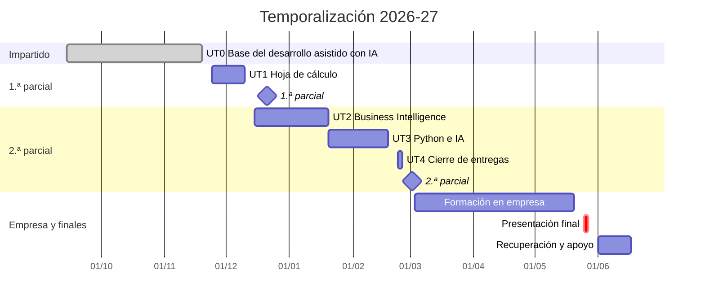

# Temporalización del módulo

Calendario de las unidades de trabajo (UT) del curso 2026-27. Es **orientativo**: las fechas pueden ajustarse a lo largo del curso y la versión que manda es la que publique el profesor.

El módulo se imparte los **martes (19:25 a 21:15)** y los **miércoles (15:30 a 17:20)**: dos sesiones semanales de 1 h 50 min. En total son **48 sesiones y 88 h**.

## Calendario por unidades

| UT | Título | Del | Al | Sesiones | Horas |
|----|--------|-----|----|----------|-------|
| UT0 | Base del desarrollo asistido con IA y método de trabajo (ya impartida) | 14 sep | 18 nov | 18 | 33,00 |
| UT1 | Hoja de cálculo avanzada | 24 nov | 9 dic | 5 | 9,17 |
| UT2 | Análisis de datos con plataformas de Business Intelligence | 15 dic | 19 ene | 6 | 11,00 |
| UT3 | Python e Inteligencia Artificial para datos y automatización | 20 ene | 17 feb | 8 | 14,67 |
| UT4 | Cierre de la cartera de aportaciones | 23 feb | 24 feb | 2 | 3,67 |
| | Repaso y 2.ª evaluación parcial | 2 mar | 2 mar | 1 | 1,83 |
| UT4 | Presentación final individual | 25 may | 26 may | 2 | 3,67 |
| | Recuperación, apoyo y preparación de la 2.ª final | 1 jun | 16 jun | 6 | 11,00 |
| | **Total** | | | **48** | **88,00** |

Entre el **3 de marzo y el 19 de mayo** el alumnado hace la formación en empresa y no hay sesiones del módulo.

## Sesiones de cada unidad

Cada unidad combina cuatro tipos de sesión:

| Tipo | Qué se hace |
|------|-------------|
| C | Contenido guiado con el agente de IA |
| T | Taller de aportación: se construye la entrega y se abre el pull request |
| E | Ejercicios específicos de la unidad |
| R | Repaso y cierre de la evaluación parcial |

| UT | Sesiones (martes y miércoles) | Tipos | Entrega |
|----|-------------------------------|-------|---------|
| UT1 | 24 nov, 25 nov, 1 dic, 2 dic, 9 dic | C, C, C, T, E | E1 (9 dic) |
| UT2 | 15 dic, 16 dic, 22 dic, 12 ene, 13 ene, 19 ene | C, C, C, C, T, E | E2 (19 ene) |
| UT3 | 20 ene, 26 ene, 27 ene, 2 feb, 3 feb, 10 feb, 16 feb, 17 feb | C, C, C, C, T, T, C, E | E3 (17 feb) |
| UT4 (cierre) | 23 feb, 24 feb | T, R | Cartera completa |
| UT4 (presentación) | 25 may, 26 may | Presentaciones individuales | E4 y presentación |

## Evaluaciones

- **1.ª parcial:** lunes 21 de diciembre, con la UT1 y la entrega E1.
- **2.ª parcial:** 2 de marzo, con las UT2 y UT3 y las entregas E2 y E3.
- **Presentación final:** 25 y 26 de mayo. Las fechas de las evaluaciones finales las fija el centro y la presentación se ajusta a ellas.
- Cada ejercicio específico se anuncia por escrito con una semana de antelación.

Mientras no se publique la versión definitiva, esta página puede cambiar.
