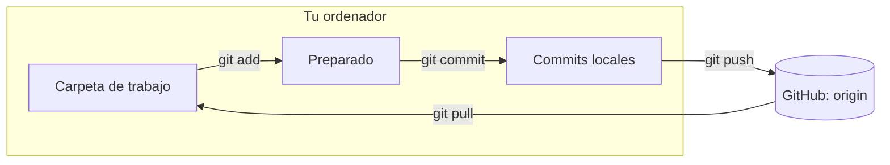

# 1. Conceptos básicos

← [Índice](README.md) · [Siguiente: Preparar el equipo](02-preparar-el-equipo.md) →

## El problema que resuelve Git

Imagina que diez personas editan el mismo documento. Sin un sistema, acabas con ficheros como `trabajo_final_v2_AHORA_bueno.docx`, y nadie sabe qué cambió ni quién lo cambió. **Git** resuelve esto: guarda la historia de todos los cambios de un proyecto y permite trabajar a varias personas a la vez sin pisarse.

## Git y GitHub no son lo mismo

| | Qué es | Dónde vive |
|---|---|---|
| **Git** | Un programa que guarda la historia de los cambios | En tu ordenador |
| **GitHub** | Una web que aloja repositorios de Git y ayuda a colaborar (Issues, pull requests) | En Internet |

Git funciona sin GitHub. GitHub añade el sitio común donde todos suben y revisan el trabajo.

## Las ideas que necesitas

- **Repositorio:** la carpeta del proyecto, con toda su historia. Hay una copia en GitHub (el *remoto*) y una copia en tu ordenador (la *local*).
- **Commit:** una "foto" de tus cambios con un mensaje que explica qué hiciste. Es la unidad de trabajo de Git.
- **Rama (branch):** una línea de trabajo paralela. Trabajas en tu rama sin tocar `main`, y cuando está lista la propones para unirla.
- **`main`:** la rama principal, la versión buena del proyecto. Aquí no se trabaja directamente.
- **Remoto (`origin`):** el repositorio de GitHub. `origin` es el nombre con el que Git lo recuerda.
- **Push:** enviar tus commits a GitHub.
- **Pull:** traerte a tu ordenador lo nuevo que hay en GitHub.
- **Issue:** una tarea o una propuesta de trabajo, con su conversación. En este repo, el profesor propone las Issues.
- **Pull request (PR):** la petición de unir tu rama con `main`. Es donde el profesor revisa tu trabajo.

## El mapa mental

Tu trabajo pasa por **tres estados** antes de llegar a GitHub:

1. Lo editas en tu carpeta.
2. Lo **preparas** con `git add` (eliges qué entra en el commit).
3. Lo **guardas** con `git commit`, y después lo **subes** con `git push`.

## Comprobación

Sin mirar arriba, intenta responder:

1. ¿Dónde está la copia de `origin`: en tu ordenador o en GitHub?
2. ¿Para qué sirve una rama?
3. ¿Por qué no se trabaja directamente en `main`?

Si dudas, relee la sección correspondiente o consulta el [glosario](../glosario.md).

Ver las respuestas

1. **En GitHub.** `origin` es el nombre con el que Git recuerda el repositorio remoto (el de GitHub). Tu copia en el ordenador es la local.
2. **Para trabajar en una línea paralela** sin tocar `main`. Cuando está lista, se propone unirla.
3. **Porque `main` es la versión buena del proyecto.** Si se trabaja directamente en ella, un error afecta a todos y no se puede revisar antes. Por eso está protegida y todo entra por pull request.

## Fuentes

- [Pro Git: ¿Qué es Git?](https://git-scm.com/book/es/v2/Inicio---Sobre-el-Control-de-Versiones-Acerca-del-Control-de-Versiones)
- [Pro Git: guardando cambios en el repositorio](https://git-scm.com/book/es/v2/Fundamentos-de-Git-Guardando-cambios-en-el-Repositorio)
