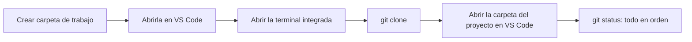

# 3. Carpeta de trabajo y descarga del proyecto

← [Anterior: Preparar el equipo](02-preparar-el-equipo.md) · [Siguiente: Práctica guiada](08-practica-guiada.md) →

Se hace **una sola vez**. Vas a crear tu carpeta de trabajo y a descargar el proyecto en ella.



## 3.1 Crear tu carpeta de trabajo

Elige un sitio que encuentres fácilmente, por ejemplo dentro de `Documentos`, y crea una carpeta nueva. Un nombre sencillo, sin espacios ni tildes, como `trabajo-daw` o `proyectos-dam`.

> **Importante:** esta carpeta es donde guardarás los proyectos. **No** crees la carpeta del proyecto a mano: la creará Git al descargarlo.

## 3.2 Abrirla en VS Code

1. Abre VS Code.
2. Menú *File → Open Folder…* (*Archivo → Abrir carpeta…*).
3. Elige la carpeta de trabajo que acabas de crear.
4. Si VS Code pregunta si confías en los autores, elige que sí: es tu propia carpeta.

## 3.3 Abrir la terminal integrada

Pulsa `` Ctrl+` `` o usa el menú *Terminal → New Terminal*. Se abre abajo una terminal **ya situada en tu carpeta de trabajo**. Compruébalo:

```bash
pwd
```

(En Windows con PowerShell, el equivalente es `pwd` también; debe mostrar la ruta de tu carpeta de trabajo.)

## 3.4 Descargar el proyecto (clonar)

**Clonar** es descargar el repositorio entero, con su historia. Como eres **colaborador**, lo descargas directamente:

```bash
git clone https://github.com/profeFPInfor/upgrade-ia.git
```

Si has configurado el acceso con el *Git Credential Manager*, en este punto se abre el navegador para iniciar sesión en GitHub. Si no pasa nada raro, el clon termina con la carpeta `upgrade-ia` dentro de tu carpeta de trabajo.

Debe mostrar líneas de progreso (`Cloning into 'upgrade-ia'...`, `Receiving objects: 100%`) y terminar sin errores. Comprueba que existe la carpeta con `ls` (en PowerShell, también `ls` o `dir`).

> Si falla con un error de permisos o de autenticación, mira [errores frecuentes](06-errores-frecuentes.md). Lo más habitual es no haber aceptado la invitación al repositorio.

## 3.5 Abrir el proyecto en VS Code

Ahora trabajarás **dentro de la carpeta del proyecto**, no de la carpeta de trabajo:

1. Menú *File → Open Folder…*
2. Elige la carpeta `upgrade-ia` que se acaba de crear.
3. Abre otra vez la terminal con `` Ctrl+` ``. Ahora está dentro de `upgrade-ia`.

En el panel izquierdo (*Explorer*) verás las carpetas del proyecto, como `proceso/`, `herramientas-ia/` y `docs/`. La explicación de cada una está en el [README del repositorio](../../README.md).

## 3.6 Comprobar que todo está en orden

```bash
git status
```

Debe decir que estás en la rama `main`, que está al día con `origin/main` y que no hay nada que confirmar (*nothing to commit, working tree clean*).

`git status` es el comando que más vas a usar: te dice en qué rama estás y qué has cambiado. **Ante la duda, ejecútalo.**

Mira la historia reciente:

```bash
git log --oneline -5
```

Cada línea es un commit: un código corto y su mensaje. Sal de la lista con la tecla `q`.

## 3.7 Qué NO hacer todavía

No edites nada estando en `main`. Para aportar se crea siempre una rama, y eso lo aprendes en la práctica y en el flujo de trabajo de las páginas siguientes.

## Fuentes

- [Pro Git: obteniendo un repositorio Git](https://git-scm.com/book/es/v2/Fundamentos-de-Git-Obteniendo-un-repositorio-Git)
- [VS Code: control de código fuente](https://code.visualstudio.com/docs/sourcecontrol/overview)

## Comprobación

- [ ] Tienes una carpeta de trabajo y dentro, la carpeta `upgrade-ia`.
- [ ] VS Code tiene abierta la carpeta `upgrade-ia`.
- [ ] `git status` dice que estás en `main` y que no hay cambios.

Siguiente: [práctica guiada sin riesgo](08-practica-guiada.md).
