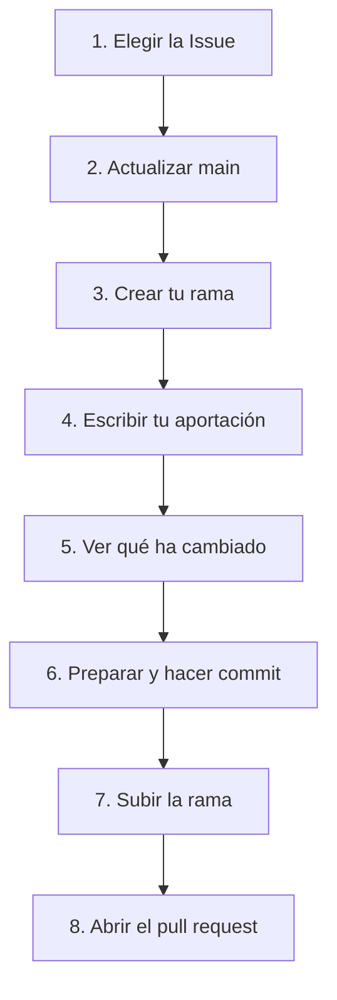

# 4. Una aportación completa

← [Anterior: Issues y etiquetas](10-issues-y-etiquetas.md) · [Siguiente: La revisión](05-la-revision.md) →

Vas a recorrer el ciclo entero, desde que el profesor propone una tarea hasta que abres tu pull request. Esta página explica **el detalle y el porqué** de cada paso; la versión corta, para tener a mano mientras trabajas, está en [Cómo trabajamos en este repositorio](09-como-trabajamos.md).

> **Antes de empezar:** haz la [práctica guiada](08-practica-guiada.md). Te lleva 30 minutos, no toca el proyecto real y te quita el miedo a equivocarte.



> **Los ejemplos de esta página son ficticios.** Usan la Issue `#12`, la rama `docs/12-analisis-sota` y el fichero `proceso/01-analisis/mi-aportacion.md`. **Tú debes sustituirlos por los de tu Issue:** tu número, un nombre de rama con ese número y la ruta que te indique la Issue.

## 1. Elegir la Issue

El profesor propone las tareas como **Issues** en la pestaña *Issues* del repositorio en GitHub.

1. Entra en [github.com/profeFPInfor/upgrade-ia](https://github.com/profeFPInfor/upgrade-ia) y abre la pestaña *Issues*.
2. Elige una Issue **que no tenga a nadie asignado**. Si ya tiene a alguien, es de otra persona.
3. Ábrela y fíjate en su **número** (por ejemplo `#12`).
4. **Cógela:** en el panel de la derecha, pulsa *Assignees*, escribe tu nombre de usuario y selecciónalo. Así todos saben que la estás haciendo. También puedes dejar un comentario: "Me encargo yo".

Una Issue, una persona: no cojas varias a la vez.

*Fuente:* [Assigning issues and pull requests to other GitHub users](https://docs.github.com/en/issues/tracking-your-work-with-issues/using-issues/assigning-issues-and-pull-requests-to-other-github-users).

## 2. Actualizar `main`

Antes de empezar, asegúrate de partir de lo último:

```bash
git checkout main
git pull
```

Si no hay nada nuevo, `git pull` responde `Already up to date` (*Ya está actualizado*). Si había cambios, muestra una lista de los ficheros que se han traído.

> **¿Por qué?** Si creas tu rama sobre un `main` antiguo, tu trabajo partirá de una versión desactualizada y al final habrá más probabilidades de conflictos.

## 3. Crear tu rama

Una rama por Issue, con un nombre que diga qué es. Una forma sencilla: `docs/` + número de la Issue + tema.

```bash
git checkout -b docs/12-analisis-sota
```

Git responde `Switched to a new branch 'docs/12-analisis-sota'`. Comprueba:

```bash
git status
```

La primera línea debe decir `On branch docs/12-analisis-sota`. **Si dice `main`, no sigas:** repite el paso.

> **¿Por qué una rama por Issue?** Mantiene tu trabajo separado del de los demás y de `main`. Así se puede revisar solo lo tuyo, se puede rehacer sin afectar a nadie, y si algo sale mal, la versión buena del proyecto no se estropea.

## 4. Escribir tu aportación

**La Issue es tu guía.** Léela despacio, de principio a fin: te dice **qué** hay que hacer y **dónde** debe ir el resultado dentro del proyecto (la carpeta o el fichero). Haz exactamente eso:

1. Localiza en el panel *Explorer* de VS Code la carpeta que indica la Issue. Los enlaces de la Issue te llevan a las páginas que debes completar.
2. Crea o edita el fichero en esa ubicación. El material va en **Markdown** (ficheros `.md`: texto con formato sencillo; mira el [curso de Markdown](../../markdown/) si no lo conoces).
3. Cumple los puntos que pida la Issue, uno a uno. Si hay una lista con casillas, es tu lista de tareas.
4. Sigue las reglas de estilo de la [guía de trabajo](../README.md).
5. Si algo no está claro o no sabes dónde va, **pregunta en un comentario de la propia Issue** antes de seguir; no improvises la ubicación.

## 5. Ver qué ha cambiado

```bash
git status
```

Los ficheros nuevos salen como *Untracked files* (archivos sin rastrear) y los editados como *modified* (*Changes not staged for commit*, cambios sin preparar). Revisa que **solo aparece lo que querías cambiar**.

## 6. Preparar y hacer commit

Git trabaja con una zona intermedia: el **área de preparación** (*staging area*). Un fichero está **preparado** (*staged*) cuando lo has marcado para que entre en el próximo commit. Prepara los ficheros uno por uno, así no cuelas nada sin querer:

```bash
git add proceso/01-analisis/mi-aportacion.md
```

Comprueba que está preparado:

```bash
git status
```

Verás el fichero bajo *Changes to be committed* (cambios a ser confirmados). Antes de confirmar, revisa **qué** vas a guardar:

```bash
git diff --staged
```

Muestra, línea a línea, lo que hay preparado. Si ves algo que no esperabas, corrígelo ahora. Después guarda la "foto" con un mensaje:

```bash
git commit -m "docs: añadir ejemplo de matriz comparativa"
```

Debe responder algo como `1 file changed, 12 insertions(+)`.

El mensaje sigue el formato **Conventional Commits** ([especificación](https://www.conventionalcommits.org/es/)): un tipo, dos puntos y una frase corta que diga qué hiciste.

| Tipo | Cuándo |
|---|---|
| `docs:` | Documentación o material de clase (el más habitual aquí) |
| `fix:` | Corregir un error |
| `feat:` | Añadir una funcionalidad |
| `chore:` | Tareas menores de mantenimiento |

Un buen mensaje cuenta **qué** hiciste, en pocas palabras:

| Mal | Bien |
|---|---|
| `cambios` | `docs: añadir matriz comparativa de frameworks` |
| `arreglo` | `fix: corregir enlace roto en el glosario` |
| `asdf` | `docs: completar sección de riesgos` |

Si te sale una ventana de editor rara al hacer `git commit` sin `-m`, mira [errores frecuentes](06-errores-frecuentes.md#se-abre-un-editor-raro-al-hacer-commit).

Puedes hacer varios commits pequeños en vez de uno grande; se revisan mejor. Mira el resultado:

```bash
git log --oneline -3
```

### Lo mismo desde VS Code

El panel de **Control de código fuente** (*Source Control*, `Ctrl+Shift+G`) hace lo mismo con botones:

1. En la lista *Changes* pasa el ratón sobre un fichero y pulsa el botón **+** (*Stage Changes*). El fichero pasa a *Staged Changes*. Es lo mismo que `git add`.
2. Escribe el mensaje en la caja de arriba y pulsa **Commit**.

Para **subir**, usa la terminal (siguiente paso): es la forma que este tutorial ha verificado. VS Code también ofrece subir desde el panel (*Sync Changes*, o *Push* en el menú *More Actions*, `...`), pero los nombres de los botones cambian con la versión.

*Fuente:* [VS Code: Source Control quickstart](https://code.visualstudio.com/docs/sourcecontrol/quickstart).

## 7. Subir la rama

La primera vez que subes una rama nueva:

```bash
git push -u origin docs/12-analisis-sota
```

`-u` deja enlazada tu rama local con la de GitHub, así que las siguientes veces basta con `git push`. Debe responder algo como:

```text
 * [new branch]      docs/12-analisis-sota -> docs/12-analisis-sota
branch 'docs/12-analisis-sota' set up to track 'origin/docs/12-analisis-sota'.
```

La línea `new branch` confirma que la rama ya está en GitHub. A veces también aparece un enlace para crear el pull request.

> **Si intentas subir a `main`, GitHub lo rechaza** con un mensaje que empieza por `remote: error: GH006: Protected branch update failed`. No es un fallo tuyo: `main` está protegida a propósito. Crea una rama y sigue por aquí. (Documentación: [About protected branches](https://docs.github.com/en/repositories/configuring-branches-and-merges-in-your-repository/managing-protected-branches/about-protected-branches).)

## 8. Abrir el pull request

1. En GitHub, abre el repositorio. Encima de la lista de ficheros verás un banner amarillo con tu rama y un botón **Compare & pull request**. Púlsalo. Si no lo ves, elige tu rama en el menú *Branch* y aparecerá.
2. Comprueba que la rama **base** es `main` y la rama **compare** es la tuya.
3. Escribe un **título** claro, con el mismo estilo que un commit: `docs: añadir ejemplo de matriz comparativa`.
4. En la **descripción**, cuenta qué aportas y enlaza la Issue con la palabra `Closes` y su número:

   ```text
   Añade un ejemplo de matriz comparativa al análisis.

   Closes #12
   ```

   Así la Issue se cierra sola cuando se fusione el PR. Funciona porque el PR apunta a `main`, la rama por defecto del repositorio; si apuntara a otra rama, la palabra se ignoraría.
5. Pulsa **Create pull request**.

Si tu trabajo no está terminado pero quieres enseñarlo, puedes crear un **borrador** (*draft*): en lugar del botón verde, despliega y elige *Create Draft Pull Request*. Un borrador indica que aún no está listo para revisar.

Ya está: tu aportación está pendiente de revisión.

*Fuentes:* [Creating a pull request](https://docs.github.com/en/pull-requests/collaborating-with-pull-requests/proposing-changes-to-your-work-with-pull-requests/creating-a-pull-request) y [Linking a pull request to an issue](https://docs.github.com/en/issues/tracking-your-work-with-issues/using-issues/linking-a-pull-request-to-an-issue).

## Tu trabajo queda en el historial

El profesor revisa tu aportación a través del **historial del repositorio**: la lista de commits con su autor y su fecha. Para que tu trabajo quede bien registrado:

- **Usa siempre tu propia identidad.** Antes de empezar, comprueba con `git config user.name` y `git config user.email` que son los tuyos (ver [paso 2.4](02-preparar-el-equipo.md#24-decirle-a-git-quién-eres)). Usa el correo `noreply` de tu cuenta para que GitHub te reconozca como autor sin mostrar tu correo.
- **Haz commits pequeños y con mensajes claros**, a medida que avanzas, no uno gigante al final. Cada commit cuenta lo que hiciste.
- **Sube tu trabajo con `git push`** al terminar cada sesión. Lo que solo está en tu ordenador no existe para el repositorio.
- **No reescribas el historial.** No uses `git push --force` ni borres commits ya subidos: se perdería la prueba de tu trabajo y se complicaría el de los demás (más en [Más allá](11-mas-alla.md#por-qué-no-se-reescribe-el-historial-compartido)).
- **Un PR por Issue**, enlazado con `Closes #N`.

Comprueba cómo queda tu trabajo:

```bash
git log --oneline -5
```

En GitHub puedes verlo en la pestaña *Commits* de tu rama o de tu pull request: cada commit aparece con tu nombre de usuario.

## Comprobación

- [ ] Tu rama aparece en GitHub.
- [ ] `git log` muestra tus commits con tu nombre.
- [ ] Tu pull request aparece en la pestaña *Pull requests*, con base `main`.
- [ ] En el PR solo se ven los ficheros que querías subir (pestaña *Files changed*).
- [ ] La descripción enlaza la Issue con `Closes #N`.

Siguiente: [la revisión](05-la-revision.md).
