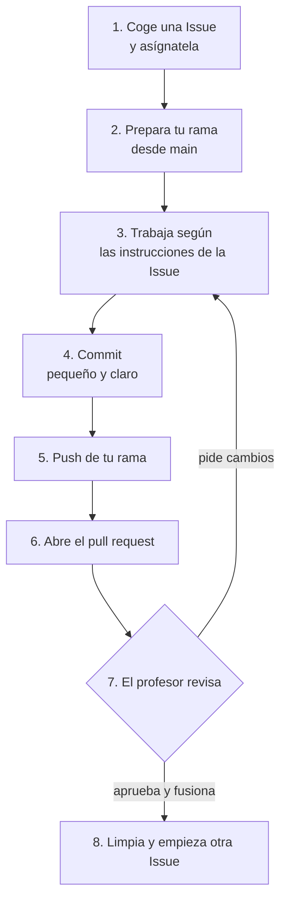

# 9. Cómo trabajamos en este repositorio

← [Anterior: Práctica guiada](08-practica-guiada.md) · [Índice](README.md) · [Siguiente: Issues y etiquetas](10-issues-y-etiquetas.md) →

Esta es la **versión corta** del flujo: los pasos que repites cada vez que coges una Issue. Tenla abierta mientras trabajas. Si un paso no lo entiendes, la página [Una aportación completa](04-una-aportacion-completa.md) lo explica con más detalle.

> **Antes de empezar:** haz la [práctica guiada](08-practica-guiada.md) una vez. Y ten en cuenta que los ejemplos usan la Issue `#12` y la rama `docs/12-analisis-sota`: **sustitúyelos por los tuyos**.

## El ciclo de cada Issue



## Los 8 pasos

### 1. Coge una Issue

1. Abre la pestaña *Issues* del repositorio en GitHub.
2. Elige una **sin nadie asignado**.
3. En el panel de la derecha, en *Assignees*, escribe tu usuario y selecciónalo.
4. Apunta su **número** (por ejemplo `#12`).

Una Issue, una persona. No cojas varias a la vez. Cómo se organizan las Issues y qué significa cada etiqueta está en [Issues y etiquetas](10-issues-y-etiquetas.md).

### 2. Prepara tu rama

En VS Code, abre la carpeta `upgrade-ia` y la terminal (*Terminal → New Terminal*):

```bash
git checkout main
git pull
git checkout -b docs/12-analisis-sota
git status
```

`git status` debe decir `On branch docs/12-analisis-sota`. Si dice `main`, repite el último paso.

**El nombre de la rama:** `docs/` + el número de la Issue + el tema, en minúsculas y con guiones. Por ejemplo `docs/12-analisis-sota`.

### 3. Trabaja según las instrucciones de la Issue

La Issue te dice **qué** hacer y **dónde** debe ir. Haz exactamente eso:

- Busca en el panel *Explorer* la carpeta o el fichero que indica.
- Escribe en **Markdown** (`.md`).
- Cumple los puntos de la Issue uno a uno.
- Si algo no está claro, **pregunta en un comentario de la propia Issue** antes de seguir.

### 4. Haz commit

Haz commits **pequeños**, a medida que avanzas, no uno gigante al final:

```bash
git status
git add ruta/de/tu-fichero.md
git diff --staged
git commit -m "docs: añadir ejemplo de matriz comparativa"
```

- `git add` con el **fichero concreto**, no con un punto, para no colar nada sin querer.
- `git diff --staged` para revisar lo que vas a guardar.
- El mensaje empieza por `docs:` y cuenta **qué** hiciste.

### 5. Sube tu rama

```bash
git push -u origin docs/12-analisis-sota
```

Debe aparecer `new branch`. Las siguientes veces basta con `git push`.

> **Sube tu trabajo al terminar cada sesión.** Lo que solo está en tu ordenador no existe para el repositorio, y el profesor lo revisa en el historial de GitHub.

### 6. Abre el pull request

1. En GitHub, en la página del repositorio, pulsa el botón **Compare & pull request** del banner amarillo. Si no lo ves, elige tu rama en el menú *Branch*.
2. Comprueba que **base** es `main` y **compare** es tu rama.
3. Título claro, como un commit: `docs: añadir ejemplo de matriz comparativa`.
4. En la descripción, cuenta qué aportas y enlaza la Issue:

   ```text
   Añade un ejemplo de matriz comparativa al análisis.

   Closes #12
   ```

5. Pulsa **Create pull request**.

### 7. Atiende la revisión

El profesor puede comentar, pedirte cambios o aprobar.

- **Si pide cambios:** haz los cambios en tu rama, y repite `git add`, `git commit` y `git push`. El pull request se actualiza solo; **no abras otro**.
- **Responde a cada comentario** (por ejemplo, "hecho").
- **Si `main` avanzó y hay conflictos:** mira [errores frecuentes](06-errores-frecuentes.md#mi-rama-está-desactualizada-o-hay-conflictos).

### 8. Limpia y empieza otra

Cuando el profesor fusiona tu pull request:

```bash
git checkout main
git pull
git branch -d docs/12-analisis-sota
```

Si Git muestra un aviso pero dice `Deleted branch`, está bien. Si se niega con `not fully merged`, y **solo si tu PR ya está fusionado**, usa `git branch -D docs/12-analisis-sota` ([explicación](05-la-revision.md#cuando-se-fusiona)).

Después, vuelve al paso 1 con otra Issue.

## Lista de comprobación antes de abrir el pull request

- [ ] La Issue está asignada a mí y la he leído entera.
- [ ] Mi rama se creó desde un `main` actualizado y su nombre lleva el número de la Issue.
- [ ] El fichero está donde indica la Issue.
- [ ] `git status` no muestra ficheros que no quería subir.
- [ ] Mis commits tienen mensajes claros y mi nombre (`git log --oneline -5`).
- [ ] No hay claves, contraseñas ni datos personales en lo que subo.
- [ ] La descripción del PR incluye `Closes #N`.

## Reglas de este repositorio

| Sí | No |
|---|---|
| Una rama y un pull request por Issue | Subir directamente a `main` (está protegida) |
| Commits pequeños con mensaje claro | Un commit gigante con todo al final |
| Preguntar en la Issue si hay dudas | Improvisar dónde va el fichero |
| Subir tu trabajo al terminar la sesión | Dejar el trabajo solo en tu ordenador |
| Usar siempre tu propia identidad | Commits con otra cuenta o nombre |
| Avisar si subes algo por error | Intentar arreglarlo a escondidas |
| Usar `git branch -d` para borrar tu rama | Usar `git push --force` |

## ¿Algo ha salido mal?

1. Ejecuta `git status` y lee lo que dice.
2. Busca el síntoma en [errores frecuentes](06-errores-frecuentes.md).
3. Si no lo encuentras o dudas, **pregunta** en la Issue o al profesor, pegando el texto del error. No borres nada si no estás seguro.

## Fuentes

- [Creating a pull request](https://docs.github.com/en/pull-requests/collaborating-with-pull-requests/proposing-changes-to-your-work-with-pull-requests/creating-a-pull-request)
- [Linking a pull request to an issue](https://docs.github.com/en/issues/tracking-your-work-with-issues/using-issues/linking-a-pull-request-to-an-issue)
- [Assigning issues and pull requests to other GitHub users](https://docs.github.com/en/issues/tracking-your-work-with-issues/using-issues/assigning-issues-and-pull-requests-to-other-github-users)
- [Conventional Commits](https://www.conventionalcommits.org/es/)
- [git branch](https://git-scm.com/docs/git-branch)
