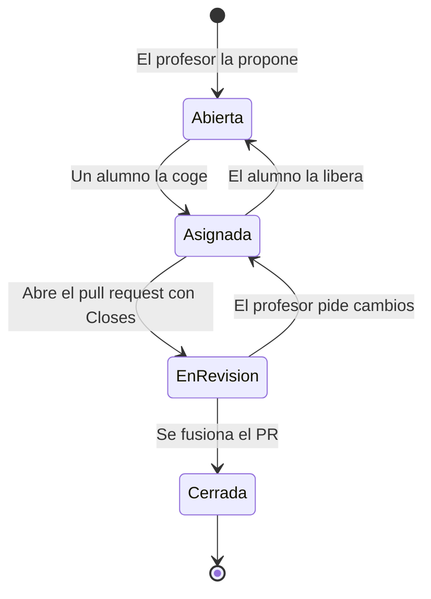

# 10. Issues y etiquetas: cómo organizamos el trabajo

← [Anterior: Cómo trabajamos](09-como-trabajamos.md) · [Índice](README.md) · [Siguiente: Una aportación completa, paso a paso](04-una-aportacion-completa.md) →

En este repositorio el trabajo se reparte con **Issues**. El profesor las propone, cada alumno coge una, la desarrolla en su rama y la entrega con un pull request. Las **etiquetas** (*labels*) sirven para clasificarlas y encontrarlas. Esta página explica cómo funciona todo esto.

## Qué es una Issue

Una **Issue** es una tarea o una propuesta de trabajo, con su propia página y su propia conversación. Tiene:

- Un **número** único (`#12`) y un **título**.
- Una **descripción** que explica qué hay que hacer.
- Un **estado**: abierta o cerrada.
- Una o varias personas **asignadas** (*Assignees*).
- Cero o más **etiquetas**.
- Un hilo de **comentarios** para preguntar y aclarar dudas.

Piensa en ella como la ficha de una tarea en un tablero compartido.

## Cómo es una Issue de este proyecto

Las Issues del profesor siguen una estructura parecida, para que sepas siempre dónde mirar:

| Apartado | Qué te cuenta |
|---|---|
| **Objetivo** | Qué se quiere conseguir con esta tarea. |
| **Dónde va** | La carpeta o el fichero del proyecto donde debe quedar el resultado. |
| **Qué hay que hacer** | Los puntos concretos, a menudo como lista con casillas. |
| **Referencias** | Enlaces o documentos para empezar. |

Un ejemplo, **inventado** para que veas el aspecto:

```text
Título: Documentar la fase de análisis: estado del arte

Objetivo: Explicar con un ejemplo cómo se hace un estado del arte.

Dónde va: proceso/01-analisis/

Qué hay que hacer:
- [ ] Escribir un ejemplo de informe de estado del arte
- [ ] Añadir una matriz comparativa de dos alternativas
- [ ] Citar al menos dos fuentes primarias

Referencias: README de la fase 01
```

**Tu trabajo es seguir esa Issue.** Si algo no está claro, pregunta en sus comentarios antes de empezar, como se explica en [Cómo trabajamos](09-como-trabajamos.md#3-trabaja-según-las-instrucciones-de-la-issue).

## El ciclo de vida de una Issue



1. **Abierta:** nadie la ha cogido todavía.
2. **Asignada:** un alumno se la ha asignado y está trabajando en ella.
3. **En revisión:** su pull request está abierto y el profesor lo revisa.
4. **Cerrada:** el PR se ha fusionado y la Issue se cierra sola, si en la descripción del PR se escribió `Closes #N`.

> Una Issue **se cierra automáticamente** al fusionar el PR solo si ese PR apunta a la rama por defecto del repositorio (`main`) y su descripción incluye una palabra como `Closes` seguida del número. Si no, hay que cerrarla a mano. ([Documentación](https://docs.github.com/en/issues/tracking-your-work-with-issues/using-issues/linking-a-pull-request-to-an-issue).)

## Cómo encontrar una Issue para coger

En la pestaña *Issues* del repositorio:

1. Abre el desplegable **Assignee** y elige **Assigned to nobody** (asignadas a nadie). Así solo ves las que están libres.
2. Abre el desplegable **Labels** y elige una etiqueta, por ejemplo `docs` para ver las de documentación.
3. Fíjate en que estén **abiertas**.
4. Si hay varias, empieza por la de **prioridad más alta** (`P0` antes que `P1`, y así hasta `P3`).

También puedes escribir la búsqueda directamente en la barra:

```text
state:open is:issue no:assignee label:"docs"
```

Esa búsqueda muestra las Issues abiertas, sin asignar y con la etiqueta `docs`. Para ver solo las urgentes, cambia la etiqueta por `P0` o `P1`. Para limpiar los filtros, pulsa *Clear current search query, filters, and sorts*.

([Documentación de filtros](https://docs.github.com/en/issues/tracking-your-work-with-issues/using-issues/filtering-and-searching-issues-and-pull-requests).)

## Las etiquetas del repositorio

Una **etiqueta** es una marca de color con un nombre que clasifica una Issue o un pull request. Puede llevar varias. Hay tres grupos y **cada grupo tiene su propia gama de color**, para que los reconozcas de un vistazo. La referencia completa está en [CONTRIBUTING](../../CONTRIBUTING.md#etiquetas).

**Tipo: qué es** (azules, violeta y gris)

| Etiqueta | Para qué la usamos |
|---|---|
| `docs` | Escribir o mejorar documentación. **Será la más habitual.** |
| `feat` | Contenido nuevo que se propone. |
| `fix` | Algo está mal en lo ya publicado: un error, un enlace roto, una errata. |
| `chore` | Mantenimiento y estructura del repositorio. |
| `pregunta` | Hay una duda abierta. |

**Estado: en qué punto está** (amarillo, naranja, verde, marrón)

| Etiqueta | Significa |
|---|---|
| `estado: pendiente-revisión` | Tu pull request espera al profesor. |
| `estado: cambios-solicitados` | **Te toca a ti**: el profesor ha pedido cambios. |
| `estado: aprobado` | Listo para fusionar. |
| `estado: bloqueado` | Parado: depende de algo externo. |

**Prioridad: cuánto corre prisa** (un solo rojo: cuanto más intenso, más urgente)

| Etiqueta | Significa |
|---|---|
| `P0` | Crítica: bloquea la clase o rompe `main`. Se atiende ya. |
| `P1` | Alta: debe entrar antes de la próxima clase o entrega. |
| `P2` | Normal: mejora útil sin fecha. Es la que se asume si no hay ninguna. |
| `P3` | Baja: se hace si hay tiempo. |

Un ejemplo de Issue bien etiquetada: `docs` + `P1`. Y su pull request, al abrirlo, pasará a `estado: pendiente-revisión`.

**El profesor puede añadir etiquetas nuevas** (por ejemplo, por fase del proceso o por tema). Esta página se actualizará cuando eso ocurra.

([Documentación sobre etiquetas](https://docs.github.com/en/issues/using-labels-and-milestones-to-track-work/managing-labels).)

## Reglas para trabajar con Issues y etiquetas

1. **Coge una Issue sin asignar** y asígnatela tú mismo (panel derecho, *Assignees*). Una a la vez.
2. **Cuando la cojas, deja un comentario** corto: "Me encargo yo". Así quien mire la Issue sabe que está en marcha.
3. **Las dudas se preguntan en la Issue**, no por mensajes privados. Así la respuesta le sirve a todos.
4. **Las etiquetas las gestiona el profesor.** Aunque GitHub te permita cambiarlas, no las modifiques tú: si crees que una Issue está mal etiquetada, dilo en un comentario.
5. **Si no puedes terminarla**, no la dejes bloqueada: quítate de *Assignees* y deja un comentario explicando hasta dónde llegaste. Otra persona podrá cogerla.
6. **Una Issue, un pull request.** Enlázalos con `Closes #N` en la descripción del PR.
7. **No cierres Issues a mano** salvo que te lo pidan: se cierran solas al fusionarse el PR.

## Si encuentras un error o tienes una idea

Cualquier colaborador puede **abrir una Issue nueva**:

1. En la pestaña *Issues*, pulsa *New issue*.
2. Escribe un **título claro**: qué pasa y dónde (`El enlace de la fase 03 no funciona`).
3. En la descripción cuenta: **qué ocurre**, **dónde** (la página o el fichero) y **qué esperabas**. Si es un error, añade los pasos para verlo.
4. Publícala. El profesor la revisa, la etiqueta (`fix`, `feat`, `pregunta`…) y decide si se hace.

No te asignes una Issue que has abierto tú sin que el profesor la haya revisado.

## Comprobación

- [ ] Sabes encontrar las Issues libres con los filtros *Assignee* y *Labels*.
- [ ] Sabes qué significan los tres grupos de etiquetas: tipo, estado y prioridad.
- [ ] Sabes qué hacer cuando ves `estado: cambios-solicitados` en tu pull request.
- [ ] Sabes cómo coger una Issue y qué comentar.
- [ ] Sabes qué hacer si no puedes terminarla.
- [ ] Sabes por qué el PR debe llevar `Closes #N` y apuntar a `main`.

Siguiente: [una aportación completa, paso a paso](04-una-aportacion-completa.md).

## Fuentes

- [Assigning issues and pull requests to other GitHub users](https://docs.github.com/en/issues/tracking-your-work-with-issues/using-issues/assigning-issues-and-pull-requests-to-other-github-users)
- [Filtering and searching issues and pull requests](https://docs.github.com/en/issues/tracking-your-work-with-issues/using-issues/filtering-and-searching-issues-and-pull-requests)
- [Managing labels](https://docs.github.com/en/issues/using-labels-and-milestones-to-track-work/managing-labels)
- [Linking a pull request to an issue](https://docs.github.com/en/issues/tracking-your-work-with-issues/using-issues/linking-a-pull-request-to-an-issue)
