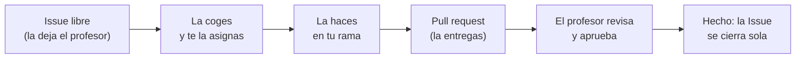
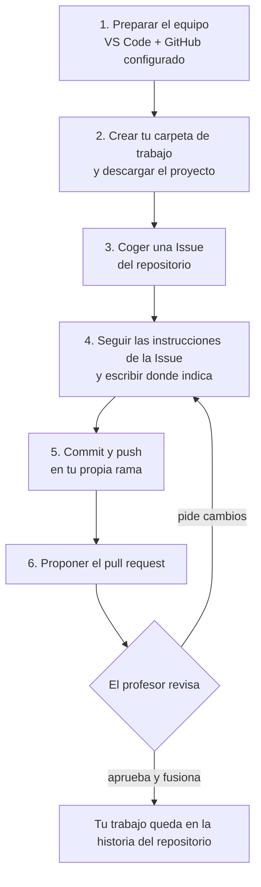
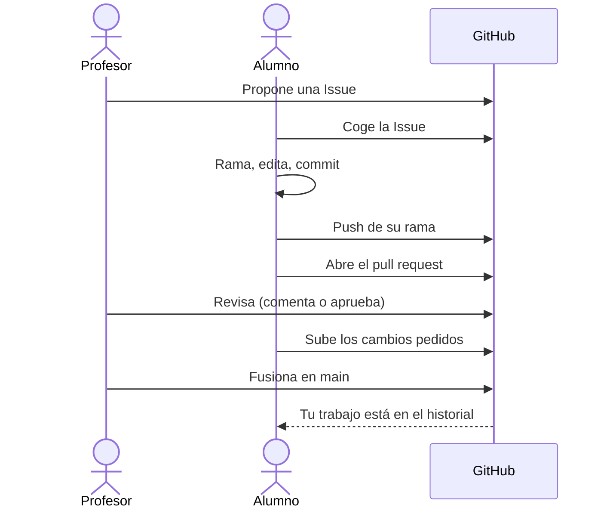

# Trabajo colaborativo con Git y GitHub: tutorial desde cero

Este tutorial es para ti si **nunca has trabajado con GitHub** o con un proyecto en el que participa más gente. No necesitas saber nada previo. Al terminar sabrás hacer una aportación completa a este repositorio, trabajando desde **Visual Studio Code**.

> Cuando encuentres una palabra que no conozcas, búscala en el [glosario](../glosario.md).

## La idea en 30 segundos

Aquí no se trabaja "a lo que cada uno quiera": se trabaja con **Issues**.

- Una **Issue** es una **tarea por hacer**, escrita por el profesor en la pestaña *Issues* de GitHub. Dice qué hay que conseguir y dónde debe quedar el resultado.
- **Tú eliges una que esté libre** y te la asignas. Desde ese momento es tuya.
- La haces en **tu propia rama** (una copia de trabajo donde no molestas a nadie) y la entregas con un **pull request**: una petición para que el profesor revise lo que has hecho y lo añada al proyecto.
- Cuando el profesor lo aprueba, tu trabajo queda en el proyecto y la Issue se cierra sola.

Piensa en un tablero de tareas de clase: el profesor pega las tareas, cada alumno se apunta a una, la hace y la enseña antes de darla por terminada.

### Las etiquetas te dicen cómo está cada Issue

Cada Issue lleva etiquetas de colores. Las tres que más vas a mirar:

| Mira | Ejemplo | Te dice |
|---|---|---|
| **Tipo** | `docs`, `feat`, `fix` | Qué clase de tarea es. |
| **Prioridad** | `P0` (la más urgente) a `P3` | Por cuál empezar: cuanto más rojo intenso, antes. |
| **Estado** | `estado: cambios-solicitados` | En qué punto va. Si ves esta en tu pull request, **te toca a ti**. |

El significado completo está en [Issues y etiquetas](10-issues-y-etiquetas.md) y en [CONTRIBUTING](../../CONTRIBUTING.md#etiquetas). Las etiquetas las pone el profesor; tú no tienes que tocarlas.

### Reglas que no cambian

1. **Una Issue a la vez**, y que esté sin asignar.
2. **Comenta "Me encargo yo"** al cogerla, para que se vea que está en marcha.
3. **Las dudas se preguntan en la Issue**, no en privado: así le sirven a todos.
4. **Si no puedes terminarla**, quítate de *Assignees* y cuenta hasta dónde llegaste. Otra persona la retomará.

## El flujo de trabajo en 6 pasos

Así se trabaja en este proyecto, de principio a fin:

Y quién hace qué en cada momento:

## Qué vas a aprender

1. Qué es Git y qué es GitHub, y por qué se usan.
2. Dejar listo VS Code y el acceso a GitHub.
3. Descargar el proyecto en tu carpeta de trabajo.
4. Coger una Issue, seguir sus instrucciones y hacer tu aportación.
5. Dejar tu trabajo en el historial del repositorio con commits, push y pull request.
6. Qué hacer cuando algo sale mal, y practicarlo sin riesgo.

## Cómo seguirlo

Ve en orden. Cada página termina con una **comprobación**: si no te sale lo que dice, no sigas; relee el paso o pregunta.

| Paso | Página | Tiempo aproximado |
|------|--------|-------------------|
| 1 | [Conceptos básicos](01-conceptos.md) | 10 min |
| 2 | [Preparar el equipo](02-preparar-el-equipo.md) | 20 min |
| 3 | [Carpeta de trabajo y descarga del proyecto](03-primer-dia.md) | 15 min |
| 4 | **[Práctica guiada sin riesgo](08-practica-guiada.md)** (antes de tu primera Issue real) | 30 min |
| 5 | **[Cómo trabajamos en este repositorio](09-como-trabajamos.md)**: los pasos de cada Issue | 10 min |
| 6 | **[Issues y etiquetas](10-issues-y-etiquetas.md)**: cómo se reparte y se organiza el trabajo | 10 min |
| 7 | [Una aportación completa, paso a paso](04-una-aportacion-completa.md): el detalle de cada paso | 30 min |
| 8 | [La revisión](05-la-revision.md) | 10 min |
| 9 | [Errores frecuentes](06-errores-frecuentes.md) | consulta |
| 10 | [Chuleta de comandos](07-chuleta.md) | consulta |
| 11 | [Más allá del tutorial](11-mas-alla.md) | cuando quieras profundizar |

## Dónde encaja este flujo en el proyecto

Este flujo no es solo para este repositorio: es la base de cualquier trabajo en equipo con software. En Upgrade IA, forma parte de la fase de [entorno y control de versiones](../../proceso/05-entorno-y-control-de-versiones/) del proceso de desarrollo, y es la manera en que se entrega todo el material: documentación de [herramientas de IA](../../herramientas-ia/) incluida.

## Reglas del juego

- **Eres colaborador del repositorio:** descargas el proyecto directamente y subes tus propias ramas. No hace falta hacer copias (*forks*): un fork es para quien **no** tiene permiso de escritura en el repositorio ([más detalles](11-mas-alla.md#fork-o-rama)).
- **La rama `main` está protegida:** nadie sube cambios directamente a ella. Todo entra por pull request y solo el profesor lo fusiona.
- **Tu trabajo es tuyo y queda registrado:** el historial del repositorio guarda cada commit con tu nombre. El profesor lo revisa para ver tu aportación, así que trabaja siempre con tu identidad y con commits claros (ver [paso 4](04-una-aportacion-completa.md#tu-trabajo-queda-en-el-historial)).
- **Una Issue, una rama, un pull request.**

## Cómo leer los comandos

Los comandos se escriben en una **terminal**, una ventana donde das órdenes escribiéndolas. Se escribe el comando y se pulsa `Enter` para **ejecutarlo**. Se pueden copiar y pegar.

- En VS Code usa la **terminal integrada**: menú *Terminal → New Terminal* (*Terminal → Nueva terminal*). Funciona igual en Windows, macOS y Linux.
- El atajo `` Ctrl+` `` no funciona con todos los teclados (en el español, la tecla del acento grave obliga a pulsar también la barra espaciadora). Si no te sale, usa el menú.
- En Windows, la terminal integrada puede ser PowerShell o Git Bash. **Los comandos de este tutorial valen en las dos.** Una precaución: las expresiones con llaves, como `"HEAD@{1}"`, se escriben **entre comillas** para que PowerShell no las interprete (en Git Bash también funcionan con comillas).
- Los mensajes de Git pueden salir en español o en inglés según tu equipo; el sentido es el mismo.

## Cómo se ha verificado este tutorial

- Los comandos de Git se han probado con **Git 2.53** el 2026-11-18, en un repositorio de prueba.
- Los textos y pasos de la interfaz de GitHub y de VS Code se han contrastado con su documentación oficial en esa fecha. Las interfaces cambian: si un botón se llama distinto en tu pantalla, busca el equivalente y, si dudas, usa el comando.
- Las fuentes están al final de cada página.

## Fuentes

- [Pro Git (en español)](https://git-scm.com/book/es/v2)
- [Documentación de Git](https://git-scm.com/docs)
- [Documentación de GitHub](https://docs.github.com)
- [Documentación de VS Code: control de código fuente](https://code.visualstudio.com/docs/sourcecontrol/overview)
