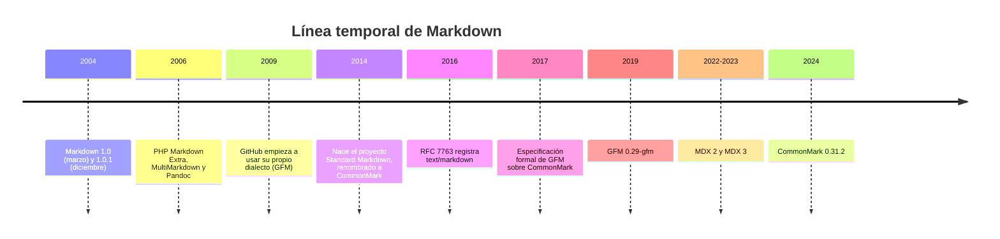

# 2. Historia de Markdown

> [← Índice general](README.md) · Capítulo 2 de 63

## 2.1 Origen

- **John Gruber** (autor del blog *Daring Fireball*) diseñó Markdown y escribió el script original en Perl, `Markdown.pl`. Publicó **Markdown 1.0 el 19 de marzo de 2004**; la versión **1.0.1** (diciembre de 2004) fue la última que publicó el autor.
- **Aaron Swartz** colaboró en el diseño de la sintaxis y aportó retroalimentación decisiva; Gruber lo reconoce como colaborador clave en la documentación original. Swartz también es autor de *atx*, un formato de marcado propio cuya idea de encabezados con `#` influyó en Markdown.
- Objetivo original: ofrecer una forma de escribir para la web que fuese **fácil de leer y de escribir**, con salida HTML (originalmente XHTML) válida.
- La descripción original **no era una especificación formal**: dejaba muchos casos sin definir, lo que provocó implementaciones divergentes.

## 2.2 Evolución

- El Markdown original quedó como **descripción informal** sin especificación formal y con casos ambiguos; el script original dejó de evolucionar.
- Aparecieron numerosas implementaciones (PHP Markdown, Python-Markdown, Showdown, Pandoc, etc.) con comportamientos distintos.
- Esa fragmentación motivó la creación de **CommonMark** (≈2014) y de especificaciones específicas como **GFM** (formalizada por GitHub sobre CommonMark).
- En **2016** se registró el tipo de medio `text/markdown` (RFC 7763) y se documentaron variantes en RFC 7764.

## 2.3 Dialectos principales

| Dialecto | Origen / idea |
|---|---|
| Markdown original (Gruber) | Sintaxis y `Markdown.pl` de 2004 |
| Markdown Extra | Extensión de PHP Markdown (Michel Fortin): tablas, notas al pie, listas de definición, atributos |
| MultiMarkdown | Fletcher Penney: metadatos, tablas, notas, citas, referencias cruzadas |
| CommonMark | Especificación rigurosa y suite de pruebas (John MacFarlane y otros) |
| GFM | Superconjunto de CommonMark mantenido por GitHub |
| Pandoc Markdown | Dialecto muy extenso de Pandoc |
| MDX | Markdown + JSX (no es Markdown estándar) |

## 2.4 Línea temporal

| Año | Hito |
|---|---|
| 2004 | Gruber publica Markdown 1.0 (marzo) y 1.0.1 (diciembre) |
| 2004-2006 | Aparecen PHP Markdown, Markdown Extra y MultiMarkdown; John MacFarlane inicia Pandoc (2006) |
| 2008-2009 | Se popularizan Stack Overflow y GitHub; GitHub desarrolla su variante (GFM) |
| 2014 | Nace el proyecto que acaba llamándose **CommonMark** |
| 2016 | Se registra el tipo de medio `text/markdown` en el [RFC 7763](https://www.rfc-editor.org/rfc/rfc7763) |
| 2017 | GitHub publica la especificación formal de GFM, basada en CommonMark |
| 2017-2018 | Aparece MDX (John Otander) |
| 2019 | Especificación GFM 0.29-gfm |
| 2022-2023 | MDX 2 (2022) y MDX 3 (2023), basados en el ecosistema unified/micromark |
| 2024 | CommonMark 0.31.2 |
| 2020s | GitHub incorpora Mermaid, fórmulas matemáticas, notas al pie y alertas en su Markdown |

> Las fechas intermedias son aproximadas; las de Markdown 1.0, el RFC 7763 y las versiones de especificación figuran en documentación oficial. Consulta las fuentes de la [sección 55](55-recursos-y-documentacion-oficial.md) para precisiones.

---

[← 1. Introducción a Markdown](01-introduccion-a-markdown.md) · [Índice general](README.md) · [3. Cómo funciona Markdown →](03-como-funciona-markdown.md)
