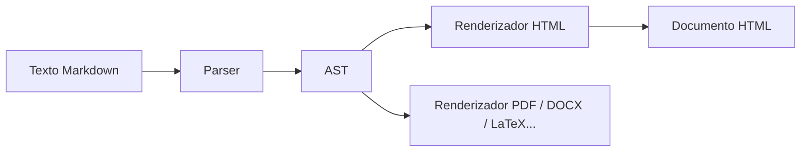

# 3. Cómo funciona Markdown

> [← Índice general](README.md) · Capítulo 3 de 63

## 3.1 Lenguaje de marcado ligero

Un lenguaje de marcado ligero usa **convenciones de texto plano** (símbolos como `#`, `*`, `-`, `>`) en lugar de etiquetas explícitas. El software interpreta esas convenciones y genera la salida formateada.

## 3.2 Pipeline de conversión



1. **Parser**: lee el texto y reconoce bloques (párrafos, listas, código) y elementos en línea (énfasis, enlaces).
2. **AST (Abstract Syntax Tree)**: representación en árbol del documento (nodos como `heading`, `paragraph`, `list`, `emphasis`…). Muchos procesadores modernos (CommonMark, Pandoc, remark/unified) trabajan con un AST.
3. **Renderizador**: recorre el árbol y emite HTML u otro formato.

Los parsers *clásicos* (como `Markdown.pl`) usaban expresiones regulares y conversión directa a HTML; los modernos suelen ser de dos fases (bloques → inline).

Implementaciones de referencia y habituales:

| Implementación | Lenguaje | Notas |
|---|---|---|
| `cmark` / `cmark-gfm` | C | Referencia de CommonMark; `cmark-gfm` añade las extensiones de GitHub |
| `commonmark.js` | JavaScript | Implementación de referencia en JavaScript |
| `markdown-it` | JavaScript | CommonMark + plugins; base de muchas webs y de la vista previa de VS Code |
| `marked` | JavaScript | Rápida y muy extendida |
| `remark` / `micromark` | JavaScript | Ecosistema unified basado en AST; base de MDX |
| `pulldown-cmark` | Rust | Usado por rustdoc |
| `Python-Markdown` | Python | Base de MkDocs, con extensiones |
| `Goldmark` | Go | Parser de Hugo (CommonMark + extensiones) |
| Pandoc | Haskell | Múltiples dialectos de entrada y salida |

## 3.3 Sintaxis frente a especificación

| Concepto | Descripción |
|---|---|
| Markdown como **sintaxis** | Convenciones de escritura (`# título`, `**negrita**`) |
| Markdown como **especificación** | Reglas precisas y verificables sobre cómo interpretar cada caso. Markdown original no la tenía; **CommonMark** sí |
| Markdown como **implementación** | Programa concreto (markdown-it, cmark, Pandoc, Goldmark…) |

## 3.4 Ejemplo de AST conceptual

Entrada:

```markdown
## Hola *mundo*
```

AST simplificado (representación ilustrativa, no de una librería concreta):

```text
document
└── heading (level=2)
    ├── text "Hola "
    └── emphasis
        └── text "mundo"
```

Salida HTML:

```html
<h2>Hola <em>mundo</em></h2>
```

---

[← 2. Historia de Markdown](02-historia-de-markdown.md) · [Índice general](README.md) · [4. Sintaxis básica →](04-sintaxis-basica.md)
