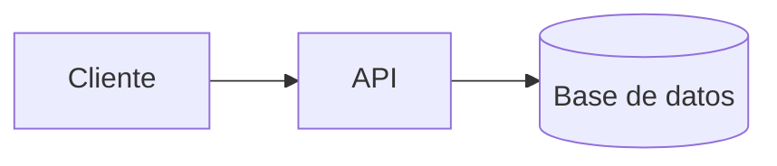

# 8. README.md

> [← Índice general](README.md) · Capítulo 8 de 63

## 8.1 Qué es un README

El **README** es el archivo de presentación de un proyecto: la primera cosa que lee un usuario o contribuidor. En GitHub, el `README.md` de la raíz (o de `.github/` o `docs/`) se muestra automáticamente en la página del repositorio.

## 8.2 Estructura recomendada

| Sección | Contenido |
|---|---|
| Nombre del proyecto | Título y logo opcional |
| Descripción | Qué hace y para quién, en 1-3 frases |
| Características | Lista breve de funciones clave |
| Tecnologías | Lenguajes, frameworks, versiones |
| Requisitos | Software y versiones necesarias |
| Instalación | Pasos reproducibles |
| Configuración | Variables de entorno, archivos de configuración |
| Uso | Comandos y ejemplos mínimos |
| Ejemplos | Casos más completos |
| Capturas | Imágenes o GIFs con alt descriptivo |
| Arquitectura | Diagrama (Mermaid) y enlace a docs |
| Documentación | Enlaces a `docs/` o sitio web |
| API | Resumen y enlace a referencia |
| Tests | Cómo ejecutarlos |
| Contribución | Enlace a `CONTRIBUTING.md` |
| Licencia | Tipo de licencia y archivo `LICENSE` |
| Autoría | Autores y agradecimientos |
| Contacto | Canal de soporte |
| Estado del proyecto | Activo, mantenimiento, archivado, hoja de ruta |

## 8.3 Plantilla completa

````markdown
# Nombre del Proyecto


> Descripción breve (una o dos frases) de qué hace el proyecto y qué problema resuelve.

## Tabla de contenidos

- [Características](#características)
- [Tecnologías](#tecnologías)
- [Requisitos](#requisitos)
- [Instalación](#instalación)
- [Configuración](#configuración)
- [Uso](#uso)
- [Arquitectura](#arquitectura)
- [Documentación](#documentación)
- [Tests](#tests)
- [Contribución](#contribución)
- [Licencia](#licencia)
- [Autoría y contacto](#autoría-y-contacto)
- [Estado del proyecto](#estado-del-proyecto)

## Características

- Característica 1
- Característica 2
- Característica 3

## Tecnologías

- Lenguaje: Rust 1.80+ / Java 21 / Node.js 20+
- Base de datos: PostgreSQL 16
- Otras: Docker, GitHub Actions

## Requisitos

- Git
- Docker 24+ (opcional)
- Node.js 20+

## Instalación

```bash
git clone https://github.com/usuario/repo.git
cd repo
npm install
```

## Configuración

Copia el archivo de ejemplo y edítalo:

```bash
cp .env.example .env
```

| Variable | Descripción | Valor por defecto |
|---|---|---|
| `PORT` | Puerto HTTP | `8080` |
| `DATABASE_URL` | Cadena de conexión | — |

## Uso

```bash
npm start
```

Ejemplo mínimo:

```javascript
import { saludar } from "nombre-del-proyecto";
console.log(saludar("mundo"));
```


## Arquitectura



Más detalles en [docs/arquitectura.md](docs/arquitectura.md).

## Documentación

- [Guía de instalación](docs/instalacion.md)
- [Referencia de la API](docs/api.md)

## Tests

```bash
npm test
```

## Contribución

Lee [CONTRIBUTING.md](CONTRIBUTING.md) antes de abrir un pull request.

## Licencia

Distribuido bajo licencia MIT. Consulta [LICENSE](LICENSE).

## Autoría y contacto

- Autor/a: Nombre Apellido ([@usuario](https://github.com/usuario))
- Contacto: correo@example.com

## Estado del proyecto

Activo. Consulta el [roadmap](docs/roadmap.md) y el [CHANGELOG](CHANGELOG.md).
````

---

[← 7. Código y documentación de software](07-codigo-y-documentacion-de-software.md) · [Índice general](README.md) · [9. Documentación técnica con Markdown →](09-documentacion-tecnica-con-markdown.md)
