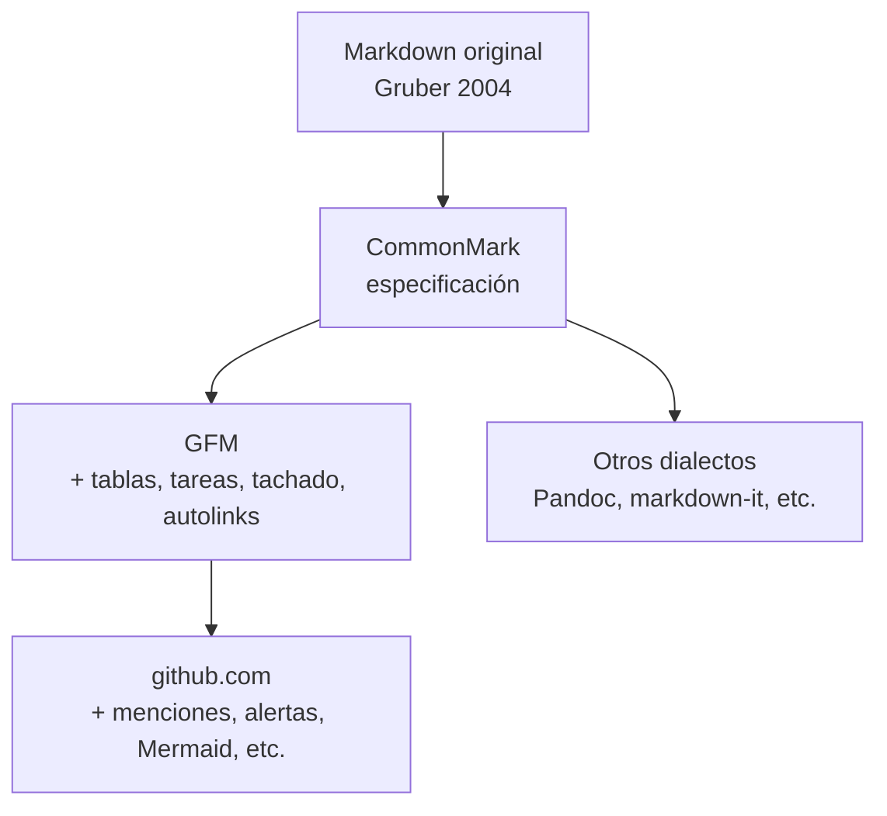

# 11. CommonMark

> [← Índice general](README.md) · Capítulo 11 de 63

## 11.1 Qué es y por qué existe

**CommonMark** es una **especificación formal, sin ambigüedades, de la sintaxis Markdown**, acompañada de una **suite de pruebas** (*spec tests*) y de implementaciones de referencia (`cmark` en C, `commonmark.js` en JavaScript). Nació (≈2014, inicialmente como "Standard Markdown") por iniciativa de John MacFarlane y otros desarrolladores para resolver las **inconsistencias entre implementaciones** del Markdown original.

## 11.2 Objetivos

- Describir de forma **precisa** cómo se interpreta cada construcción.
- Ofrecer **casos de prueba** con la salida HTML esperada.
- Ser una **base común** sobre la que construir extensiones (GFM es el ejemplo principal).
- Mantener el **espíritu original** de legibilidad.

## 11.3 Diferencias relevantes con el Markdown original

| Aspecto | Original | CommonMark |
|---|---|---|
| Especificación | Descripción informal | Especificación formal + tests |
| Título ATX | `#Título` aceptado por algunas implementaciones | Requiere espacio tras `#` |
| Listas | Reglas ambiguas | Reglas definidas (sangría, interrupción de párrafos) |
| Bloques de código con valla | No definidos | Definidos (```` ``` ```` y `~~~`) |
| Énfasis | Casos ambiguos | Algoritmo de delimitadores definido |
| Saltos de línea duros | Solo dos espacios | Dos espacios **o barra invertida** |
| HTML en bloque | Reglas parciales | 7 tipos de bloque HTML definidos |
| Entidades HTML y escapes | Parcialmente descritos | Totalmente definidos |

## 11.4 Compatibilidad y relación con GFM

CommonMark **no incluye** tablas, tachado, listas de tareas, notas al pie ni diagramas. Son extensiones que se añaden por encima (GFM las define en su especificación).



## 11.5 Especificación oficial

- Sitio: <https://commonmark.org/>
- Especificación (versión actual publicada): <https://spec.commonmark.org/current/>
- Versión 0.31.2 (la más reciente al redactar): <https://spec.commonmark.org/0.31.2/>
- *Playground* (Dingus): <https://spec.commonmark.org/dingus/>
- Guía de 10 minutos: <https://commonmark.org/help/>

> Comprueba en el sitio oficial cuál es la versión vigente antes de citarla en un documento normativo.

---

[← 10. GitHub Flavored Markdown (GFM)](10-github-flavored-markdown-gfm.md) · [Índice general](README.md) · [12. Variantes y dialectos de Markdown →](12-variantes-y-dialectos-de-markdown.md)
