# 14. Mermaid

> [← Índice general](README.md) · Capítulo 14 de 63

## 14.1 Qué es y para qué sirve

**Mermaid** es una herramienta de **diagramas y gráficos basada en texto** (librería JavaScript) que genera SVG a partir de una descripción escrita en un lenguaje propio. Sirve para mantener diagramas **versionados junto al código**, editables en un PR y sin archivos binarios.

> **Mermaid NO forma parte del estándar Markdown.** Es un proyecto independiente que ciertas plataformas (GitHub, GitLab, Obsidian, etc.) o plugins integran sobre bloques de código.

## 14.2 Cómo funciona

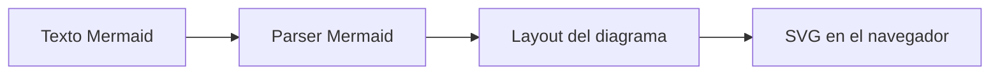

El renderizado ocurre normalmente **en el navegador** (o mediante la CLI `mmdc`, que genera SVG/PNG/PDF).

## 14.3 Integración con Markdown

Se escribe un **bloque de código con valla** cuyo lenguaje es `mermaid`:

````markdown
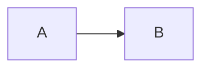
````

Si el entorno no soporta Mermaid, se verá como un bloque de código normal (degradación elegante).

**Fuera de plataformas integradas** se puede cargar la librería desde un CDN:

```html
<pre class="mermaid">
flowchart LR
    A[Inicio] --> B[Fin]
</pre>

<script type="module">
  import mermaid from 'https://cdn.jsdelivr.net/npm/mermaid@11/dist/mermaid.esm.min.mjs';
  mermaid.initialize({ startOnLoad: true });
</script>
```

**Generación en línea de comandos** con `@mermaid-js/mermaid-cli`:

```bash
npm install -g @mermaid-js/mermaid-cli
mmdc -i diagrama.mmd -o diagrama.svg
```

## 14.4 Compatibilidad

| Entorno | Soporte / integración |
|---|---|
| GitHub (README, issues, PR, wikis, discusiones) | Sí, nativo (versión gestionada por GitHub) |
| GitLab | Sí, nativo |
| VS Code | Con extensión (p. ej. *Markdown Preview Mermaid Support*) |
| Obsidian | Sí, nativo |
| MkDocs | Con plugin o *superfences* (p. ej. `pymdownx.superfences`) |
| Docusaurus | Con `@docusaurus/theme-mermaid` |
| VitePress / Astro | Con plugin o componente propio |
| Pandoc / PDF | Requiere filtro (p. ej. `mermaid-filter`) o CLI previa |
| CommonMark / GFM puros | No: se muestra como bloque de código |

La **versión de Mermaid** integrada varía según la plataforma: los diagramas nuevos o en beta pueden no estar disponibles en todas partes.

## 14.5 Sintaxis general

- La **primera línea** declara el tipo (`flowchart`, `sequenceDiagram`, `classDiagram`…).
- Comentarios con `%%`.
- Directivas/configuración mediante un bloque `---` (front matter de Mermaid) o `%%{init: …}%%`.
- Identificadores sin espacios; el texto visible va entre corchetes/comillas.
- Evita palabras reservadas como `end` en minúsculas como texto de nodo (usa `"end"` o `End`).

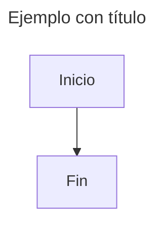

## 14.6 Flowcharts

**Qué representa:** procesos, algoritmos, flujos de decisión. **Cuándo usarlo:** lógica de negocio, pipelines, árboles de decisión.

**Sintaxis:** `flowchart TD|LR|BT|RL`; nodos `A[rect]`, `B(redondeado)`, `C{decisión}`, `D[(BD)]`, `E((círculo))`; flechas `-->`, `---`, `-.->`, `==>`, con etiqueta `-->|texto|`; agrupación con `subgraph`.

| Forma | Sintaxis |
|---|---|
| Rectángulo | `A[Texto]` |
| Bordes redondeados | `A(Texto)` |
| Estadio (inicio/fin) | `A([Texto])` |
| Rombo (decisión) | `A{Texto}` |
| Cilindro (base de datos) | `A[(Texto)]` |
| Círculo | `A((Texto))` |
| Entrada/salida (paralelogramo) | `A[/Texto/]` |

| Conexión | Sintaxis |
|---|---|
| Flecha | `A --> B` |
| Línea | `A --- B` |
| Con texto | `A -- texto --> B` o `A -->\|texto\| B` |
| Punteada | `A -.-> B` |
| Gruesa | `A ==> B` |

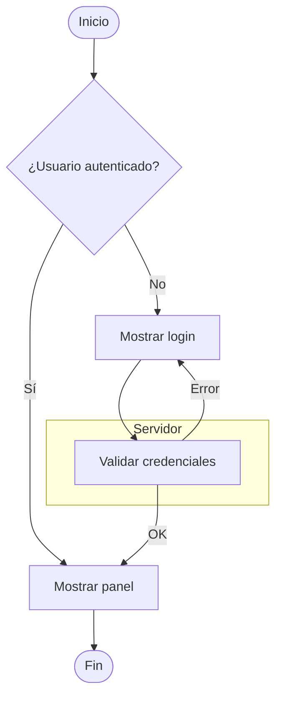

**Explicación:** `{ }` crea un rombo de decisión; las etiquetas `|Sí|` describen las aristas; `subgraph` agrupa nodos.

**Buenas prácticas:** una dirección consistente, pocos nodos por diagrama (≤ 15-20), etiquetas cortas, subgrafos para agrupar.

## 14.7 Sequence diagrams

**Representa:** interacciones entre participantes a lo largo del tiempo. **Úsalo para:** llamadas entre servicios, protocolos, autenticación.

**Sintaxis:** `participant`, `actor`, mensajes `->>` (síncrona), `-->>` (respuesta), `-x` (mensaje perdido), `alt/else/end`, `opt`, `par`, `loop`, `Note over`; `autonumber` numera los mensajes.

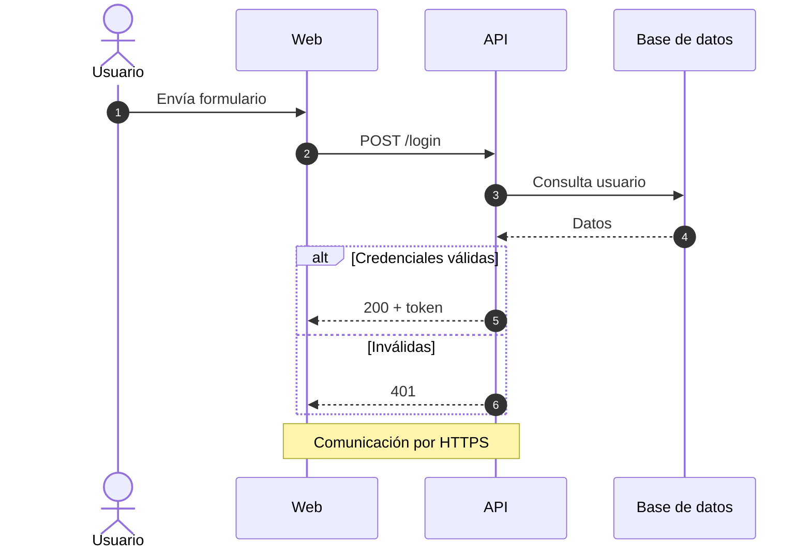

**Buenas prácticas:** alias cortos, nombres de mensaje con verbo, `alt`/`loop` solo si aclaran.

## 14.8 Class diagrams

**Representa:** clases, atributos, métodos y relaciones (UML). **Úsalo para:** modelos de dominio, diseño orientado a objetos.

**Sintaxis:** `class Nombre { +tipo atributo; +metodo() }`; relaciones `<|--` herencia, `*--` composición, `o--` agregación, `-->` asociación, `..>` dependencia, `..|>` realización.

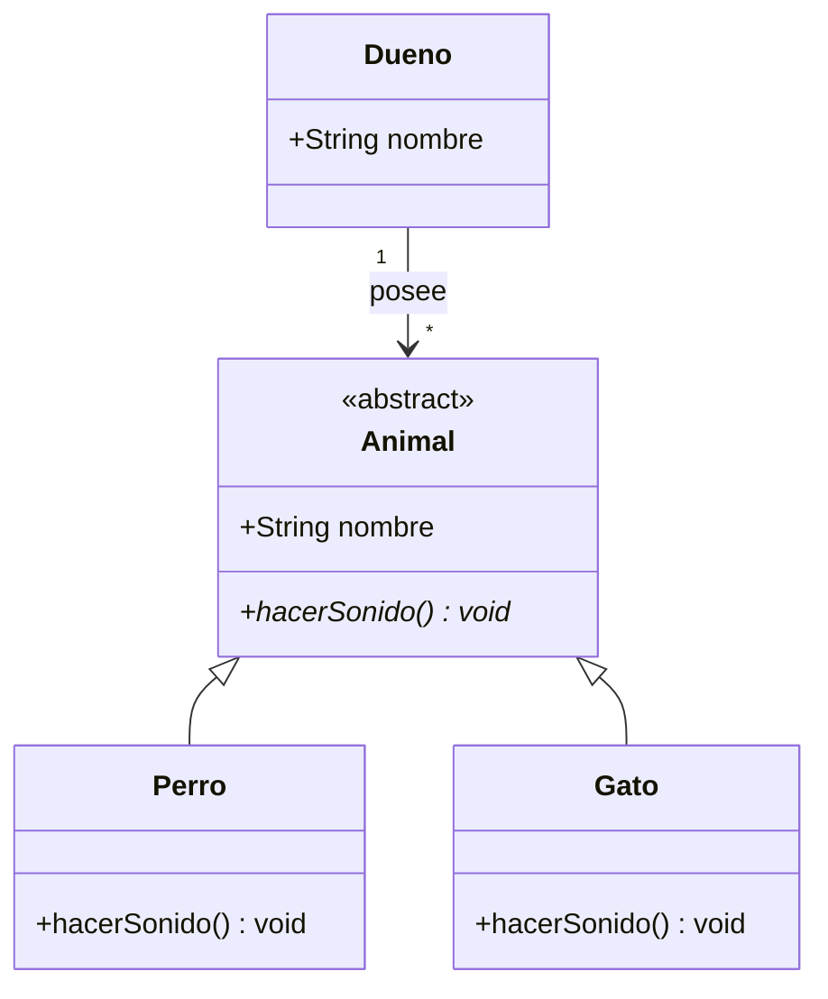

**Explicación:** `<|--` indica herencia; `"1"` y `"*"` son multiplicidades; `<<abstract>>` es un estereotipo.

## 14.9 State diagrams

**Representa:** estados y transiciones de un sistema. **Úsalo para:** ciclo de vida de pedidos, máquinas de estados, UI.

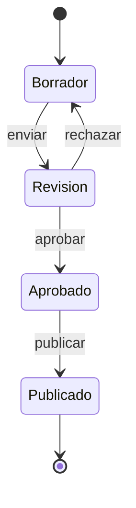

**Buenas prácticas:** nombra estados con sustantivos/adjetivos y transiciones con eventos.

## 14.10 Entity Relationship diagrams

**Representa:** entidades, atributos y cardinalidades. **Úsalo para:** modelado de bases de datos.

**Sintaxis de cardinalidad:** `||` uno exacto, `o|` cero o uno, `}o` cero o muchos, `}|` uno o muchos.

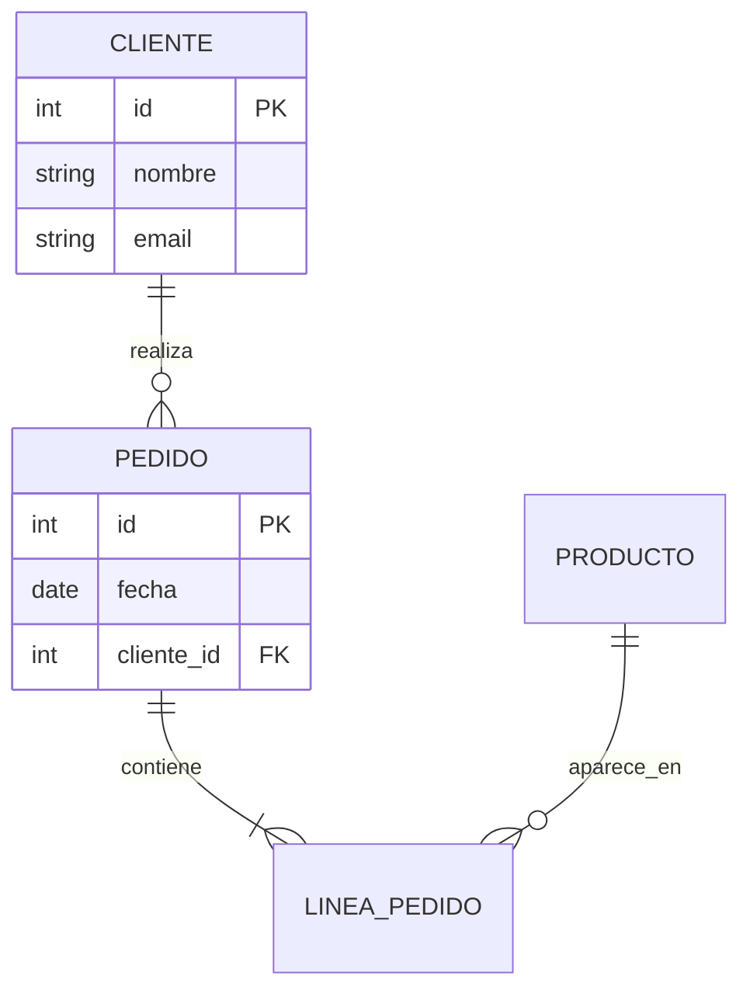

## 14.11 User Journey

**Representa:** la experiencia de un usuario por etapas, con puntuación de satisfacción (1-5).

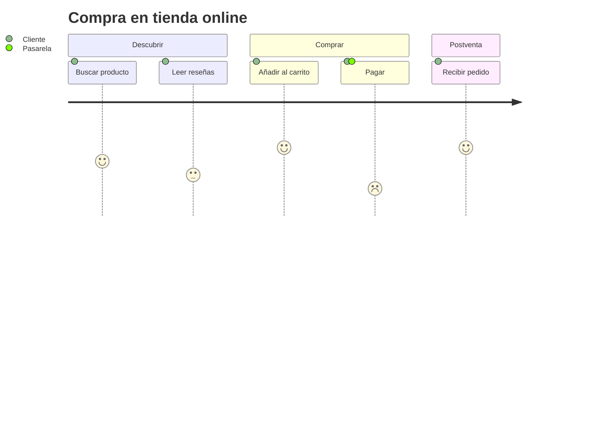

## 14.12 Gantt

**Representa:** planificación temporal de tareas y dependencias.

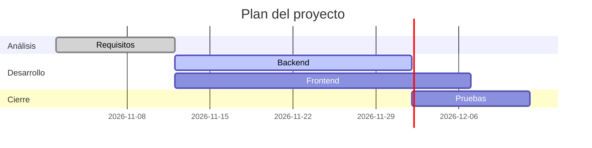

**Buenas prácticas:** fechas en formato ISO, identificadores para dependencias (`after id`).

## 14.13 Pie charts

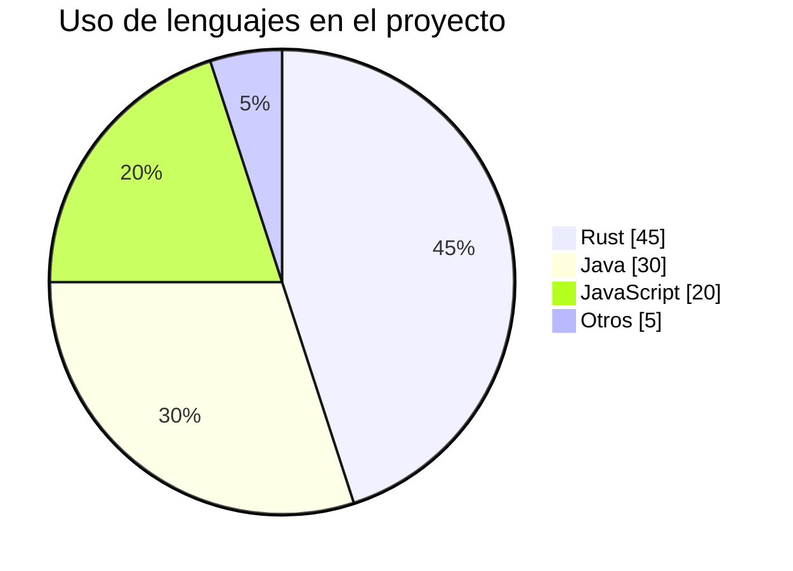

Úsalo solo con pocas categorías que sumen un total con sentido.

## 14.14 Git graphs

**Representa:** ramas, commits y merges.

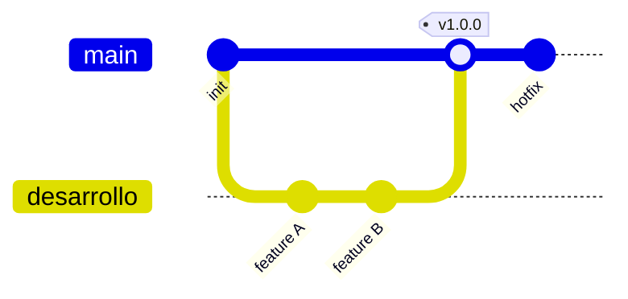

## 14.15 Mindmaps

**Representa:** ideas jerárquicas; la jerarquía se define **por indentación**.

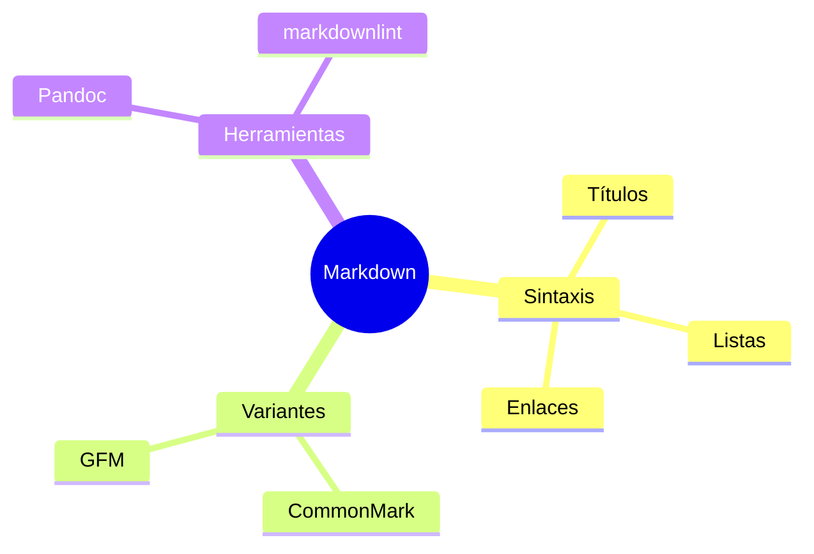

## 14.16 Timelines

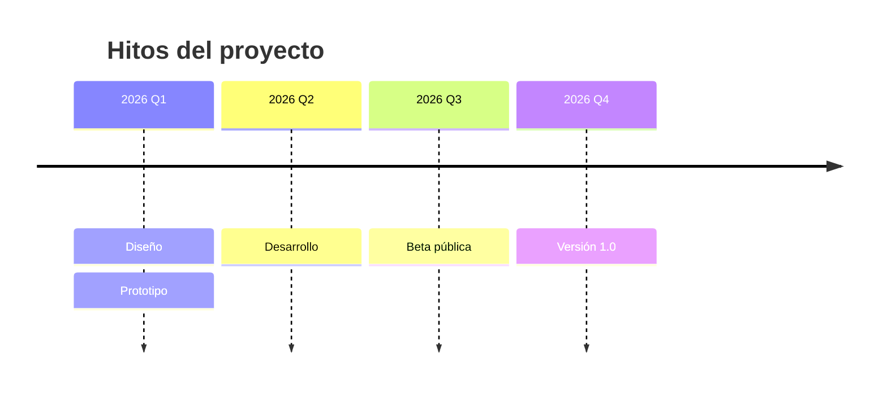

## 14.17 Architecture diagrams

Tipo introducido como `architecture-beta` (su sintaxis y disponibilidad pueden cambiar; **compruébalo en la documentación de Mermaid y en la versión integrada en tu plataforma**). Representa servicios, grupos y conexiones de infraestructura.

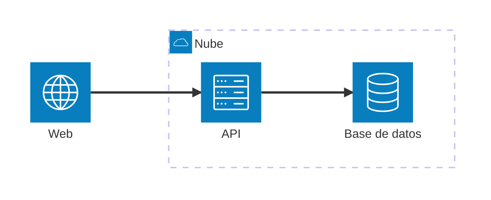

**Alternativa estable:** un `flowchart` con `subgraph` (funciona en más entornos):

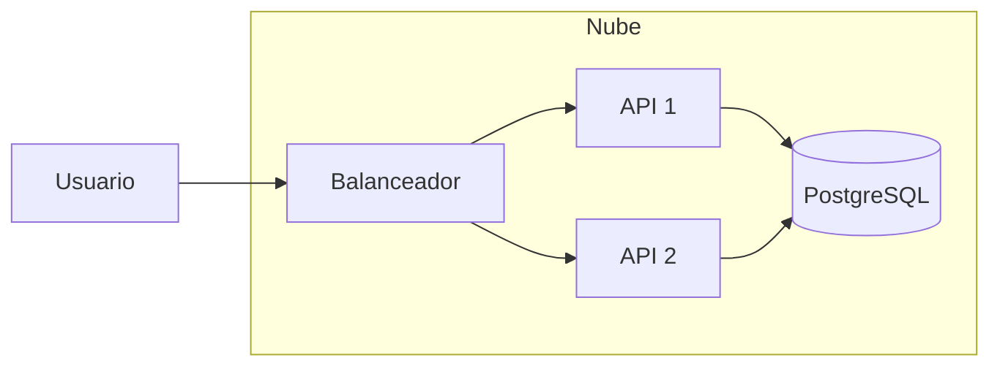

También existe el tipo **C4** (`C4Context`, etc.) en modo experimental.

## 14.18 Quadrant charts

**Representa:** elementos posicionados en dos ejes (p. ej. matriz esfuerzo/impacto). Coordenadas entre 0 y 1.

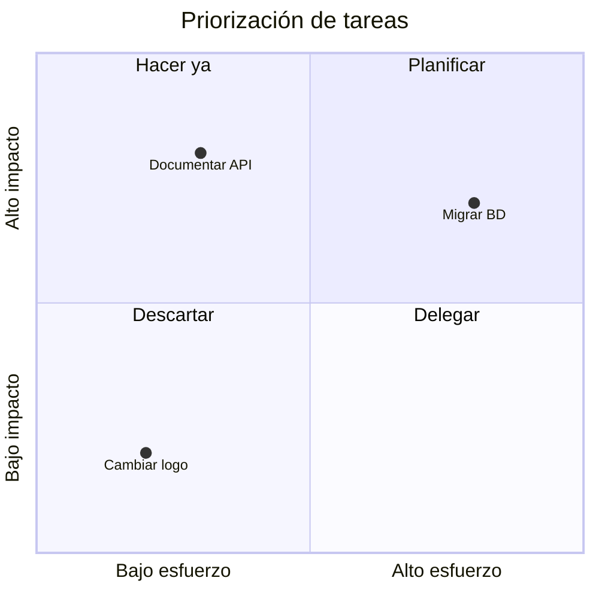

## 14.19 XY charts

Tipo `xychart-beta` (nombre y sintaxis susceptibles de cambio; verifícalo). Representa series en ejes X/Y como barras y líneas.

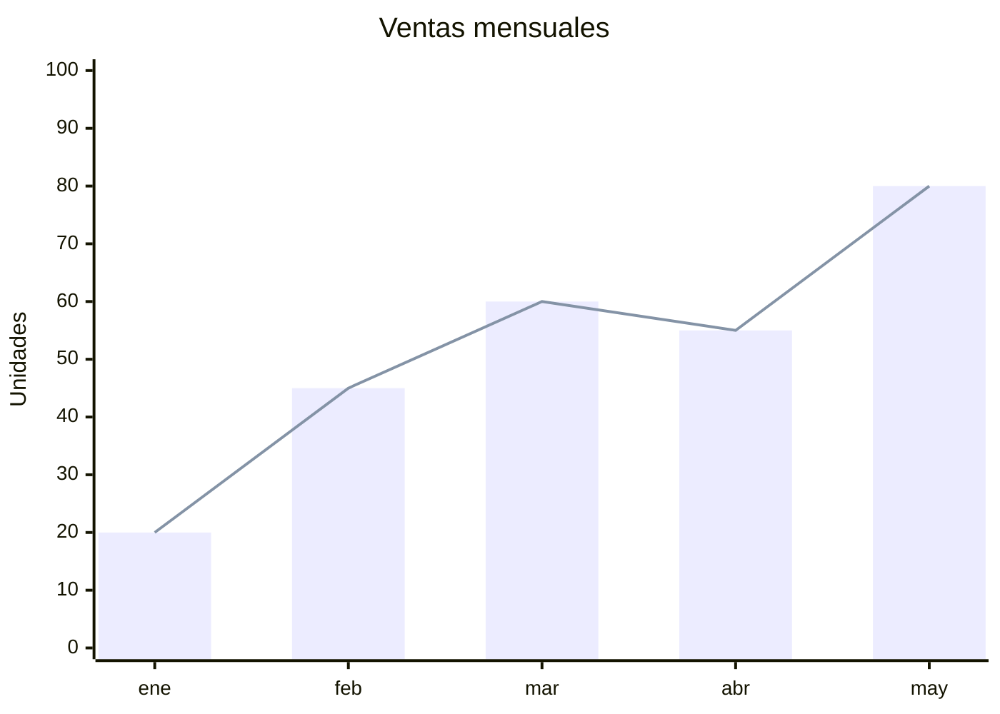

## 14.20 Configuración del diagrama

**Directiva `%%{init}%%`:** permite fijar tema y opciones **dentro del propio diagrama** (es sintaxis de Mermaid, no de Markdown):

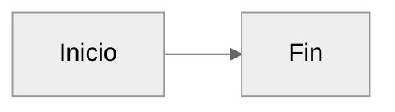

| Opción | Valores habituales | Efecto |
|---|---|---|
| `theme` | `default`, `neutral`, `dark`, `forest`, `base` | Paleta general del diagrama |
| `themeVariables` | Objeto de colores | Personalización fina (solo con `base`) |
| `flowchart.curve` | `basis`, `linear`, `step`… | Forma de las líneas |
| `sequenceDiagram.mirrorActors` | `true`/`false` | Duplica o no los actores |
| `securityLevel` | `strict`, `loose`… | Permisos de interacción |

> En plataformas gestionadas (GitHub, GitLab) la configuración global **la impone la plataforma**; `%%{init}%%` puede ignorarse o estar limitada por seguridad.

La alternativa equivalente es la **cabecera YAML propia de Mermaid** al inicio del diagrama:

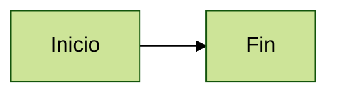

## 14.21 Accesibilidad del diagrama: `accTitle` y `accDescr`

Mermaid admite un **título** y una **descripción** accesibles que se incorporan al SVG (`<title>` y `<desc>`): es la forma de que un lector de pantalla anuncie qué representa el diagrama.

```mermaid
flowchart LR
    accTitle: Flujo de despliegue
    accDescr: El código pasa por pruebas y, si son correctas, se despliega.
    Codigo[Código] --> Pruebas[Pruebas] --> Despliegue[Despliegue]
```

Complementa siempre `accTitle`/`accDescr` con una frase de texto **fuera** del bloque: no todos los renderizadores conservan esos metadatos (ver [sección 47](47-accesibilidad.md)).

## 14.22 Otros diagramas disponibles

Según la documentación de Mermaid (la lista crece y algunos son **beta/experimentales**), además de los anteriores existen, entre otros: **Requirement diagram** (`requirementDiagram`), **C4**, **Sankey** (`sankey-beta`), **Block diagram** (`block-beta`), **Packet** (`packet-beta`), **Kanban**, **Radar** y **ZenUML** (plugin externo). Consulta <https://mermaid.js.org/> para la lista vigente y la sintaxis exacta.

**Requisitos:**

```mermaid
requirementDiagram
    requirement login_seguro {
        id: 1
        text: "El sistema exige autenticación"
        risk: high
        verifymethod: test
    }
    element suite_tests {
        type: "test suite"
    }
    suite_tests - verifies -> login_seguro
```

**Sankey** (flujos proporcionales; el *payload* son filas CSV):

```mermaid
sankey-beta

Ingresos,Desarrollo,50
Ingresos,Marketing,20
Ingresos,Operaciones,30
```

**Packet** (estructura de un paquete de red, rangos de bits):

```mermaid
packet-beta
0-15: "Puerto de origen"
16-31: "Puerto de destino"
32-63: "Número de secuencia"
```

**Block** (distribución en cuadrícula):

```mermaid
block-beta
    columns 3
    A["Cliente"] B["API"] C["Base de datos"]
```

**Referencia oficial de sintaxis, por tipo de diagrama:**

| Diagrama | Documentación |
|---|---|
| Flowchart | <https://mermaid.js.org/syntax/flowchart.html> |
| Sequence | <https://mermaid.js.org/syntax/sequenceDiagram.html> |
| Class | <https://mermaid.js.org/syntax/classDiagram.html> |
| State | <https://mermaid.js.org/syntax/stateDiagram.html> |
| ER | <https://mermaid.js.org/syntax/entityRelationshipDiagram.html> |
| User Journey | <https://mermaid.js.org/syntax/userJourney.html> |
| Gantt | <https://mermaid.js.org/syntax/gantt.html> |
| Pie | <https://mermaid.js.org/syntax/pie.html> |
| Git graph | <https://mermaid.js.org/syntax/gitgraph.html> |
| Mindmap | <https://mermaid.js.org/syntax/mindmap.html> |
| Timeline | <https://mermaid.js.org/syntax/timeline.html> |
| Architecture | <https://mermaid.js.org/syntax/architecture.html> |
| Quadrant | <https://mermaid.js.org/syntax/quadrantChart.html> |
| XY chart | <https://mermaid.js.org/syntax/xyChart.html> |
| Sankey | <https://mermaid.js.org/syntax/sankey.html> |
| Block | <https://mermaid.js.org/syntax/block.html> |
| Packet | <https://mermaid.js.org/syntax/packet.html> |
| Requirement | <https://mermaid.js.org/syntax/requirementDiagram.html> |

## 14.23 Buenas prácticas generales

1. **Un diagrama, una idea**; divide los diagramas grandes (más de ~15 nodos suele ser señal de que hay que separarlo).
2. Mantén la fuente Mermaid **en el repositorio** y revísala en los PRs.
3. Prueba en el **Mermaid Live Editor** (<https://mermaid.live>) y después en la plataforma de destino.
4. No dependas de **estilos personalizados** que quizá no funcionen en todos los entornos (ni de temas fijos que se rompen en modo oscuro).
5. Añade **descripción textual** y, si es posible, `accTitle`/`accDescr` (accesibilidad; ver [sección 47](47-accesibilidad.md)).
6. Evita tipos **beta** si el diagrama debe ser estable.
7. Valida la sintaxis en CI con `mmdc` si los diagramas son parte de la documentación publicada.
8. Usa **identificadores cortos** y etiquetas legibles; entrecomilla las etiquetas con caracteres especiales: `A["Texto (con) paréntesis"]`.
9. Comenta el propio diagrama con `%%` al inicio de línea cuando la intención no sea evidente.

---

[← 13. HTML dentro de Markdown](13-html-dentro-de-markdown.md) · [Índice general](README.md) · [15. Mermaid en GitHub →](15-mermaid-en-github.md)
