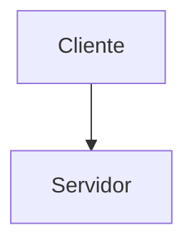
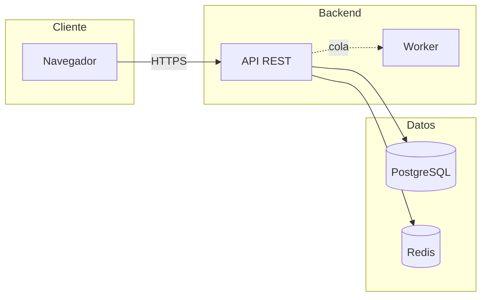
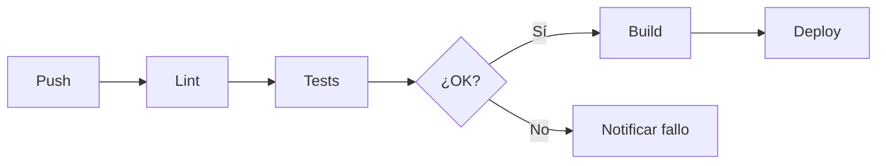
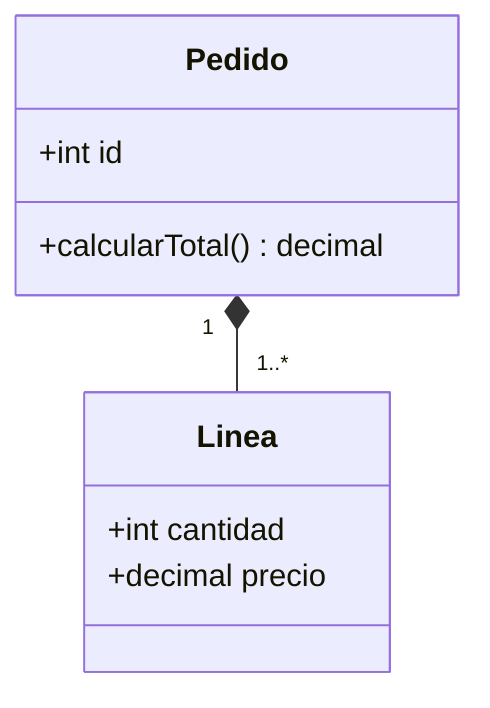

# 15. Mermaid en GitHub

> [← Índice general](README.md) · Capítulo 15 de 63

## 15.1 Sintaxis y dónde funciona

GitHub renderiza Mermaid **de forma nativa** en archivos Markdown, issues, pull requests, discusiones y wikis, cuando se usa un bloque con valla y lenguaje `mermaid`.

````markdown

````

GitHub también permite incluir un **archivo `.mermaid` / `.mmd`** en el repositorio y verlo renderizado.

El diagrama se dibuja dentro de un **iframe aislado** con controles de ampliación y desplazamiento; por eso el resultado puede verse algo distinto al de la vista previa del editor y por eso los enlaces interactivos quedan limitados.

## 15.2 Compatibilidad y limitaciones

- GitHub integra **una versión concreta de Mermaid**: diagramas o sintaxis más recientes pueden no estar disponibles todavía.
- Algunas funciones están **limitadas por seguridad**: por ejemplo, enlaces/`click` y HTML en etiquetas pueden restringirse.
- Los diagramas **no son accesibles** por defecto para lectores de pantalla; añade explicación textual.
- No se pueden cargar **iconos externos** arbitrarios.
- El renderizado puede fallar con **errores de sintaxis**: GitHub muestra un mensaje de error en lugar del diagrama.
- Hay límites de tamaño/complejidad; un diagrama enorme se vuelve ilegible en móvil.
- En herramientas que **no** soportan Mermaid, el bloque se ve como código: el documento sigue siendo legible.

## 15.3 Ejemplos para README

**Arquitectura** (tres capas con `subgraph`):



**Flujo de CI/CD:**



**UML (clases):**



## 15.4 Buenas prácticas en GitHub

1. Coloca diagramas de arquitectura **cerca del inicio** del README o en `docs/arquitectura.md`.
2. Usa `flowchart` en vez de `graph` (más moderno, misma idea).
3. **Prueba la vista previa** del PR antes de fusionar.
4. Proporciona una descripción de texto, `accTitle`/`accDescr` o una tabla equivalente.
5. Mantén el diagrama **pequeño y enfocado**; revisa el README cuando cambie la arquitectura.
6. Evita colores forzados y funciones **beta** en documentos críticos.

## 15.5 Documentación oficial

- Mermaid en GitHub (crear diagramas): <https://docs.github.com/es/get-started/writing-on-github/working-with-advanced-formatting/creating-diagrams>
- Mermaid, sintaxis: <https://mermaid.js.org/intro/syntax-reference.html>
- Mermaid, uso en Markdown/integraciones: <https://mermaid.js.org/ecosystem/integrations-community.html>

---

[← 14. Mermaid](14-mermaid.md) · [Índice general](README.md) · [16. UML y Markdown →](16-uml-y-markdown.md)
