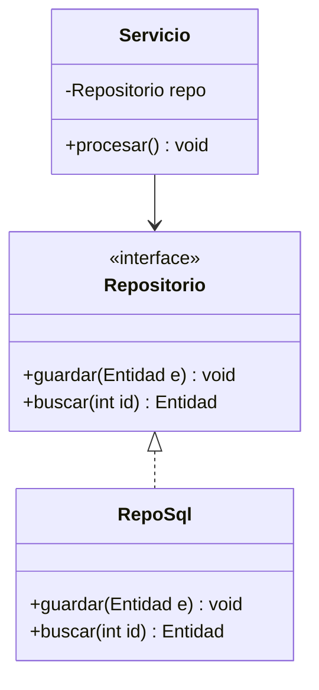
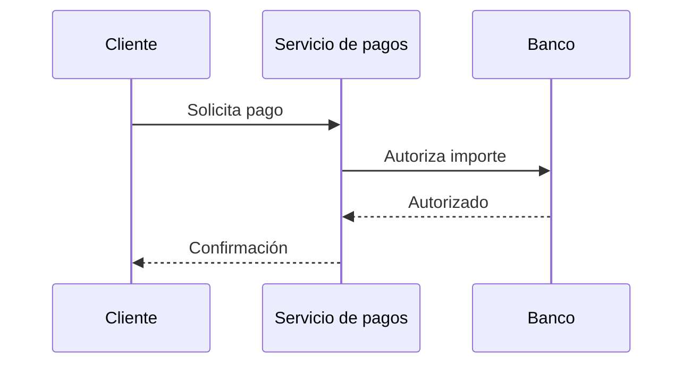
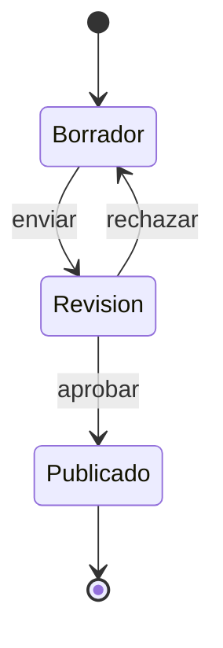
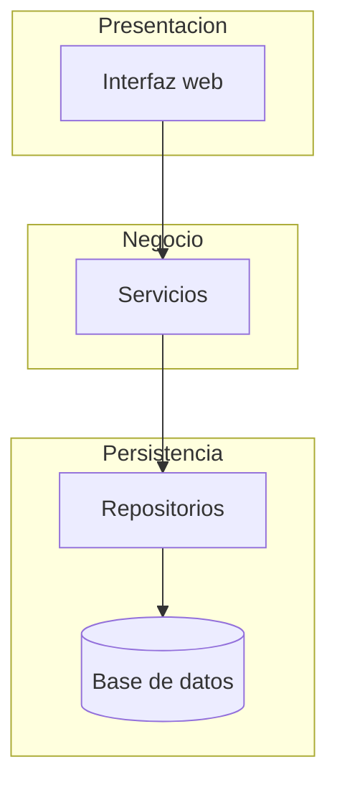
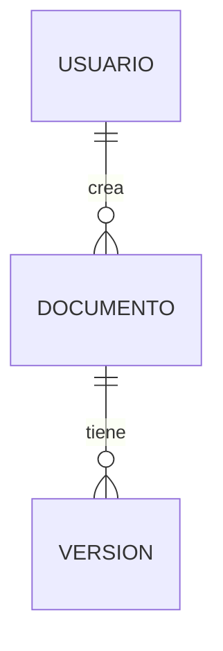
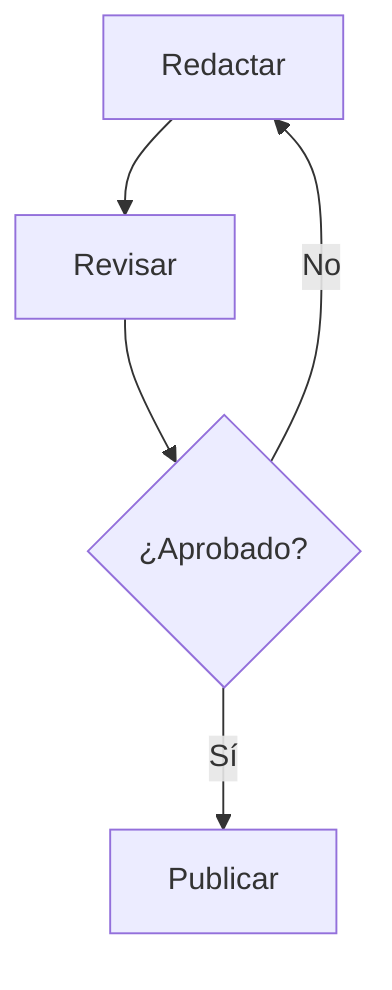
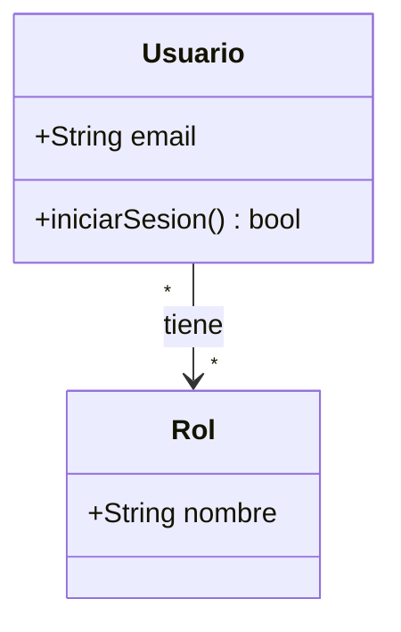

# 16. UML y Markdown

> [← Índice general](README.md) · Capítulo 16 de 63

Markdown solo aporta el contenedor; **Mermaid** aporta los diagramas. Esto permite mantener modelos UML y de arquitectura **como texto versionado**: se revisan en el mismo PR que el código, los diffs son legibles y no hay binarios que se desincronicen.

Mermaid **no cubre todo UML**: no existen tipos propios para diagramas de casos de uso, componentes ni despliegue, aunque pueden aproximarse con `flowchart` y `subgraph` (o con el tipo C4). Para UML estricto se suele recurrir a PlantUML u otras herramientas.

## 16.1 Qué tipo de diagrama usar

| Necesidad UML | Tipo Mermaid |
|---|---|
| Clases y relaciones | `classDiagram` |
| Secuencias | `sequenceDiagram` |
| Estados | `stateDiagram-v2` |
| Entidades/relaciones | `erDiagram` |
| Procesos / actividades | `flowchart` |
| Arquitectura | `flowchart` con `subgraph`, `C4*` o `architecture-beta` |
| Requisitos | `requirementDiagram` |
| Casos de uso, componentes, despliegue | No hay tipo propio: se aproxima con `flowchart` |

## 16.2 Clases y relaciones

| Relación UML | Sintaxis Mermaid |
|---|---|
| Herencia | `A <\|-- B` |
| Composición | `A *-- B` |
| Agregación | `A o-- B` |
| Asociación | `A --> B` |
| Dependencia | `A ..> B` |
| Realización (interfaz) | `A ..\|> B` |



Los sufijos `+` (público), `-` (privado), `#` (protegido) y `~` (paquete) indican visibilidad; `$` marca métodos estáticos y `*` abstractos.

## 16.3 Secuencias



## 16.4 Estados



## 16.5 Arquitecturas por capas



## 16.6 Entidades



## 16.7 Procesos



## 16.8 Elegir el diagrama por la pregunta que responde

| Pregunta | Diagrama |
|---|---|
| ¿Qué **es** y cómo se relaciona? | Clases o ER |
| ¿Cómo **interactúa**? | Secuencia |
| ¿En qué **estado** está? | Estados |
| ¿Cómo se **despliega** / compone? | Arquitectura (`flowchart` + `subgraph`) |
| ¿Qué **pasos** sigue? | Flujo (`flowchart`) |

Ejemplo integrado en un documento de diseño:

````markdown
### Modelo de dominio



El modelo muestra que un usuario puede tener varios roles y un rol puede asignarse a varios usuarios.
````

> Mermaid cubre un **subconjunto** de UML; para diagramas de componentes, despliegue o actividad completos se suele recurrir a PlantUML u otras herramientas.

---

[← 15. Mermaid en GitHub](15-mermaid-en-github.md) · [Índice general](README.md) · [17. Enlaces internos →](17-enlaces-internos.md)
