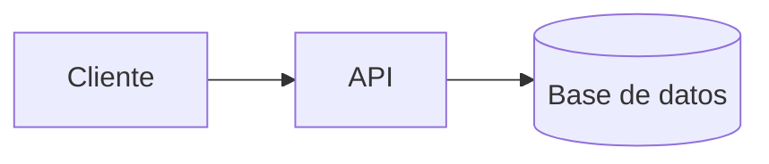

# 21. Documentación de proyectos de software

> [← Índice general](README.md) · Capítulo 21 de 63

La documentación de un proyecto no es un archivo: es un conjunto de respuestas que distintas personas buscan en momentos distintos. Quien evalúa el proyecto quiere saber qué hace; quien lo instala, qué requisitos necesita; quien contribuye, cómo se revisa un cambio; quien opera, qué hacer cuando algo falla.

Este capítulo propone un mapa mínimo y una plantilla ampliable. No todos los proyectos necesitan todos los documentos, pero conviene saber cuáles existen y cuáles se han decidido no tener.

## 21.1 Audiencias y preguntas

| Audiencia | Pregunta | Documento típico |
|---|---|---|
| Persona que descubre el proyecto | ¿Qué es y para quién? | `README.md` |
| Usuario nuevo | ¿Cómo lo instalo y lo pruebo? | Guía de inicio |
| Usuario habitual | ¿Cómo hago X? | Guías de tareas |
| Integrador | ¿Qué parámetros acepta la API? | Referencia de API |
| Contribuidor | ¿Cómo está organizado el código? | Guía de desarrollo |
| Operador | ¿Cómo despliego y recupero el servicio? | Runbooks |
| Equipo técnico | ¿Por qué se tomó esta decisión? | ADR |
| Responsable de cumplimiento | ¿Qué licencia y qué datos maneja? | Licencia, seguridad, privacidad |

Un README que intenta responder a todas esas preguntas se vuelve ilegible. La solución es un README breve con enlaces a documentos específicos.

## 21.2 Documentos mínimos

| Archivo | Función | Cuándo omitirlo |
|---|---|---|
| `README.md` | Puerta de entrada | Nunca |
| `LICENSE` | Términos de uso | Solo si el código no se distribuye |
| `CONTRIBUTING.md` | Cómo contribuir | Proyecto sin contribuciones externas |
| `CHANGELOG.md` | Cambios por versión | Prototipo sin usuarios |
| `SECURITY.md` | Cómo reportar vulnerabilidades | Nunca en proyectos públicos |
| `CODE_OF_CONDUCT.md` | Normas de convivencia | Proyecto unipersonal |
| Guía de instalación | Puesta en marcha | Herramienta sin instalación |
| Guía de desarrollo | Entorno, pruebas, estilo | Proyecto sin código |

Los archivos comunitarios de GitHub (`CONTRIBUTING.md`, `SECURITY.md`, plantillas de issue y PR) se reconocen en la raíz, en `docs/` o en `.github/`. El capítulo [26](26-markdown-y-github.md) explica cómo los usa la plataforma.

## 21.3 Plantilla completa

La plantilla usa cuatro acentos graves para poder mostrar bloques internos:

````markdown
# Nombre del Proyecto

Una frase que explique qué hace y para quién.

## 1. Descripción

Qué problema resuelve, qué incluye y qué no.

## 2. Arquitectura



Componentes, límites y decisiones. Enlaza a los ADR.

## 3. Tecnologías

| Capa | Tecnología | Versión |
|---|---|---|
| Backend | Java | 21 |
| Base de datos | PostgreSQL | 16 |

## 4. Instalación

Requisitos, pasos reproducibles y verificación.

## 5. Configuración

Tabla de variables de entorno y ejemplo de `.env.example`.

## 6. Ejecución

```bash
docker compose up -d
```

## 7. Uso

Ejemplos de CLI o de API, con resultados esperados.

## 8. Estructura del proyecto

```text
src/
  main/
  test/
docs/
```

## 9. Base de datos

Esquema, migraciones y datos de ejemplo.

## 10. API

Resumen de endpoints y enlace a la referencia.

## 11. Pruebas

Cómo ejecutarlas y qué cobertura se exige.

## 12. Despliegue

Entornos, pipeline y procedimiento de reversión.

## 13. Mantenimiento

Copias de seguridad, monitorización, dependencias y runbooks.

## 14. Contribución

Ramas, commits, revisión y criterios de aceptación.

## 15. Licencia

Tipo de licencia y enlace a `LICENSE`.
````

La plantilla es un menú, no un formulario. Un proyecto pequeño puede quedarse en descripción, instalación, uso y licencia. Un servicio crítico necesita, además, operación, seguridad y decisiones.

## 21.4 README: la puerta de entrada

Un buen README responde en menos de un minuto:

1. **Qué es** el proyecto.
2. **Para quién** y qué problema resuelve.
3. **Cómo se instala** o se prueba.
4. **Dónde está** la documentación completa.
5. **Cómo se contribuye** y con qué licencia.

Malas señales: un README que empieza con una lista de tecnologías, que no dice qué hace el proyecto o que solo contiene badges. Los badges no explican nada si el texto no empieza por el propósito (capítulo [27](27-badges.md)).

## 21.5 Documentación extensa

Cuando el README se queda corto, el contenido se organiza por propósito (capítulo [19](19-organizacion-de-documentacion.md)):

```text
docs/
├── README.md
├── inicio/
│   ├── instalacion.md
│   └── primera-ejecucion.md
├── guias/
│   ├── configuracion.md
│   └── migracion.md
├── referencia/
│   ├── cli.md
│   └── api.md
├── explicaciones/
│   └── arquitectura.md
├── operaciones/
│   └── runbook.md
└── decisiones/
    └── 0001-base-de-datos.md
```

Cada carpeta responde a una necesidad distinta y puede tener su propio propietario. La referencia puede generarse desde el código; las guías, no.

## 21.6 Mantener la documentación viva

- **Un propietario por documento** o por carpeta.
- **Fecha de revisión** y estado editorial.
- **Documentación en el mismo repositorio** que el código.
- **Revisión conjunta** de código y documentación en el mismo pull request.
- **Validación en CI**: enlaces, estilo, Front Matter.
- **Deprecación explícita** cuando una página deja de ser válida.

El capítulo [62](62-gobierno-frescura-y-metricas.md) desarrolla el ciclo de vida y las métricas; el [25](25-markdown-y-git.md), el flujo de revisión.

## 21.7 Errores frecuentes

| Error | Consecuencia |
|---|---|
| README que lo explica todo | Nadie lo lee hasta el final |
| Instalación sin verificación | El usuario no sabe si funcionó |
| Documentación solo en la wiki | Se desincroniza y no pasa revisión |
| Capturas sin versión | La interfaz cambió y la imagen miente |
| Enlaces a rutas locales | No funcionan en otro equipo |
| Sin propietario | Nadie la actualiza |
| Sin fecha de revisión | No se distingue lo vigente de lo histórico |

## 21.8 Lista de comprobación

- [ ] El README explica qué es el proyecto, para quién y cómo empezar.
- [ ] La instalación incluye requisitos y verificación.
- [ ] Hay una guía de contribución si se aceptan cambios externos.
- [ ] La licencia está presente y enlazada.
- [ ] Las decisiones relevantes tienen ADR.
- [ ] La operación crítica tiene runbook.
- [ ] La documentación vive en el repositorio y se revisa en PR.
- [ ] Cada documento tiene propietario y fecha de revisión.
- [ ] Los enlaces internos funcionan en el sitio publicado.
- [ ] Lo que no se mantiene está marcado como histórico o retirado.

---

[← 20. Documentación de APIs](20-documentacion-de-apis.md) · [Índice general](README.md) · [22. Changelog →](22-changelog.md)
