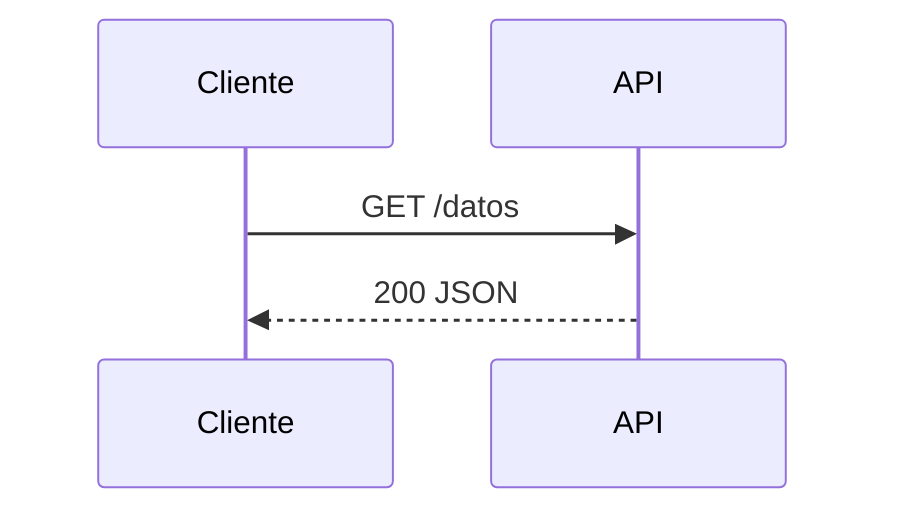
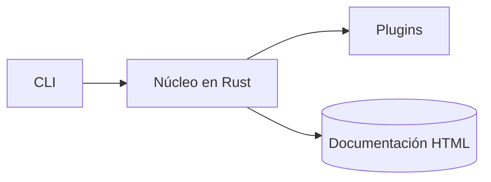

# 29. MDX: creación de páginas web con Markdown y componentes

> [← Índice general](README.md) · Capítulo 29 de 63

## 29.1 ¿Qué es MDX?

**MDX** es un formato que permite **escribir JSX dentro de documentos Markdown** e importar/exportar módulos JavaScript (ESM). Se compila (normalmente a JavaScript que describe un componente) mediante `@mdx-js/mdx` y se integra en frameworks y bundlers.

- **Relación con Markdown:** el contenido textual sigue escribiéndose en Markdown (en la práctica, una base CommonMark; las extensiones como GFM se añaden con plugins `remark`).
- **Relación con JSX:** JSX es una sintaxis tipo XML para describir interfaces en JavaScript (popularizada por React). MDX permite usarla dentro del documento.
- **Qué permite:** insertar **componentes** (`<Boton />`), pasar **props**, usar **expresiones** `{…}`, y usar `import`/`export`.
- **Qué pertenece a qué:**
  - *Markdown*: títulos, listas, énfasis, enlaces, imágenes, código, citas.
  - *JSX*: elementos/componentes con etiquetas y props.
  - *JavaScript/ESM*: `import`, `export`, expresiones entre llaves.
  - *React*: los componentes que se usan normalmente son componentes React (aunque MDX permite otros *runtimes* compatibles con JSX, como Preact o Vue con configuración adecuada).
- **MDX NO es Markdown estándar**: un parser CommonMark/GFM lo interpretaría mal (los `import`, `{}` y componentes aparecerían como texto o HTML inválido).
- **Casos de uso habituales:** documentación interactiva, blogs técnicos, *landing pages* de contenido, tutoriales con ejemplos en vivo, *design systems*.

| Característica | Markdown | MDX |
|---|---|---|
| Texto | Sí | Sí |
| Títulos | Sí | Sí |
| Listas | Sí | Sí |
| Tablas | Depende de la implementación | Depende de la implementación (GFM con plugin `remark-gfm`) |
| Componentes | No | Sí |
| JSX | No | Sí |
| JavaScript | No | Sí |
| Componentes React | No | Sí |
| Interactividad | Limitada | Sí |
| Páginas web | Sí, mediante herramientas | Sí |
| Aplicaciones web | No directamente | Sí, mediante frameworks |

## 29.2 Sintaxis básica de MDX

Todo el Markdown "normal" funciona en un `.mdx` (con las salvedades de la sección 29.5):

````mdx
# Título principal

Un párrafo con **negrita**, *cursiva* y un [enlace](https://mdxjs.com/).

- Elemento 1
- Elemento 2

> Una cita.


```js
console.log("Hola MDX");
```

| Columna A | Columna B |
|---|---|
| 1 | 2 |
````

> Las **tablas**, el tachado y las listas de tareas requieren GFM; en MDX 2+ se activan con el plugin `remark-gfm`.

**Extensiones de archivo:**

```text
.md    Markdown (texto y, como mucho, HTML embebido)
.mdx   MDX (Markdown + JSX + ESM)
```

Algunos frameworks procesan `.md` también con la misma canalización (Docusaurus, Astro, Next.js según configuración), pero en MDX estricto el `.md` se interpreta como Markdown sin JSX salvo que se configure lo contrario.

**Diferencias de sintaxis respecto a Markdown "con HTML" (MDX 2 en adelante):**

- Los comentarios HTML `<!-- -->` **no** se admiten; usa `{/* comentario */}`.
- `<` y `{` tienen **significado especial**: para escribirlos literalmente, usa `\<`, `\{` o `&lt;`/`&#123;`.
- El HTML se interpreta como **JSX** (etiquetas cerradas, `className` en lugar de `class` en algunos contextos, atributos con expresiones).
- Los autoenlaces `<https://…>` **no** están soportados en MDX 2+ (usa `[texto](url)`).
- Las **líneas en blanco** importan: dentro de JSX en bloque, para que el contenido se procese como Markdown hay que separarlo con líneas en blanco.

## 29.3 Componentes dentro de Markdown

Progresión de ejemplos:

**1) Componente simple**

```mdx
<Button>Haz clic aquí</Button>
```

**2) Con props**

```mdx
<Button variant="primary" href="/instalacion">
  Empezar
</Button>
```

**3) Con expresiones en las props**

```mdx
<Chart data={[10, 20, 30]} title="Ventas" />
```

**4) Con contenido Markdown dentro** (nota las líneas en blanco)

```mdx
<Note title="Atención">

Esto es **Markdown** dentro de un componente.

- Se puede usar listas
- y `código`

</Note>
```

**5) Componente interactivo** (definido en el propio documento)

```mdx
import { useState } from 'react'

export function Contador() {
  const [n, setN] = useState(0)
  return <button onClick={() => setN(n + 1)}>Clics: {n}</button>
}

<Contador />
```

Conceptos:

- **Componente:** función que recibe *props* y devuelve JSX.
- **Props:** argumentos del componente (`variant="primary"`).
- **Reutilizables/personalizados:** se definen en archivos `.jsx/.tsx` y se importan.
- **Interactivos:** usan estado (`useState`) y eventos; en frameworks con renderizado en servidor pueden requerir marcarlos como componentes cliente (por ejemplo `"use client"` en Next.js App Router, o directivas de hidratación como `client:load` en Astro).
- **UI:** botones, tarjetas, pestañas, alertas, gráficos.

## 29.4 JSX dentro de MDX

**JSX** es una extensión de sintaxis de JavaScript que permite escribir marcado dentro de código. En MDX:

```mdx
import { Card } from '../components/Card'

export const autor = "Ana"

# Hola

<Card title="Autor" color="blue">
  Escrito por {autor}
</Card>
```

| Elemento | Ejemplo | Pertenece a |
|---|---|---|
| `import` | `import { Card } from './Card'` | ESM (JavaScript) |
| `export` | `export const autor = "Ana"` | ESM |
| Componente | `<Card title="x" />` | JSX |
| Expresión | `{autor}` | JavaScript (dentro de JSX/texto) |
| Título `# Hola` | | Markdown |

Reglas básicas de JSX:

- Las etiquetas deben cerrarse (``, `<br />`).
- Las props de texto usan comillas; las de código usan llaves (`count={3}`).
- Se usan **fragmentos** (`<>…</>`) para devolver varios elementos.
- Los *imports/exports* deben ir a nivel superior del documento.

## 29.5 JavaScript en MDX

Posibilidades:

- **Expresiones** `{1 + 1}` o `{props.nombre}` en línea.
- **Variables y funciones** con `export const`/`export function`.
- **Importación** de módulos y componentes.
- **Exportación** de metadatos (`export const metadata = {…}`, o *front matter* con el plugin adecuado).

Limitaciones:

- No se admiten **sentencias** dentro de las llaves (solo expresiones); no hay `if` ni `for` directos, pero se puede usar `cond ? a : b`, `.map()`, etc.
- El comportamiento **depende del compilador, framework y configuración** (versión de MDX, plugins `remark`/`rehype`, *runtime* JSX, proveedores de componentes, resolución de módulos).
- En unos frameworks el contenido MDX se compila en **tiempo de build**; en otros se evalúa en **tiempo de ejecución** (p. ej. `evaluate` o `MDXRemote`), con implicaciones de seguridad y rendimiento.

> MDX **no** es "Markdown con JavaScript ilimitado": su alcance real lo determinan la herramienta y la configuración.

**Seguridad:** el código de un MDX **se ejecuta**. Véase [29.17](#2917-seguridad-en-mdx).

## 29.6 React + MDX

- MDX genera un componente que puede renderizarse con **React**.
- Los componentes se **importan** o se inyectan globalmente con un **proveedor de componentes** (`components` prop / `MDXProvider` / `mdx-components.tsx`).
- Mediante ese mapa se pueden **reemplazar elementos Markdown** (`h1`, `a`, `pre`, `img`…) por componentes propios.

Ejemplo completo de una página con varios componentes React:

````mdx
import { Alert } from '../components/Alert'
import { Card } from '../components/Card'
import { Tabs, Tab } from '../components/Tabs'
import { Contador } from '../components/Contador'

# Guía rápida de MiLibrería

<Alert type="info">
  Esta guía asume **Node.js 20** o superior.
</Alert>

## Instalación

<Tabs>
  <Tab label="npm">

```bash
npm install mi-libreria
```

  </Tab>
  <Tab label="pnpm">

```bash
pnpm add mi-libreria
```

  </Tab>
</Tabs>

## Prueba interactiva

<Contador />

## Siguientes pasos

<Card title="API" href="/api">Consulta la referencia completa.</Card>
<Card title="Ejemplos" href="/ejemplos">Casos de uso reales.</Card>
````

**Documentación mediante componentes:** se pueden mostrar *playgrounds*, tablas de props generadas desde TypeScript, ejemplos en vivo, etc.

## 29.7 Crear una página web completa con MDX

Ejemplo de página (los comentarios `{/* … */}` indican qué es Markdown y qué es MDX/JSX). Requiere que el framework tenga definidos los componentes `Hero`, `Card`, `Button` y `Mermaid` y soporte el diagrama (véase 29.9):

````mdx
{/* ===== ESM (JavaScript): importaciones y datos ===== */}
import { Hero, Card, Button } from '../components/ui'
import { Mermaid } from '../components/Mermaid'
import { Contador } from '../components/Contador'

export const meta = { titulo: "Mi proyecto", fecha: "2026-10-28" }

{/* ===== JSX: componente de cabecera ===== */}
<Hero title={meta.titulo} subtitle="Documentación interactiva" />

{/* ===== Markdown: título, intro, texto ===== */}
# Bienvenido a Mi proyecto

Esta página combina **Markdown** para el texto y **componentes** para la interacción.
Consulta el [repositorio](https://github.com/usuario/proyecto) o la [guía](/guia).


{/* ===== Markdown: lista y tabla (la tabla requiere GFM) ===== */}
## Características

- Rápido
- Ligero
- Extensible

| Plan | Precio |
|---|---|
| Libre | 0 € |
| Pro | 9 € |

{/* ===== Markdown: código ===== */}
## Código

```js
import { crear } from "mi-proyecto";
crear({ nombre: "demo" });
```

{/* ===== JSX: tarjetas y botón ===== */}
## Empieza ya

<div className="grid">
  <Card title="Guía">Aprende lo básico.</Card>
  <Card title="API">Referencia completa.</Card>
</div>

<Button href="/instalacion">Instalar</Button>

{/* ===== JSX + React: componente interactivo ===== */}
## Pruébalo

<Contador />

{/* ===== Diagrama (depende de plugin/componente) ===== */}
## Arquitectura

<Mermaid chart={`
flowchart LR
  Usuario --> Web --> API
`} />
````

Resumen de partes: **Markdown** (títulos, texto, listas, imagen, tabla, bloque de código, enlaces); **MDX/ESM** (`import`, `export`); **JSX/React** (`Hero`, `Card`, `Button`, `Contador`, `Mermaid`).

## 29.8 Crear documentación web con MDX

MDX permite construir documentación moderna con:

| Uso | Qué aporta MDX |
|---|---|
| Documentación de APIs | Tablas de parámetros con componentes, *playgrounds* de peticiones |
| Librerías y frameworks | Ejemplos de UI renderizados junto al código |
| Tutoriales y guías | Pasos con pestañas, quizzes o comprobaciones interactivas |
| Manuales | Componentes de aviso (`<Warning />`) homogéneos |
| Landing pages | Contenido editable en Markdown con secciones en JSX |
| Blogs técnicos | Gráficos, demos y *embeds* dentro del artículo |
| Documentación interactiva | Editores de código en vivo, selectores de versión/lenguaje |

**Ventajas de los componentes interactivos:** el lector **prueba** lo que lee, se reduce la ambigüedad, el ejemplo se mantiene **sincronizado** con el código real, y el diseño es **coherente** (mismos componentes en todo el sitio).

## 29.9 MDX y Mermaid

La compatibilidad **depende del framework o plugin**. Opciones frecuentes:

1. **Componente propio** que reciba el texto del diagrama y llame a la librería `mermaid` en el cliente.
2. **Plugin rehype** (p. ej. `rehype-mermaid`) que convierte bloques ` ```mermaid ` en SVG durante el build.
3. **Soporte del framework**: Docusaurus incluye `@docusaurus/theme-mermaid`; MkDocs Material y otros tienen configuración propia.

Ejemplo con bloque (si el plugin está configurado):

````mdx

````

Ejemplo con componente propio y expresión de plantilla:

```mdx
import { Mermaid } from '../components/Mermaid'

<Mermaid chart={`
erDiagram
    USUARIO ||--o{ PEDIDO : realiza
`} />
```

Esquema de componente mínimo (conceptual, con la librería `mermaid`):

```jsx
// components/Mermaid.jsx
import { useEffect, useRef } from "react";
import mermaid from "mermaid";

export function Mermaid({ chart }) {
  const ref = useRef(null);
  useEffect(() => {
    mermaid.initialize({ startOnLoad: false, securityLevel: "strict" });
    mermaid.render("m-" + Math.random().toString(36).slice(2), chart).then(({ svg }) => {
      if (ref.current) ref.current.innerHTML = svg;
    });
  }, [chart]);
  return <div ref={ref} role="img" aria-label="Diagrama" />;
}
```

Se pueden representar con este mecanismo: *flowcharts*, arquitectura, UML (clases/secuencia) y ER, como en la [sección 14](14-mermaid.md).

## 29.10 MDX y generadores/frameworks

> **No todos soportan las mismas características.** Revisa siempre la documentación de la versión que uses.

| Herramienta | Qué es | Cómo usa MDX | Crear `.mdx` / insertar componentes | Ventajas | Limitaciones | Documentación |
|---|---|---|---|---|---|---|
| **Next.js** | Framework React | Soporte oficial mediante `@next/mdx` (y alternativas como `next-mdx-remote`) | Archivos `.mdx` como páginas o importados; `mdx-components` para mapear elementos | Control total, SSR/SSG | Configuración manual; interacción con App Router y componentes de cliente | <https://nextjs.org/docs/app/guides/mdx> |
| **Docusaurus** | SSG de documentación (React) | MDX integrado de serie en docs, blog y páginas | `.md`/`.mdx` en `docs/`; importa componentes React | Sidebar, versionado, i18n, Mermaid opcional | Reglas estrictas de MDX (p. ej. comentarios/llaves) | <https://docusaurus.io/docs/markdown-features/react> |
| **Astro** | Framework orientado a contenido | Integración oficial `@astrojs/mdx` | `.mdx` en `src/pages` o colecciones; componentes de Astro/React/Vue/Svelte con directivas `client:*` | Poco JS en cliente, multi-framework | Hay que añadir la integración; interactividad requiere hidratación explícita | <https://docs.astro.build/en/guides/integrations-guide/mdx/> |
| **Gatsby** | Framework React con GraphQL | MDX vía plugin `gatsby-plugin-mdx` | `.mdx` en carpetas de contenido o como páginas | Ecosistema de plugins | Proyecto con menor actividad en los últimos años; verifica su estado antes de adoptarlo | <https://www.gatsbyjs.com/docs/how-to/routing/mdx/> |
| **VitePress** | SSG de documentación (Vue) | **No usa MDX**: ofrece Markdown con componentes **Vue** directamente | `.md` con `<MiComponente />` de Vue | Muy rápido, Vue en Markdown | No admite JSX/React; no es MDX | <https://vitepress.dev/guide/using-vue> |
| **Nextra** | Documentación sobre Next.js | Basado en MDX | `.mdx` en `app/` o `pages/` según la versión | Temas de docs/blog listos | Acoplado a Next.js; cambios entre versiones mayores | <https://nextra.site/> |
| **Storybook** | Taller de componentes UI | Documentación en `.mdx` junto a las *stories* | `.mdx` con bloques de documentación (`Meta`, `Canvas`…) | Documenta componentes con ejemplos vivos | Orientado a UI; API específica | <https://storybook.js.org/docs/writing-docs/mdx> |
| **Starlight** | Tema de documentación para Astro | `.mdx` mediante Astro | Componentes de Starlight (`Tabs`, `Card`, `Aside`) | Documentación lista, accesible | Depende de Astro | <https://starlight.astro.build/> |
| **Fumadocs** | Framework de docs sobre React/Next.js | MDX con fuentes de contenido propias | `.mdx` con componentes incluidos | Flexible, moderno | Ecosistema más joven | <https://fumadocs.dev/> |

(La disponibilidad de funciones y de versiones debe comprobarse en cada documentación oficial.)

## 29.11 MDX y documentación técnica

Estructura de un sistema de documentación:

```text
docs/
├── index.mdx
├── instalacion.mdx
├── configuracion.mdx
├── guia-usuario.mdx
├── arquitectura.mdx
├── api.mdx
└── desarrollo.mdx
```

| Archivo | Contenido |
|---|---|
| `index.mdx` | Portada, propuesta de valor, tarjetas de acceso rápido |
| `instalacion.mdx` | Pestañas por gestor de paquetes/sistema operativo |
| `configuracion.mdx` | Tablas de opciones, avisos |
| `guia-usuario.mdx` | Tutorial paso a paso con componentes interactivos |
| `arquitectura.mdx` | Diagramas Mermaid, decisiones |
| `api.mdx` | Referencia con componentes de endpoints |
| `desarrollo.mdx` | Contribución, tests, publicación |

Organiza el menú lateral con el mecanismo del framework (`sidebars.js` en Docusaurus, `_meta` en Nextra, *content collections* en Astro).

## 29.12 MDX y componentes reutilizables

Una **biblioteca de componentes de documentación** unifica el aspecto y el comportamiento. Ejemplos conceptuales:

| Componente | Propósito | Uso en MDX |
|---|---|---|
| `<Alert />` | Mensaje destacado genérico | `<Alert type="info">…</Alert>` |
| `<Warning />` | Advertencia importante | `<Warning>No ejecutes esto en producción.</Warning>` |
| `<Note />` | Nota aclaratoria | `<Note>Requiere versión 2.0.</Note>` |
| `<Card />` | Tarjeta con enlace | `<Card title="API" href="/api" />` |
| `<Tabs />` | Variantes por entorno/lenguaje | `<Tabs><Tab label="npm">…</Tab></Tabs>` |
| `<CodeBlock />` | Bloque con copiar, título, líneas resaltadas | `<CodeBlock language="rust" title="main.rs">…</CodeBlock>` |
| `<Button />` | Llamada a la acción | `<Button href="/start">Empezar</Button>` |
| `<Image />` | Imagen optimizada con `alt` obligatorio | `<Image src="/img/a.png" alt="…" />` |
| `<Video />` | Vídeo con subtítulos | `<Video src="/demo.mp4" captions="/demo.vtt" />` |

Ejemplo de componente accesible:

```jsx
// components/Alert.jsx
export function Alert({ type = "info", children }) {
  return (
    <div role="note" className={`alert alert-${type}`}>
      {children}
    </div>
  );
}
```

**Componentes vs Markdown convencional:**

| Usa Markdown cuando… | Usa un componente cuando… |
|---|---|
| Es texto, lista, enlace, imagen o código simple | Necesitas interacción, estado o presentación especial |
| Quieres máxima portabilidad | La funcionalidad aporta valor real al lector |
| Va a editarlo gente no técnica | Se repite un patrón (avisos, pestañas) |

## 29.13 MDX frente a Markdown

| Característica | Markdown | MDX |
|---|---|---|
| Simplicidad | Muy alta | Media: añade JSX/ESM |
| Legibilidad | Muy alta | Alta en texto; menor con mucho JSX |
| Portabilidad | Muy alta (cualquier visor) | Baja: necesita compilador/framework |
| Componentes | No | Sí |
| Interactividad | Limitada | Sí |
| JavaScript | No | Sí (limitado por la herramienta) |
| React | No | Sí (principal caso) |
| Documentación | Excelente para texto | Excelente para docs interactivas |
| Páginas web | Con un generador | Con un framework compatible |
| Curva de aprendizaje | Muy baja | Media (JSX, React, tooling) |
| Compatibilidad | GitHub, editores, SSG | Específica de herramienta; GitHub lo muestra como código |
| Seguridad | Segura con sanitizado de HTML | **Ejecuta código**: requiere confianza en la fuente |

## 29.14 MDX frente a HTML

| Aspecto | Markdown | MDX | HTML |
|---|---|---|---|
| Objetivo | Texto estructurado | Texto + componentes | Estructura de página completa |
| Legibilidad | Muy alta | Alta | Media |
| Reutilización | Baja | Alta (componentes) | Baja (copiar/pegar o plantillas) |
| Interactividad | No | Sí (con React) | Sí (con JS) |
| Requiere compilación | Sí (a HTML) | Sí | No |
| Cuándo usarlo | Documentos y notas | Docs/blogs interactivos | Páginas finales, control total |

## 29.15 MDX frente a JSX

- **JSX:** sintaxis para escribir marcado dentro de JavaScript; sin Markdown.
- **MDX:** formato de documento **orientado a contenido** que admite JSX y ESM.
- **En común:** ambos permiten usar componentes y expresiones; ambos se compilan a JavaScript.
- **Diferencias:** en JSX todo el texto es manual (`<p>`, `<h1>`…); en MDX el texto se escribe en Markdown y solo se recurre a JSX cuando hace falta.
- **Qué aporta Markdown a JSX:** escritura de contenido rápida y legible, sin etiquetas, con la potencia de los componentes cuando se necesita.

```jsx
// JSX puro
<article>
  <h1>Título</h1>
  <p>Texto con <strong>negrita</strong>.</p>
</article>
```

```mdx
# Título

Texto con **negrita**.
```

## 29.16 Ventajas y desventajas de MDX

### Ventajas

- Sintaxis sencilla para el contenido.
- Componentes reutilizables.
- Interactividad.
- Integración con React y su ecosistema.
- Documentación avanzada y coherente.
- Reutilización entre páginas.
- Creación de páginas web a partir de contenido.

### Desventajas

- Mayor complejidad respecto a Markdown.
- Menor portabilidad (no se renderiza en GitHub como página).
- Dependencia del ecosistema JavaScript.
- Dependencia del compilador/framework y de su versión.
- Posibles problemas de seguridad.
- Mayor curva de aprendizaje y errores de sintaxis más difíciles de diagnosticar.

## 29.17 Seguridad en MDX

**MDX debe tratarse de forma diferente a Markdown puro:** compila a JavaScript que **se ejecuta**. Cualquier MDX equivale, en la práctica, a **código**.

| Riesgo | Descripción | Mitigación |
|---|---|---|
| JSX/JavaScript | Expresiones y `import` pueden ejecutar código arbitrario | Compilar solo contenido de confianza |
| Componentes | Un componente malicioso o inseguro (p. ej. `dangerouslySetInnerHTML`) amplía la superficie de ataque | Revisar y limitar los componentes disponibles |
| Contenido de usuarios | MDX enviado por usuarios puede ejecutar código en servidor o cliente (**XSS/RCE**) | **No** compilar MDX no confiable; usar Markdown con sanitizado (`rehype-sanitize`) en su lugar |
| Compilación | Compilar en el servidor ejecutaría código en el servidor | Aislar/entornos sin privilegios, o evitar `evaluate` con datos externos |
| Sanitización | La sanitización de HTML no neutraliza expresiones JS de MDX | Restringir mediante plugins que prohíban `import`/expresiones |
| Dependencias | Plugins/componentes de terceros | Auditar (`npm audit`), fijar versiones, revisar cadena de suministro |

Regla práctica: **MDX = código de confianza (tuyo o de tu equipo)**; **Markdown = contenido que puede ser no confiable, siempre con sanitizado**.

## 29.18 Buenas prácticas para MDX

1. **Separar contenido y lógica**: la lógica en componentes, no en el documento.
2. **Reutilizar componentes** en lugar de duplicar JSX.
3. **No abusar de JSX**: si Markdown lo expresa, usa Markdown.
4. **Markdown para el texto**; componentes solo cuando aporten funcionalidad.
5. **Componentes accesibles**: semántica, roles, foco, contraste, `alt`.
6. **Validar contenido** (esquemas de *front matter*, linters para MDX como `eslint-plugin-mdx`, `remark-lint`).
7. **Revisar dependencias** y actualizar versiones.
8. **Estructura clara** de carpetas y nombres.
9. **Documentar los componentes** (props, ejemplos, restricciones).
10. **Evitar lógica innecesaria** en documentos.
11. **Probar la compilación** en CI.

## 29.19 Ejemplo de proyecto MDX completo

```text
mi-documentacion/
├── docs/
│   ├── index.mdx
│   ├── instalacion.mdx
│   ├── configuracion.mdx
│   ├── guia.mdx
│   └── api.mdx
├── components/
│   ├── Alert.jsx
│   ├── Card.jsx
│   └── Button.jsx
├── public/
│   └── images/
├── package.json
└── README.md
```

| Ruta | Contenido |
|---|---|
| `docs/` | Documentos `.mdx`; el contenido real |
| `components/` | Componentes React reutilizables (`Alert`, `Card`, `Button`) |
| `public/images/` | Imágenes y recursos estáticos servidos tal cual |
| `package.json` | Dependencias (framework, MDX, plugins) y scripts (`dev`, `build`) |
| `README.md` | Cómo instalar, ejecutar y contribuir al sitio |

Archivos de configuración adicionales (dependen del framework): `next.config.mjs`, `docusaurus.config.js`, `astro.config.mjs`, etc.

## 29.20 Recursos oficiales de MDX

| Recurso | Enlace | Tipo |
|---|---|---|
| Sitio oficial de MDX | <https://mdxjs.com/> | Oficial |
| Documentación oficial de MDX | <https://mdxjs.com/docs/> | Oficial |
| GitHub oficial (`mdx-js/mdx`) | <https://github.com/mdx-js/mdx> | Oficial |
| React: escribir marcado con JSX | <https://react.dev/learn/writing-markup-with-jsx> | Oficial (React) |
| Next.js: MDX | <https://nextjs.org/docs/app/guides/mdx> | Oficial (Next.js) |
| Docusaurus: MDX y React | <https://docusaurus.io/docs/markdown-features/react> | Oficial (Docusaurus) |
| Astro: integración MDX | <https://docs.astro.build/en/guides/integrations-guide/mdx/> | Oficial (Astro) |
| Nextra | <https://nextra.site/> | Oficial (Nextra) |
| Gatsby: MDX | <https://www.gatsbyjs.com/docs/how-to/routing/mdx/> | Oficial (Gatsby) |
| Storybook: MDX | <https://storybook.js.org/docs/writing-docs/mdx> | Oficial (Storybook) |
| VitePress: Vue en Markdown | <https://vitepress.dev/guide/using-vue> | Oficial (VitePress) |
| Starlight | <https://starlight.astro.build/> | Oficial (Astro) |

> Las URLs de documentación de frameworks se reorganizan con frecuencia: si alguna redirige o falla, parte de la página principal del proyecto.

## 29.21 Ejemplo final: página web completa

Archivo `index.mdx` que combina Markdown, JSX, React, Mermaid, Rust, Java, JavaScript, tablas, imágenes, enlaces y componentes interactivos. Supone que el proyecto define los componentes importados y que el framework tiene soporte para bloques `mermaid` (plugin).

`````mdx
import { Hero, Card, Tabs, Tab, Button } from '../components/ui'
import { Contador } from '../components/Contador'
import { Calculadora } from '../components/Calculadora'

export const info = {
  nombre: "RustDocs",
  version: "1.0.0",
}

<Hero title={info.nombre} subtitle={`Versión ${info.version}`} />

# Bienvenido a {info.nombre}

{info.nombre} es una **biblioteca de ejemplo** para mostrar cómo se combinan
Markdown y componentes. Lee la [guía de inicio](/guia) o visita el
[repositorio](https://github.com/usuario/rustdocs).


## Arquitectura



## Ejemplos por lenguaje

<Tabs>
  <Tab label="Rust">

```rust
use rustdocs::generar;

fn main() {
    generar("docs/").expect("fallo al generar");
}
```

  </Tab>
  <Tab label="Java">

```java
public class Main {
    public static void main(String[] args) {
        RustDocs.generar("docs/");
    }
}
```

  </Tab>
  <Tab label="JavaScript">

```javascript
import { generar } from "rustdocs";
generar("docs/");
```

  </Tab>
</Tabs>

## Comparativa

| Característica | Markdown | MDX |
|---|---|---|
| Componentes | No | Sí |
| Portabilidad | Alta | Media/baja |

## Pruébalo

<Contador />

<Calculadora operacion="suma" a={2} b={3} />

## Empieza

<div className="cards">
  <Card title="Instalación" href="/instalacion">Requisitos y pasos.</Card>
  <Card title="API" href="/api">Referencia completa.</Card>
</div>

<Button href="/instalacion">Instalar ahora</Button>
`````

**Explicación por partes:**

| Parte | Tipo | Qué hace |
|---|---|---|
| `import … from '../components/ui'` | ESM | Importa componentes React |
| `export const info = {…}` | ESM/JS | Define datos reutilizables |
| `<Hero … />` | JSX/React | Cabecera con props y expresión de plantilla |
| `# Bienvenido a {info.nombre}` | Markdown + expresión | Título con valor dinámico |
| Párrafo con `**…**` y enlaces | Markdown | Texto |
| `` | Markdown | Imagen con texto alternativo |
| Bloque `mermaid` | Markdown (bloque de código) + plugin | Diagrama de arquitectura (necesita plugin/soporte) |
| `<Tabs>`/`<Tab>` con bloques Rust/Java/JS | JSX + Markdown | Pestañas; los bloques de código llevan líneas en blanco alrededor para ser procesados como Markdown |
| Tabla | Markdown (GFM) | Requiere `remark-gfm` o soporte del framework |
| `<Contador />`, `<Calculadora … />` | JSX/React interactivo | Componentes con estado (pueden requerir hidratación en cliente) |
| `<div className="cards">`, `<Card>`, `<Button>` | JSX | Maquetación con componentes |

---

[← 28. Generadores de sitios estáticos](28-generadores-de-sitios-estaticos.md) · [Índice general](README.md) · [30. Editores Markdown →](30-editores-markdown.md)
