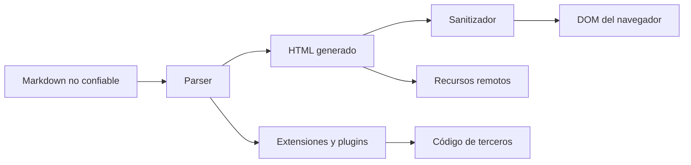

# 48. Seguridad

> [← Índice general](README.md) · Capítulo 48 de 63

Markdown es texto, pero un **pipeline** Markdown puede producir HTML, ejecutar JavaScript, cargar recursos remotos o compilar código (MDX). Por eso, un documento Markdown no confiable debe tratarse con las mismas precauciones que cualquier entrada de usuario.

## 48.1 Modelo de amenaza



Riesgos principales:

| Riesgo | Descripción |
|---|---|
| **XSS** | Inyección de scripts que se ejecutan en el navegador de otro usuario |
| **HTML injection** | Inserción de etiquetas o atributos no deseados |
| **CSS injection** | Alteración de la interfaz o exfiltración mediante CSS |
| **Tracking** | Imágenes remotas que revelan IP, hora y agente de usuario |
| **SSRF** | Si el servidor descarga recursos remotos, puede acceder a redes internas |
| **RCE** | MDX o plugins que ejecutan código en el servidor |
| **DoS** | Entradas enormes, expresiones regulares costosas o diagramas complejos |
| **Supply chain** | Dependencias y plugins comprometidos |

## 48.2 HTML embebido

El Markdown original y CommonMark permiten HTML crudo. Eso incluye etiquetas peligrosas:

```html
<script>alert(document.cookie)</script>

<iframe src="https://ejemplo.com"></iframe>
<a href="javascript:alert(1)">Enlace</a>
```

Medidas:

- Desactiva el HTML en el parser cuando no sea necesario (`markdown-it({ html: false })`, `cmark` sin `--unsafe`).
- Si necesitas HTML, usa una **allowlist** de etiquetas y atributos.
- Sanitiza **después** de generar el HTML, no antes.
- En GitHub, el *tagfilter* de GFM escapa etiquetas peligrosas y la plataforma sanea el resultado; no asumas que otras plataformas hacen lo mismo.

## 48.3 URLs y protocolos

Los enlaces pueden ejecutar código si el navegador interpreta un esquema peligroso.

| Protocolo | Uso seguro | Notas |
|---|---|---|
| `https:` | Sí | Preferido |
| `http:` | Con cautela | Puede mezclar contenido; redirige a HTTPS cuando sea posible |
| `mailto:` | Sí | Permite abrir el cliente de correo |
| `tel:` | Sí | En dispositivos compatibles |
| `javascript:` | **No** | Ejecuta código |
| `data:` | **No** para enlaces | Puede contener HTML/JS; para imágenes, con precaución |
| `vbscript:` | **No** | Obsoleto y peligroso |
| `file:` | **No** en web | Acceso a archivos locales |

Recomendaciones:

- Valida el esquema con una allowlist antes de renderizar.
- Normaliza la URL y decodifica entidades antes de comprobar (`javascript&#58;` puede evadir una comprobación ingenua).
- Para enlaces externos con `target="_blank"`, añade `rel="noopener noreferrer"`.
- Muestra el destino real y evita URLs acortadas opacas en contextos de seguridad.
- Ojo con el phishing homográfico (dominios con caracteres Unicode similares).

## 48.4 JavaScript

Markdown **no ejecuta JavaScript por sí mismo**. El riesgo aparece cuando:

- Se permite HTML con `<script>` o atributos `on*`.
- Se usa un enlace `javascript:`.
- Se inserta HTML generado con `innerHTML` sin sanear.
- Se compila MDX, que **es código** por diseño.
- Un plugin o componente ejecuta código en el servidor.

Si el contenido es de confianza, JavaScript puede aportar interactividad. Si no lo es, no debe ejecutarse.

## 48.5 XSS

**XSS (Cross-Site Scripting)** ocurre cuando una entrada no confiable llega al navegador como código. Tipos:

- **Almacenado:** el payload se guarda (comentario, perfil, documento) y se ejecuta al visualizarlo.
- **Reflejado:** el payload viaja en la petición y se devuelve en la respuesta.
- **DOM:** el código del cliente inserta datos no confiables en el DOM.

Ejemplo de cadena vulnerable:

```javascript
// ❌ Nunca hagas esto con Markdown de usuarios
const html = md.render(entradaUsuario);
document.getElementById("contenido").innerHTML = html;
```

Cadena segura:

```javascript
import DOMPurify from "dompurify";

const html = md.render(entradaUsuario);
const limpio = DOMPurify.sanitize(html, {
  ALLOWED_TAGS: ["p", "h1", "h2", "h3", "ul", "ol", "li", "a", "code", "pre", "strong", "em", "blockquote"],
  ALLOWED_ATTR: ["href", "title", "alt", "src"]
});
document.getElementById("contenido").innerHTML = limpio;
```

Aun así, la allowlist debe ajustarse al caso. Para enlaces, valida también los protocolos.

- OWASP XSS Prevention Cheat Sheet: <https://cheatsheetseries.owasp.org/cheatsheets/Cross_Site_Scripting_Prevention_Cheat_Sheet.html>
- MDN: tipos de ataques: <https://developer.mozilla.org/en-US/docs/Web/Security/Attacks>

## 48.6 Imágenes externas y contenido remoto

Una imagen remota puede ser un **píxel de seguimiento**:

```markdown

```

Al cargarla, el servidor remoto recibe la IP, el agente de usuario, la hora y el `Referer`. Medidas:

- Aloja las imágenes en tu propio dominio o en un CDN de confianza.
- Usa un proxy de imágenes que elimine metadatos y cookies.
- Añade `referrerpolicy="no-referrer"` y `loading="lazy"` en HTML.
- Restringe `img-src` con una Content Security Policy.
- No permitas SVG remotos sin sanear: un SVG puede contener scripts.
- Si el servidor descarga imágenes, valida el destino para evitar SSRF.

## 48.7 Sanitización

La sanitización elimina etiquetas, atributos y protocolos no permitidos. Debe hacerse con una biblioteca probada, no con expresiones regulares caseras.

| Ecosistema | Biblioteca recomendada |
|---|---|
| JavaScript (navegador) | DOMPurify |
| JavaScript (AST) | `rehype-sanitize` |
| Python | Bleach (mantenimiento limitado; revisa alternativas) |
| Java | OWASP Java HTML Sanitizer |
| Ruby | Loofah |
| PHP | HTML Purifier |

Ejemplo con `rehype-sanitize`:

```javascript
import { unified } from "unified";
import remarkParse from "remark-parse";
import remarkRehype from "remark-rehype";
import rehypeSanitize from "rehype-sanitize";
import rehypeStringify from "rehype-stringify";

const file = await unified()
  .use(remarkParse)
  .use(remarkRehype)
  .use(rehypeSanitize)
  .use(rehypeStringify)
  .process(markdown);
```

La sanitización debe aplicarse **después** de convertir Markdown a HTML y **antes** de insertarlo en el DOM. Si el HTML se genera en el servidor, sanitiza también en el servidor; si se genera en el cliente, no confíes solo en el cliente.

## 48.8 MDX y contenido ejecutable

MDX compila a JavaScript. Un archivo MDX puede importar módulos, ejecutar expresiones y renderizar componentes. Por tanto:

- **No compiles MDX de usuarios** en un servidor con privilegios.
- **No uses `evaluate`** con contenido remoto sin aislamiento.
- **Restringe imports y componentes** disponibles si el contenido es semitrustado.
- **Aísla el proceso** (contenedor, sandbox, límites de recursos) si no hay alternativa.
- **Aplica CSP** y evita secretos en el entorno de compilación.
- Para contenido generado por usuarios, usa **Markdown + sanitización**, no MDX.

Véase también la sección [29.17](29-mdx-creacion-de-paginas-web-con-markdown-y-componentes.md#2917-seguridad-en-mdx).

## 48.9 Dependencias y cadena de suministro

- Fija versiones y usa un archivo de bloqueo (`package-lock.json`, `pnpm-lock.yaml`, `yarn.lock`).
- Ejecuta `npm audit` o el equivalente de tu gestor.
- Activa Dependabot o Renovate para actualizaciones controladas.
- Revisa los plugins que procesan Markdown: se ejecutan durante el build.
- Desconfía de paquetes con nombres similares a los oficiales (typosquatting).
- Verifica la procedencia de temas, componentes y acciones de CI.
- En GitHub Actions, fija las acciones por SHA cuando sea posible.

## 48.10 Configuración segura por herramienta

| Herramienta | Configuración recomendada |
|---|---|
| **markdown-it** | `html: false`; sanitizar si se activa HTML; cuidado con `linkify` |
| **remark/rehype** | `rehype-sanitize` en la cadena; no confiar en HTML crudo |
| **cmark** | No usar `--unsafe` con contenido no confiable |
| **GitHub/GitLab** | La plataforma sanea, pero no subas secretos ni confíes en HTML embebido |
| **Pandoc** | Usar `--sandbox` si se procesan documentos no confiables; revisar filtros Lua |
| **MDX** | Solo contenido de confianza; aislar la compilación; CSP |
| **Sitios estáticos** | CSP, `rel="noopener noreferrer"`, imágenes locales, dependencias auditadas |

> `pandoc --sandbox` restringe el acceso al sistema de archivos, pero no convierte a Pandoc en un entorno completamente seguro para código arbitrario. Los filtros y las plantillas también deben revisarse.

## 48.11 Checklist de seguridad

- [ ] El HTML está desactivado o sanitizado.
- [ ] Los protocolos de URL están en allowlist.
- [ ] Los enlaces externos usan `rel="noopener noreferrer"`.
- [ ] Las imágenes remotas están controladas o proxificadas.
- [ ] No se compila MDX de usuarios.
- [ ] Las dependencias están fijadas y auditadas.
- [ ] Hay una CSP en el sitio final.
- [ ] No hay secretos en el repositorio ni en el entorno de build.
- [ ] Los plugins y filtros se revisan antes de usarlos.
- [ ] El contenido no confiable se trata como no confiable de extremo a extremo.

---

[← 47. Accesibilidad](47-accesibilidad.md) · [Índice general](README.md) · [49. Buenas prácticas →](49-buenas-practicas.md)
