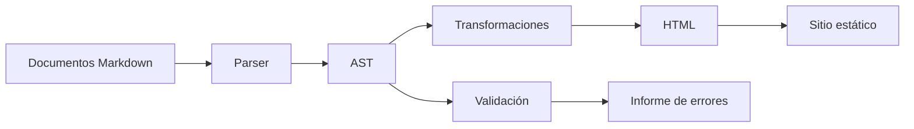

# 53. Ejemplo de documento Markdown profesional

> [← Índice general](README.md) · Capítulo 53 de 63

El siguiente ejemplo es un README ficticio, pero con la estructura y el nivel de detalle de un proyecto real. Combina títulos, índice, badges, texto, listas, tablas, código, enlaces, imágenes, checklist, Mermaid y referencias.

````markdown
# Nebula

[](https://github.com/ejemplo/nebula/actions/workflows/ci.yml)
[](LICENSE)
[](CHANGELOG.md)
[](https://example.com/nebula/docs)

> **Nebula** es una herramienta de línea de comandos para generar documentación técnica a partir de archivos Markdown. Convierte un repositorio de documentos en un sitio navegable, validado y listo para publicar.

## Tabla de contenidos

- [Características](#características)
- [Arquitectura](#arquitectura)
- [Requisitos](#requisitos)
- [Instalación](#instalación)
- [Inicio rápido](#inicio-rápido)
- [Configuración](#configuración)
- [Comandos](#comandos)
- [API](#api)
- [Pruebas](#pruebas)
- [Integración continua](#integración-continua)
- [Roadmap](#roadmap)
- [Contribución](#contribución)
- [Licencia](#licencia)
- [Referencias](#referencias)

## Características

- Generación estática a partir de Markdown y Front Matter.
- Validación de enlaces internos y externos.
- Búsqueda local sin servicios externos.
- Temas claros y oscuros.
- Soporte de tablas GFM, notas al pie y bloques de código resaltados.
- Diagramas Mermaid opcionales.
- Salida HTML accesible y responsive.

## Arquitectura



El flujo separa el análisis, las transformaciones y la publicación. La validación se ejecuta antes de generar el sitio para evitar publicar enlaces rotos.

## Requisitos

| Componente | Versión mínima | Notas |
|---|---|---|
| Node.js | 20 LTS | Recomendado |
| npm | 10 | O pnpm 9 |
| Git | 2.40 | Para el modo repositorio |

## Instalación

```bash
npm install --global nebula-cli
nebula --version
```

Si prefieres una instalación local:

```bash
npm install --save-dev nebula-cli
npx nebula --version
```

## Inicio rápido

1. Crea un directorio `docs/`.
2. Añade un archivo `docs/index.md`.
3. Ejecuta el generador:

```bash
nebula build --source docs --output dist
```

4. Abre `dist/index.html` en el navegador o publica `dist/` en tu hosting.


## Configuración

Crea `nebula.config.json` en la raíz del proyecto:

```json
{
  "source": "docs",
  "output": "dist",
  "site": {
    "title": "Mi documentación",
    "lang": "es",
    "baseUrl": "/"
  },
  "features": {
    "search": true,
    "mermaid": true,
    "darkMode": true
  }
}
```

| Opción | Tipo | Valor por defecto | Descripción |
|---|---|---|---|
| `source` | string | `docs` | Carpeta de entrada |
| `output` | string | `dist` | Carpeta de salida |
| `site.title` | string | `Documentación` | Título del sitio |
| `site.lang` | string | `es` | Idioma principal |
| `features.search` | boolean | `true` | Activa la búsqueda local |
| `features.mermaid` | boolean | `false` | Renderiza diagramas Mermaid |
| `features.darkMode` | boolean | `true` | Añade selector de tema |

## Comandos

| Comando | Descripción |
|---|---|
| `nebula build` | Genera el sitio |
| `nebula serve` | Sirve el sitio en local con recarga |
| `nebula check` | Valida enlaces y Front Matter |
| `nebula clean` | Elimina la salida generada |

## API

### `build(options)`

Genera el sitio y devuelve un resumen.

```javascript
import { build } from "nebula-cli";

const result = await build({
  source: "docs",
  output: "dist",
  failOnBrokenLinks: true
});

console.log(result.pages);
```

| Parámetro | Tipo | Obligatorio | Descripción |
|---|---|---|---|
| `source` | string | No | Carpeta de entrada |
| `output` | string | No | Carpeta de salida |
| `failOnBrokenLinks` | boolean | No | Falla si hay enlaces rotos |

## Pruebas

```bash
npm test
npm run test:e2e
```

La suite incluye pruebas unitarias del parser, pruebas de integración del generador y comprobaciones de accesibilidad con axe.

## Integración continua

```yaml
name: CI

on: [push, pull_request]

jobs:
  test:
    runs-on: ubuntu-latest
    steps:
      - uses: actions/checkout@v4
      - uses: actions/setup-node@v4
        with:
          node-version: 20
      - run: npm ci
      - run: npm test
      - run: npm run lint
      - run: npm run build
```

## Roadmap

- [x] Parser CommonMark
- [x] Generación de HTML
- [x] Búsqueda local
- [ ] Versionado de documentación
- [ ] Traducciones
- [ ] Exportación a PDF

## Contribución

1. Haz un fork del repositorio.
2. Crea una rama descriptiva: `git switch -c feat/mi-cambio`.
3. Añade pruebas y documentación.
4. Ejecuta `npm test` y `npm run lint`.
5. Abre un pull request.

Consulta [CONTRIBUTING.md](CONTRIBUTING.md) para más detalles.

## Licencia

Distribuido bajo la licencia MIT. Consulta [LICENSE](LICENSE).

## Referencias

- [Documentación de Nebula](https://example.com/nebula/docs)
- [CommonMark](https://commonmark.org/)
- [GitHub Flavored Markdown](https://github.github.com/gfm/)
- [Mermaid](https://mermaid.js.org/)
- [Keep a Changelog](https://keepachangelog.com/)
- [Semantic Versioning](https://semver.org/)
````

## 53.1 Qué muestra este ejemplo

| Parte | Tipo | Función |
|---|---|---|
| Badges | Imágenes enlazadas | Estado de CI, licencia, versión y documentación |
| Tabla de contenidos | Lista de enlaces internos | Navegación rápida |
| Títulos | Markdown | Estructura jerárquica |
| Texto y citas | Markdown | Contexto y propósito |
| Tablas | GFM/extensión | Requisitos, configuración y API |
| Bloques de código | Markdown | Comandos, JSON, JavaScript y YAML |
| Imagen | Markdown | Captura con texto alternativo |
| Mermaid | Extensión | Diagrama de arquitectura |
| Checklist | GFM/extensión | Seguimiento del roadmap |
| Enlaces | Markdown | Documentación, licencia y referencias |

## 53.2 Qué es estándar y qué es extensión

- **Estándar/CommonMark:** títulos, párrafos, listas, citas, código, enlaces, imágenes y énfasis.
- **GFM:** tablas, listas de tareas, tachado y autolinks.
- **Extensiones:** Mermaid, badges (son imágenes normales, pero dependen de un servicio externo) y resaltado de sintaxis.
- **Convenciones:** Front Matter, `CHANGELOG.md`, `CONTRIBUTING.md`, `LICENSE` y badges no forman parte de Markdown; son convenciones del ecosistema.

## 53.3 Cómo adaptar el ejemplo

No copies el README tal cual. Sustituye, en este orden:

1. **Nombre y propósito.** El primer párrafo debe describir tu proyecto, no Nebula.
2. **Badges.** Deja solo los que puedas mantener; cambia usuario, repositorio y flujo de CI (capítulo [27](27-badges.md)).
3. **Enlaces.** Reemplaza `example.com`, `LICENSE` y `CONTRIBUTING.md` por rutas reales.
4. **Requisitos y versiones.** Ajusta las versiones mínimas a las que pruebas de verdad.
5. **Comandos.** Verifica que la instalación y el arranque funcionan en un entorno limpio.
6. **Imagen.** Sustituye la captura y escribe un texto alternativo que describa la interfaz.
7. **Roadmap.** Elimina lo que no está planificado; una lista de deseos no es un roadmap.
8. **Licencia.** Usa el archivo `LICENSE` real; el texto del README no basta.
9. **Referencias.** Enlaza documentación oficial, no blogs sin fecha.

Si el proyecto no tiene API, pruebas o despliegue, **elimina esas secciones**. Una plantilla con secciones vacías es peor que una más corta: sugiere que el proyecto está incompleto.

## 53.4 Qué evitar al copiar plantillas

| Problema | Por qué importa |
|---|---|
| Badges de otro repositorio | Muestran el estado de un proyecto ajeno |
| Enlaces a `example.com` | El lector no llega a ninguna parte |
| Versiones inventadas | La instalación falla |
| Capturas de otra interfaz | Documentación incorrecta |
| Secciones vacías | Promesas sin contenido |
| Tabla de contenidos manual | Se desactualiza al cambiar los títulos |
| Roadmap con fechas | Genera expectativas que no se cumplen |
| Licencia solo en el README | No tiene validez sin el archivo `LICENSE` |

La tabla de contenidos del ejemplo es manual. En un README grande, un índice generado o un enlace al sitio reducen el mantenimiento. Si se mantiene a mano, conviértelo en una lista de páginas principales, no en una copia de todos los encabezados.

## 53.5 Accesibilidad y validación

El ejemplo incluye varios elementos que conviene revisar:

- **Jerarquía de títulos.** Un solo H1 y secciones H2; los H3 solo dentro de una sección.
- **Texto alternativo.** La captura describe qué muestra, no «imagen de la interfaz».
- **Tablas.** Cabeceras claras y sin celdas combinadas.
- **Enlaces.** Texto descriptivo; el destino se entiende sin el contexto.
- **Diagrama Mermaid.** Añade `accTitle` y `accDescr` si el renderizador lo permite (capítulo [14](14-mermaid.md)).
- **Código.** Los bloques indican el lenguaje y se pueden copiar sin caracteres extraños.
- **Badges.** El texto alternativo describe el dato; si el servicio cae, el README sigue siendo legible.

Validación mínima antes de publicar:

1. `markdownlint` sin errores (capítulo [46](46-linting-y-validacion.md)).
2. Enlaces internos y externos comprobados.
3. Render en GitHub y en el sitio generado.
4. Revisión con zoom al 200 % y en móvil.
5. Lectura del README por alguien ajeno al proyecto.

## 53.6 Lista de comprobación

- [ ] El README describe el proyecto y su público en el primer párrafo.
- [ ] Los badges son propios, actuales y enlazan a su fuente.
- [ ] Los enlaces apuntan a archivos y URLs reales.
- [ ] Las versiones mínimas se probaron.
- [ ] La instalación termina con una verificación.
- [ ] Las secciones vacías se eliminaron.
- [ ] La captura y su texto alternativo están actualizados.
- [ ] El diagrama tiene descripción accesible.
- [ ] El índice no duplica todos los encabezados.
- [ ] El README pasa el linting y el render final.

---

[← 52. Tabla de referencia rápida](52-tabla-de-referencia-rapida.md) · [Índice general](README.md) · [54. Estándares y especificaciones →](54-estandares-y-especificaciones.md)
