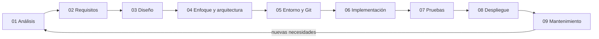

# Proceso de desarrollo multiplataforma

Guía de documentación del repositorio: cada fase del desarrollo de software multiplataforma tiene su carpeta, con la misma plantilla. Las herramientas de IA se documentan aparte, en [`herramientas-ia/`](../herramientas-ia/), y las fases las enlazan.

| Fase | Qué responde |
|------|--------------|
| [01. Análisis y estado del arte (SOTA)](01-analisis/) | Entender el problema y qué existe ya antes de decidir nada. |
| [02. Requisitos](02-requisitos/) | Convertir el problema analizado en requisitos verificables. |
| [03. Diseño](03-diseno/) | Definir qué se va a construir antes de construirlo. |
| [04. Enfoque y arquitectura](04-enfoque-y-arquitectura/) | Elegir cómo se llega a varias plataformas y cómo se organiza el código. |
| [05. Entorno y control de versiones](05-entorno-y-control-de-versiones/) | Dejar listo el entorno de trabajo del equipo. |
| [06. Implementación](06-implementacion/) | Construir la aplicación por incrementos. |
| [07. Pruebas](07-pruebas/) | Comprobar que la aplicación hace lo que debe en cada plataforma. |
| [08. Despliegue](08-despliegue/) | Empaquetar y publicar la aplicación. |
| [09. Mantenimiento y documentación](09-mantenimiento-y-documentacion/) | Mantener la aplicación y su documentación vivas. |
